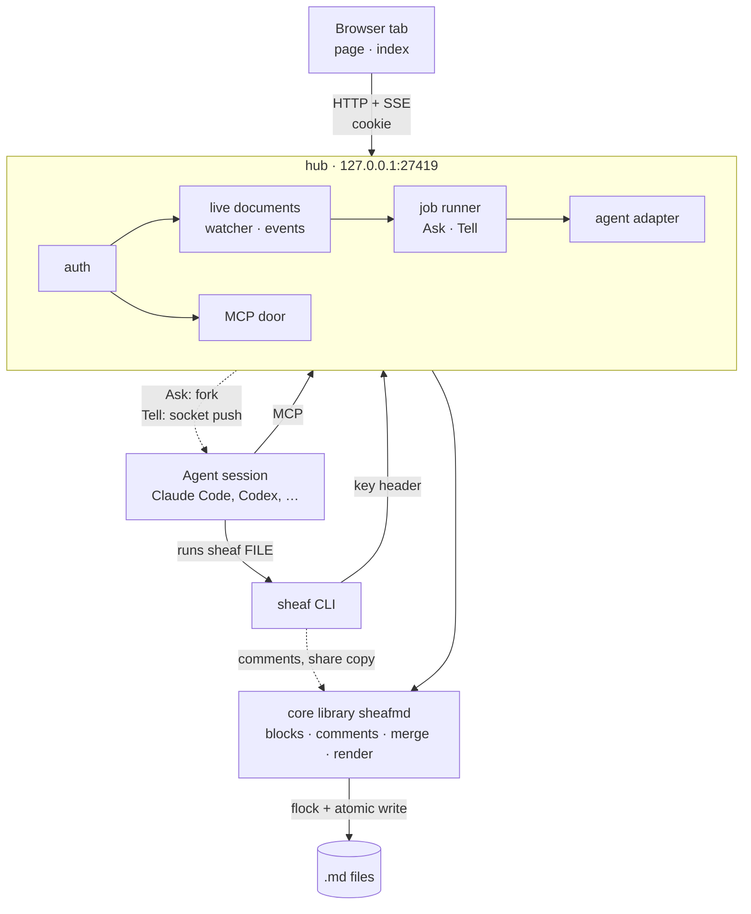
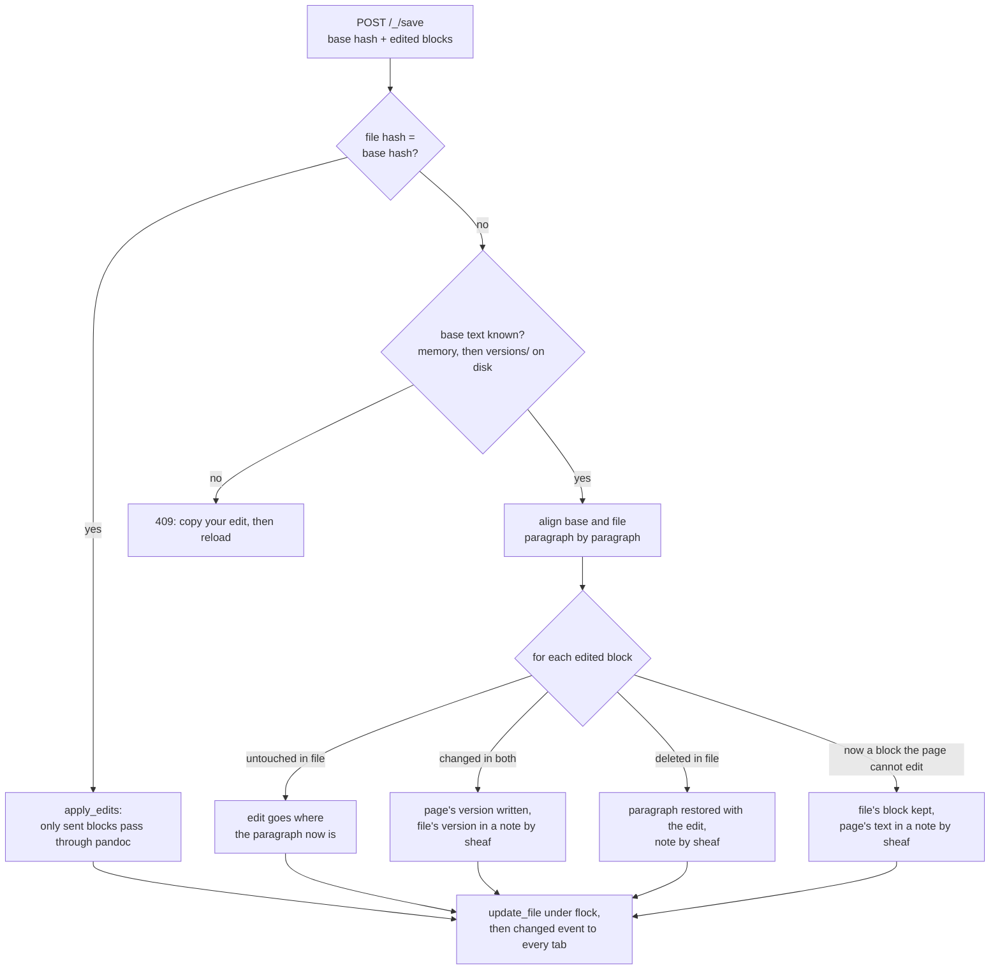
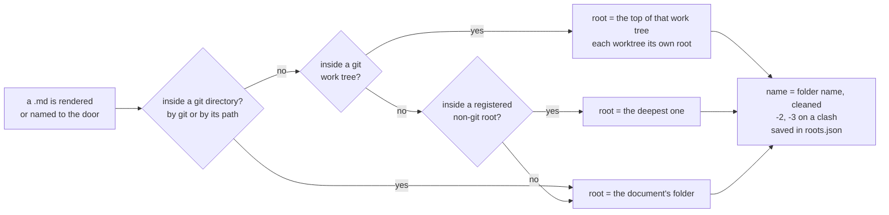
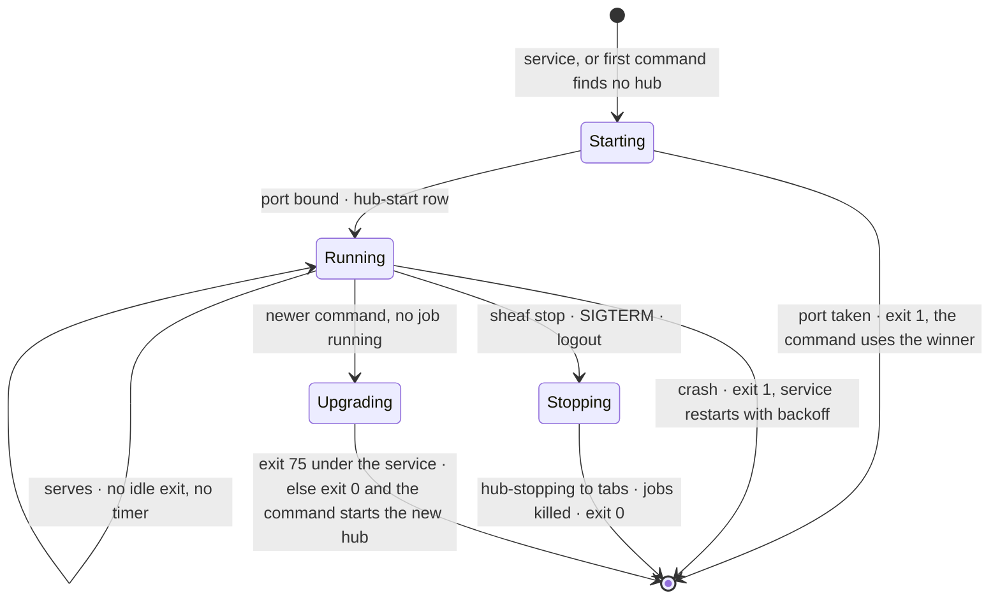
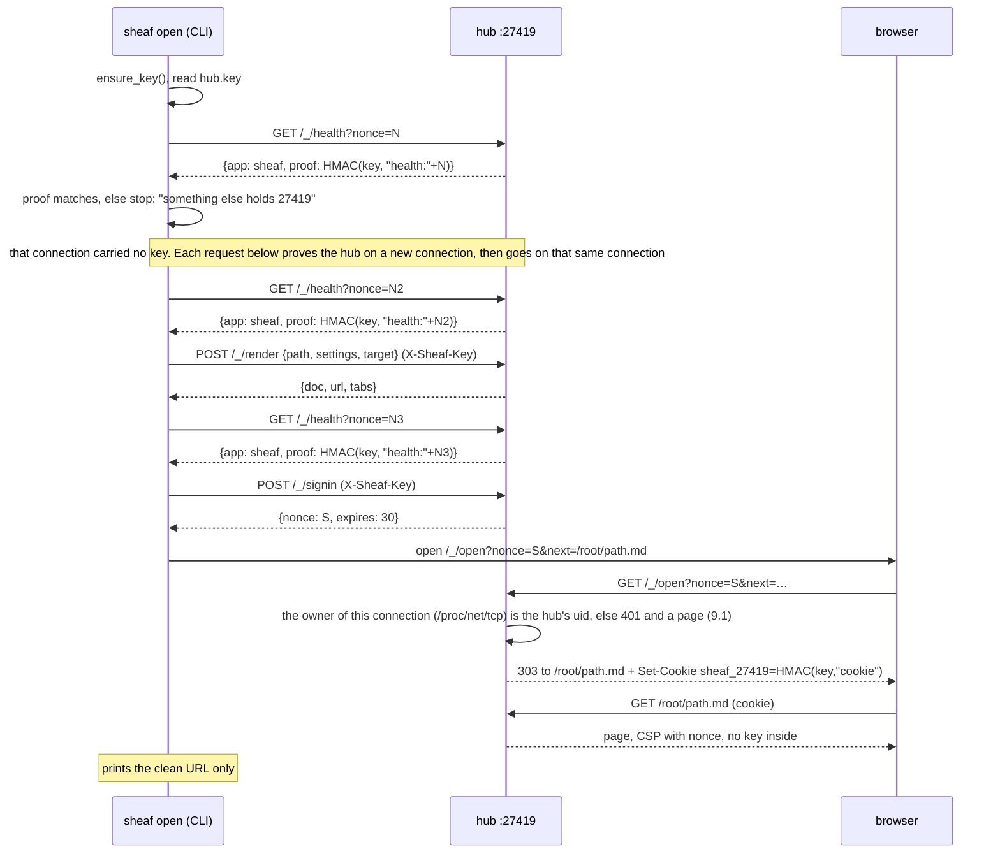
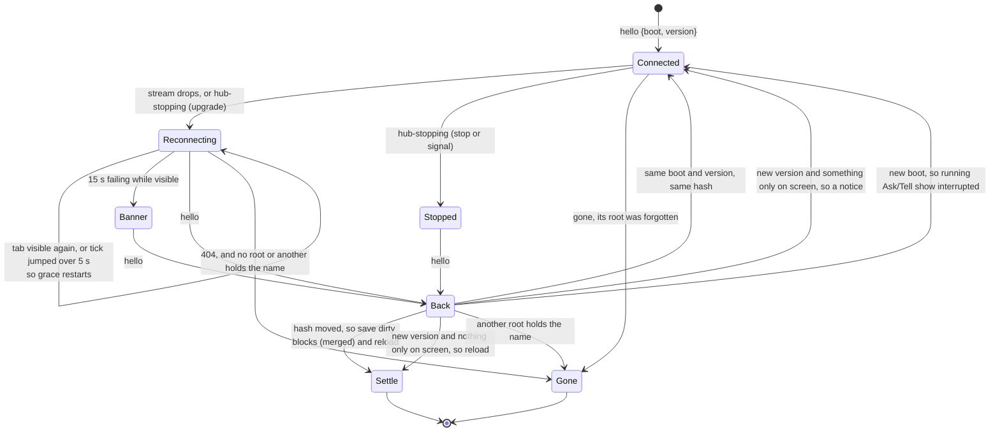
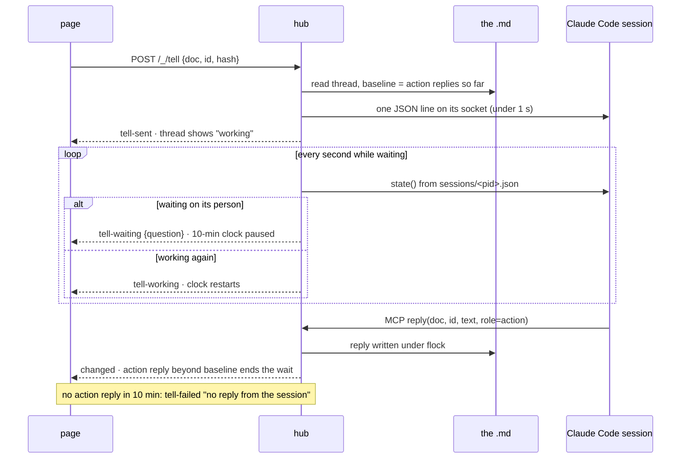

# sheaf v1: specification

**Status:** ready to build
**Date:** 2026-10-13
**Words:** the terms are defined in [GLOSSARY.md](GLOSSARY.md)

> A working page you share with your agent: edit it, comment on it, send it tasks. It runs on your machine, works with any agent, and everything lands back in the .md.

This document is the whole of v1. Section 2 lists the points this spec had to settle explicitly; everything else is the design the rest of the document describes.

---

## 1. What v1 is

sheaf turns a markdown file into a working page in the browser. You read it, edit it, comment on passages and send comments to the agent that wrote it. Every edit and every comment is written into the `.md`, which stays the only source. One local process, the **hub**, serves every document.

Three things set sheaf apart from md-redline and Plannotator, which already run locally, work with any agent and keep the `.md` as the source. v1 must keep all three:

1. **The paragraph-level merge.** A save from the page made against an older version of the file is merged into the file as it is now. Only the same paragraph changed on both sides is a conflict, and even then nothing is lost.
2. **The share copy.** The same `.md` renders to one self-contained HTML file (and PDF) with every comment removed, ready to send to someone outside the conversation.
3. **Ask and Tell from the page, at any time.** Ask answers a thread from a fork of the agent session that wrote the document. Tell puts a comment into that running session, which acts on it and replies in the thread. Neither needs the agent to be waiting.

**In v1:** the core (rendering, editing, comments, the plain theme, the link rule, the diagnostics log), the hub, the security model, the page, the index page, the agent adapter interface with one adapter (Claude Code), the MCP door (stdio and HTTP), the CLI, the user service, `sheaf init` for four agents, the library API an organisation layer uses, packaging and CI.

**Not in v1:**

- A hosted version (out of scope). v1 must only avoid blocking it; section 21 says how.
- Review, a second model reviewing the document. There is no Review and no Reviewer role.
- Adapters for Codex, Gemini CLI, Cursor and opencode. Those agents are detected and reach sheaf through the MCP door; what their adapters will do is written down in section 22 so the work is ready when it is scheduled.
- A plugin system. sheaf loads no code from outside itself.
- Windows. The README says "use WSL2 (untested)".
- Reading or writing md-redline's comment format.

---

## 2. Decided while writing this spec

Each of these is the smallest choice consistent with the rest of the design.

| # | Point | Decision | Section |
|---|---|---|---|
| D1 | How a reply records its role on disk | `@Name 2026-10-13T14:02 action: text`. The role word sits between the time and the colon. Legacy replies by `Claude (action)` and `Claude` are read as role `action` and `answer`, and their bytes are never rewritten | 5.3 |
| D2 | Author of a merge-conflict note | `sheaf` | 7.3 |
| D3 | Where Ask and Tell are on v1 for agents other than Claude Code | Nowhere: those agents are detected, get no capabilities, and keep the MCP door. "Claude Code is the first adapter" is read as "the only adapter in v1" | 11.5 |
| D4 | Which agent wins when several agents' variables are in the environment | Codex, Cursor, opencode, Gemini, then Claude Code: a Claude session commonly starts other agents, so its variables leak into theirs. `--agent` overrides | 11.5 |
| D5 | Page versions across a hub restart | Persisted in the state folder (60 per document, 7 days), so a save made before a restart or upgrade still merges | 7.4 |
| D6 | Unread state | Kept by the hub, not per browser, because the index's red dot needs it | 8.7 |
| D7 | What the page's export buttons produce | The share copy (HTML or PDF), never the editable page. The editable page's HTML carries comments; the button exists to send the document to someone | 10.9 |
| D8 | Where `--share` writes | `<stem>-share.html` (and `<stem>-share.pdf` with `--pdf`) next to the `.md`, unless `--out` | 13 |
| D9 | The MCP door's tools | Four: `documents`, `threads`, `reply`, `resolve`. `documents` is read-only and lets an agent find what waits for it. Since widened to seven: `read`, `create` and `update` work on pages, for the key and for a token made with `--write` | 12 |
| D10 | Whether the stdio door writes files itself | No: it calls the hub over HTTP with the hub key and starts the hub if none runs, so every door write goes through the same writer as the page and reaches open tabs at once | 12 |
| D11 | The cookie value | `HMAC-SHA256(hub key, "cookie")`, not the key itself, so the browser never stores the key | 9.3 |
| D12 | Remote images | Blocked on the page by the CSP (`img-src data:`) and reported at render as breaking self-containment | 9.5 |
| D13 | How the first browser on a remote box gets its cookie | `sheaf signin-url`, run by the person in their own terminal; sheaf never prints a key URL on its own | 9.3 |
| D14 | How an upgrade restart reaches a hub run by the service | The hub exits with code 75; `Restart=on-failure` and launchd's `KeepAlive.SuccessfulExit=false` start the new code | 14.4 |
| D15 | Listing a root outside git | Recursive, skipping `.git`, `node_modules` and dot-folders, capped at 2,000 files with "and N more" | 8.6 |
| D16 | Replies a Claude Code session sends to the hub's socket | Logged in the diagnostics log, not written into the thread. The Tell message asks for the reply through the door or the CLI | 11.4 |
| D17 | The page credit flag | `--credit`, or `credit = true` in `.sheaf.toml`: a footer line "Made with sheaf" linking to the repo. Off by default; an organisation layer never sets it | 6.7 |
| D18 | Package version at launch | `1.0.0` | 14.1 |
| D19 | A render from a shell with no agent in its environment | Keeps the document's stored target; only `--agent none` clears it | 8.3 |
| D20 | Replies an agent writes without naming a role | Get role `answer`, so a reply sheaf writes for an agent always carries its role | 5.3 |
| D21 | Port forwarding to another local port | Accepted: the `Host` may carry any port on `127.0.0.1` or `localhost`, and the `Origin` must equal the `Host`. The README still asks to forward to the same port number, because the cookie is named after the hub's own port | 9.2 |
| D22 | Mermaid diagrams | Rendered when `mmdc` is installed, else left as code; not a dependency, like Chrome for PDF | 6.2 |
| D23 | A change to the file while someone writes a comment on the page | The reload waits until the form is sent or cancelled, then runs send, apply, settle, tell, in that order | 10.4 |
| D24 | A selection the comment anchoring cannot use as it is | Widened to the whole formatted run (page and hub alike); otherwise a disabled button that says why, before any click | 10.4 |

---

## 3. Architecture



The hub keeps its key, roots, render settings, versions and the diagnostics log in the state folder (4.2).

- **Core library** (`sheafmd`): pure functions over markdown text plus the one file writer. No HTTP. The CLI, the hub and an organisation's own programs (for example a converter that produces .docx) all use it.
- **Hub**: one long-running process per OS user. It owns every open document, the event streams to the tabs, the Ask and Tell jobs, and the MCP HTTP door.
- **CLI** (`sheaf`): registers a document with the hub and opens it; writes share copies; reads and writes comments directly in the file; manages the hub, the service, tokens and agent setup.
- **Page**: one script and one stylesheet injected into every rendered document page. No CDN.
- **Agent adapter**: how the hub reaches an agent session (ask, deliver, state, stop).
- **MCP door**: how an agent reaches the hub (documents, threads, reply, resolve).

### 3.1 Package layout

```
pyproject.toml                 name = "sheafmd", script: sheaf = "sheafmd.cli:main"
LICENSE                        MIT
README.md
src/sheafmd/
  __init__.py                  the library API (section 16)
  __main__.py                  python -m sheafmd == sheaf
  cli.py                       argument parsing and the subcommands, except the ones in lifecycle.py
  lifecycle.py                 the commands that run the hub: restart, rotate, signin-url, service
  paths.py                     state, config and cache folders; SHEAF_HOME, SHEAF_PORT
  config.py                    user config, .sheaf.toml, theme.toml readers
  source.py                    the Source file: lock, hash, atomic write
  blocks.py                    split_md_blocks, instrument, sentinels
  comments.py                  comment grammar, parse, format, anchor, add/reply/status/edit/delete
  edit.py                      html → md for edited blocks, task boxes, merge_edits, map_block
  render.py                    build(): pandoc, transforms, page and share copy
  _pandoc.py                   the one place pandoc is started (heap cap, time limit; section 3.2)
  charts.py                    ```chart → inline SVG
  images.py                    embed and downscale local images
  sanitize.py                  raw-HTML sanitiser (section 9.5)
  links.py                     the link rule: RULE text and unlinked_mentions
  theme.py                     Theme loading, font embedding
  themes/plain/theme.toml, theme.css
  pdf.py                       find_chrome, print_pdf
  diagnostics.py               the diagnostics log
  hub/
    server.py                  socket, threads, lifecycle, signals, exit reasons
    sender.py                  who sent the signal that stops the hub (8.4)
    handler.py                 request routing; a module-level class taking (hub) — testable in memory
    auth.py                    Host/Origin checks, key, cookie, HMAC challenge, MCP token primitives (make, hash, read from a header), display-name rule, CSP
    proxy.py                   proxy mode (9.9): the [proxy] table, the member names, the proxy socket and its peer
    peer.py                    which user owns a connection: the row in /proc/net/tcp and tcp6 (sections 9.1, 9.3)
    core.py                    Hub: the entries, the render, the watcher's step, stop
    client.py                  HubClient: how a command reaches the hub, and starts it
    roots.py                   root naming, registry (roots.json), path resolution, listing
    live.py                    LiveDocument (one per open .md)
    events.py                  SSE streams
    jobs.py                    the job runner for Ask and Tell
    asktell.py                 Ask, Tell and Cancel; what the page is told about the agent (sections 10.6, 11.2, 11.3)
    sock.py                    the hub's own socket, where a session's replies to a Tell arrive (section 11.4)
    index.py                   index page and status dots
    state.py                   docs.json, seen.json, versions/, tokens.json (the `Tokens` store and its `verify`)
    service.py                 systemd and launchd units
  agents/
    base.py                    Target, State, Adapter protocol, capability names
    detect.py                  detection table (section 11.5)
    registry.py                every adapter in the order of the table (section 11.5)
    claude_code.py             the Claude Code adapter
    generic.py                 an agent that is detected but has no adapter (section 11.5)
    prompts.py                 Ask, Tell and cancel texts
  mcp.py                       the MCP door: JSON-RPC core, stdio transport, HTTP handler
  agent_setup.py               `sheaf init`: register the stdio door with an agent (section 14.5)
  page/page.js, page/page.css, page/index.js, page/index.css
  agent_files/claude-skill.md  the skill `sheaf init claude` installs
  agent_files/agents-snippet.md  the AGENTS.md snippet the README shows
tests/
tools/check-rendered-pdf.py, tools/VERIFYING-RENDERED-OUTPUT.md
tools/wheel_smoke.py           build the wheel and use it as a new user does (section 18)
tools/ci/                      the service checks CI runs on a runner; they refuse anywhere else
.github/workflows/ci.yml
```

### 3.2 Dependencies

| Package | Why | Notes |
|---|---|---|
| Python ≥ 3.11 | `tomllib` | |
| `pypandoc-binary` | pandoc as a wheel, the same binary for every user | Pin the newest `pypandoc-binary` wheel on the day the build starts, exactly (`==`), and assert the bundled pandoc's version in a test. The test suite passes against pandoc 3.7.0.2; prefer the wheel that bundles it if one exists. The edit round-trip depends on pandoc's exact output; a pandoc upgrade is a deliberate change that runs the whole test suite. Every call gets the binary from `pypandoc.get_pandoc_path()`. Nothing shells out to a bare `pandoc`. |
| `beautifulsoup4` | edit sanitising, the raw-HTML sanitiser | |
| `pillow` | downscaling embedded images | |
| `fonttools[woff]` | TTF → WOFF2 for themes that ship fonts | Imported only when a theme ships fonts |
| Chrome or Chromium | PDF only | Not a dependency. Found by `find_chrome()`; without it the PDF button and `--pdf` say what to install |
| dev: `pytest`, `playwright` | tests | |

Every call of the bundled pandoc goes through `_pandoc.run`, with a heap cap (`+RTS -M1g`) and a time limit (120 s): pandoc 3.9 runs without end and grows without bound on a footnote that cites itself (`[^1]: a [^1]`). A run that hits either is a document pandoc cannot read: `RenderError` on a render, a skipped edit or comment on the page. A document of 470 KB needs about 180 MB.

No web framework. The hub uses `http.server.ThreadingHTTPServer`. The MCP door is a small hand-written JSON-RPC handler (section 12), not the MCP SDK, so the HTTP door runs inside the same server.

---

## 4. Files on disk

### 4.1 Folders

| What | Linux | macOS |
|---|---|---|
| State folder | `$XDG_STATE_HOME/sheaf`, default `~/.local/state/sheaf` | `~/Library/Application Support/sheaf/state` |
| Config file | `$XDG_CONFIG_HOME/sheaf/config.toml`, default `~/.config/sheaf/config.toml` | `~/Library/Application Support/sheaf/config.toml` |
| Cache | `$XDG_CACHE_HOME/sheaf`, default `~/.cache/sheaf` (WOFF2 fonts, downscaled images) | `~/Library/Caches/sheaf` |
| Runtime folder (locks, hub sockets) | `$XDG_RUNTIME_DIR/sheaf`, else `/tmp/sheaf-<uid>` | `/tmp/sheaf-<uid>` |

`SHEAF_HOME=<dir>` replaces the first three with `<dir>/state`, `<dir>/config.toml` and `<dir>/cache`. With `SHEAF_PORT` it gives a development hub beside the daily one, with its own port, state and key.

The user service carries `SHEAF_PORT`, `SHEAF_HOME` and, on Linux, the XDG folders of the shell that installed it (14.3), so the hub it runs and that shell's commands read the same `hub.key`.

The runtime folder ignores `SHEAF_HOME`, so a development hub and the daily CLI lock the same `.md` through the same file. On macOS it is not under `Application Support`, because a Unix socket path there holds a space and can pass the 104-byte limit.

The state and runtime folders are mode 0700; every file in them is 0600.

### 4.2 The state folder

| File | Content |
|---|---|
| `hub.key` | The hub key: 32 random bytes, base64url, one line. Changed only by `sheaf rotate`. Created by `paths.ensure_key()`, which opens it with `O_CREAT|O_EXCL` and is called by every command and by the hub before anything else, so a command never spawns a hub before the key exists. Every HMAC uses the 32 decoded bytes |
| `hub.pid` | `{"pid": 1234, "boot": "<uuid4>", "port": 27419, "version": "1.0.0", "started": "<iso>", "service": true}` while a hub runs; removed on clean exit |
| `roots.json` | `{"<name>": {"path": "/abs", "git": true, "added": "<iso>", "id": "<random>"}}`; `id` is made when the root is registered (8.2), and a root read without one gets one, written at once. Every change to the file is made under the flock `roots.lock` and reads it again inside the lock, so a root or an id another process wrote stays; where there is no flock (Windows) the file is written as before |
| `docs.json` | One entry per rendered document, keyed `<root>/<path>` (section 8.3). With `seen.json` and `seen-members.json`, every change is made under a flock of its own (`docs.lock`, `seen.lock`, `seen-members.lock`) and reads the file again inside it, so an entry another process wrote or dropped (the offline `forget`) stays so; where there is no flock (Windows) the file is changed as before. A read answers from the last change this process made |
| `seen.json` | `{"<root>/<path>": {"c3": 2}}`: how many messages of each thread the hub's person has seen (section 8.7). Changed under `seen.lock`, as `docs.json` is |
| `seen-members.json` | `{"<member id>": {"<root>/<path>": {"c3": 2}}}`: the same for each member of proxy mode (section 9.9). Changed under `seen-members.lock`, as `docs.json` is |
| `tokens.json` | `[{"name": "codex", "display": "Codex", "sha256": "<hex>", "created": "<iso>", "last_used": "<iso>", "write": false}]`; a row without `write` reads as `false` (9.7) |
| `versions/<doc-key>/<hash>.md` | Texts handed to pages, for the merge (section 7.4). `<doc-key>` = first 16 hex of sha256 of `<root>/<path>` |
| `versions/<doc-key>/pins/<hash>.md` | The versions pages keep while a form holds their reload, beside the newest (section 7.4) |
| `versions/<doc-key>/address` | The `<root>/<path>` of that folder, so forgetting a root finds the folders of documents that were opened and never rendered |
| `diagnostics.jsonl`, `diagnostics.1.jsonl` | The diagnostics log (section 15) |
| `<runtime>/hub-<port>.sock` | Unix socket the hub listens on as the `from` address of Tell messages (section 11.4) |
| `<runtime>/locks/<key>.lock` | flock files, one per `.md` (section 7.1). `<key>` = first 12 hex of sha1 of the absolute path. The same folder holds named locks: `tokens.lock` (the MCP tokens file, 9.7), `roots.lock` (`roots.json`, 8.2), `docs.lock`, `seen.lock` and `seen-members.lock` (the files of those names) and `hub-key.lock` (`hub.key`: a rotation and a hub that is starting, 9.3) |
| `service-hint-shown` | Empty marker: the one-time `sheaf service install` hint was printed |

A state file the hub cannot read as JSON of the kind it expects (`tokens.json`, `roots.json`, `seen.json` and the like; an integer of more than 4300 digits is such a file, Python's parser refuses it) is moved to `<name>.corrupt` and read as empty, so the hub starts and every token is refused until it is fixed (fail closed). The move writes one `file-set-aside` row (source `hub`) with `file` and `moved_to` in the diagnostics log (15); a move that fails (the folder is read-only) leaves the file where it is and writes a `file-set-aside-failed` row with `file` and `error`.

### 4.3 User config: `config.toml`

```toml
port = 27419        # the hub port; one per account on a shared box
name = "Ada"        # who you are: author of your comments and default byline
browser = true      # false: sheaf never opens a browser window
```

Every key is optional. Resolution, first found wins:

- port: `SHEAF_PORT`, then `port`, then `27419`.
- name: `SHEAF_NAME`, then `name`, then `git config user.name`, then the login name, then `author`. Each is cleaned by the display-name rule of 12 first, and one with nothing left (a zero-width space, say) is skipped, so the name every caller gets is a printable one of at most 60 characters.
- browser: `SHEAF_NO_BROWSER=1` turns it off, then `browser`, then `true`.

An unknown key prints a warning naming the file. A TOML error stops the command and names the file and line.

A `[jump]` table sets the command that brings a session's terminal to the front (10.5):

```toml
[jump]
command = ["wezterm", "cli", "activate-pane", "--pane-id", "{pid}"]
```

`command` is a list of text, the program first and its arguments after, and nothing reads it as a shell line. A string, an empty list, an empty or non-text element, a table with no `command`, or a `jump` that is not a table stops the command and names the file and the key; an unknown key in the table warns. Each element may hold `{session}`, `{pid}`, `{name}` and `{agent}`, which the hub replaces, element by element and as plain text, with the session's id, the process id of its record, its name (10.1) and its agent (`claude-code`); a value never splits an element (put `--` before `{name}` for a program that reads a leading `-` as an option: a name is the session's own and may start with one), and a `{` that is none of the four stays as written, so a JSON argument keeps its braces. The same four values are in the environment of the command as `SHEAF_JUMP_SESSION`, `SHEAF_JUMP_PID`, `SHEAF_JUMP_NAME` and `SHEAF_JUMP_AGENT`, for a script. The command runs with the hub's own environment, no input, its output thrown away except its stderr (the first line of it is the reason of a failure), in a group of its own that is killed when the command has not ended after 5 seconds; a helper it leaves running after it exits is left alone; exit 0 is a jump. It is read from the file at each use, so a change needs no restart. Nothing of the page or of a request reaches it but those four values, which come from the hub's own record of the session (11.2).

A `[proxy]` table switches the hub to proxy mode (9.9). Without it the hub is in loopback mode, the default. Inside that table every key 9.9 names is required but a member's `email`, `short` and `github`, and a missing or unknown one, or an `email` that is not one address, stops the hub's start instead of printing a warning.

A `[list]` table turns on the list (9.10), a member's page, so it needs `[proxy]`: `[list]` without it stops the hub's start. Inside it `root`, `repo`, `project` and `token_file` are required and `api`, `poll`, `waiting`, `in_progress` and `stop_dir` are optional; a missing, unknown or wrong key stops the start too.

### 4.4 Root config: `.sheaf.toml`

A checked-in file at the top of a root. Every key is optional.

```toml
theme = ".sheaf/theme-acme"   # a folder relative to the root, or a built-in name ("plain")
for = "Acme"                  # byline: "Document prepared by <by> for <for>"
links = true                  # the link rule (section 6.6); false turns off the warning and the prompt text
link_tlds = ["lu", "studio"]  # endings added to the default list
credit = false                # the page credit line (D17)
versions = "root"             # the versions store inside the root, at .sheaf/versions/ (7.4)
commit = true                 # every write on the page and through the door is a commit (8.11)
push = true                   # and the hub pushes it (8.11)
```

`--for NAME` on a render replaces `for` for that render (section 6.3).

Without the file: theme `plain`, a byline without "for", the link rule on with the default endings, no credit, the versions in the state folder, no commit. A `versions` other than `"state"` or `"root"` warns and keeps the state folder. A theme path that does not exist, or a folder without `theme.toml`, stops the render with an error naming both paths. sheaf reads `.sheaf.toml` only at the top of a root, never in subfolders.

### 4.5 Theme folder

```
theme.toml
theme.css
fonts/            optional
```

```toml
name = "acme"
wordmark = "ACME"                          # optional; shown above the title
tagline = "Documents, made plain"                  # optional; beside the wordmark
pdf_footer = "ACME"                        # optional; bottom-left of every printed page

[[font]]
family = "Inter"
file = "fonts/Inter.ttf"   # .ttf/.otf are converted to WOFF2 and cached; .woff2 is embedded as is
weight = "400 700"
style = "normal"
```

- `theme.css` replaces the plain theme's stylesheet; the shared base stylesheet (layout, TOC, tables, charts, print rules) is always included first.
- Fonts are embedded as base64 `@font-face` rules. A font file that is missing prints `! theme <name>: font <file> missing, this page is OFF THEME` on stderr and in the render log; one that fails to convert, or cannot be read (a folder on the way that may not be entered), prints `! theme <name>: font <file> could not be converted (<why>), this page is OFF THEME`. Never silent.
- The wordmark renders as `<p class="doc-mark"><b>{wordmark}</b><span>{tagline}</span></p>` at the top of `main`.
- `pdf_footer` becomes `@media print{@page{@bottom-left{content:"<pdf_footer>"}}}`. Every theme, `plain` included, prints `counter(page) " / " counter(pages)` bottom-right.
- `plain` is built in: a stylesheet with a system font stack, light and dark. No wordmark, no footer text.
- A font's licence text sits next to the font file in `fonts/`, named `OFL-<Family>.txt` for an OFL font. sheaf embeds the font and never reads the licence file; it is there so the theme folder can be copied whole and still carry what the licence asks for.

---

## 5. The markdown: blocks and comments

### 5.1 Blocks

`blocks.py` splits a markdown text into blocks. Its guarantee is the base of editing: `"".join(b.text for b in split_md_blocks(t)) == t` for every text. Block kinds: `blank`, `frontmatter`, `heading`, `para`, `list`, `quote`, `table`, `fence`, `indented_code`, `html`, `hr`. Locked (not editable on the page): `fence`, `frontmatter`, `html`, `indented_code`, and any block holding an image (`. Commentable: `para`, `heading`, `list`, `quote`, `table`.

`instrument(text)` returns `(instrumented text, blocks)` and lays out each block as `<blank line> <!--MDB:i--> <blank line> content`, with exactly one blank line before the sentinel (the comments in the code say why).

### 5.2 Comment grammar

A comment is an HTML comment written right after the passage it is about (GLOSSARY: Comment). sheaf **writes** the marker `sheaf-comment` and **reads** `sheaf-comment` and `rd-comment` as the same thing, for good. Existing `rd-comment`s are never migrated.

```
The gap is **52%**<!-- sheaf-comment id=c3 by="Ada" at=2026-09-19T14:02 status=open quote="The gap is 52%"
Source? This looks like the old figure.
@Claude 2026-09-19T14:30 answer: Re-derived from GSC, 52% holds.
--> and it matters.
```

Head fields, in this order when written: `id` (`c<n>`), `by`, `at` (`YYYY-MM-DDTHH:MM`, local time, no zone), `status` (`open` | `resolved`), `orphan=1` (only when set), `quote`. `by` and `quote` are always quoted (`_val`); a reply's author is quoted only when it holds whitespace (a space, a tab, a line break, any other Unicode space) or is empty (`_who`). A line break or a tab in a quoted value is written `&#10;`, `&#13;` or `&#9;`, so the head is one line whatever the name (a name comes from `SHEAF_NAME`, config, `git config user.name` or `--agent`). The encoding rules: `--` written as `-&#45;`; `&`, `<`, `>`, `"`, `|` as entities; a paragraph break written `<br>`; a continuation line whose first character could start a block (any of `# - * + = _ | > @`, a backtick, a tilde, a digit, a space or a tab) gets that character as an entity; inside a heading or table cell the whole comment is one line joined by `<br>`.

**Two markers, everywhere.** Every place that reads a comment (the parser, the editor, the live document, the page's comment-node walk) matches `(?:sheaf|rd)-comment`, or a `sheaf-comment` is treated as a foreign comment and duplicated on the first edit. The pattern is one constant in `comments.py`, imported everywhere. `Comment` gets a `marker` field (`sheaf-comment` or `rd-comment`), set by `parse` and written back by `format`; new comments get `sheaf-comment`.

The rest of that module: `parse` (skips code blocks and inline code spans; reports `Malformed` for never-closed, missing id, duplicate key, unknown status, duplicate id), `next_id` (max of all `c<n>`, including inside malformed ones, plus one), the selection-to-source anchoring through `pandoc -f gfm+sourcepos` counting non-whitespace characters, `find_quote`, `add_comment`, `reply`, `set_status`, `edit_body`, `delete`. Comments may not go in code, raw HTML, front matter, blank or `hr` blocks.

### 5.3 Replies and roles (D1)

A reply line:

```
@<who> <at>[ <role>]: <text>
```

- `<who>` is the display name (`Claude`, `Codex`, `Ada`), quoted when it holds a space.
- A name that holds any whitespace, not only a space (a tab, a line break, another Unicode space), is quoted too, and a line break or tab inside it is written as an entity (5.2).
- `<role>` is absent, `answer` (an Ask answer) or `action` (what a session did after a Tell).
- Parse regex: `^@("(?:[^"]*)"|\S+) (\d{4}-\d\d-\d\dT\d\d:\d\d)(?: (answer|action))?:\s?(.*)$`.

The `Reply` model keeps `by` exactly as read and `role` as written (or `None`). Two derived values drive everything the page and the hub show:

| As written | `display` | `effective_role` |
|---|---|---|
| `@Claude 2026-… action:` | Claude | action |
| `@"Claude (action)" 2026-…:` (either marker) | Claude | action |
| `@Claude 2026-…:` inside an `rd-comment` | Claude | answer |
| `@Claude 2026-…:` inside a `sheaf-comment` | Claude | none |
| `@Ada 2026-…:` | Ada | none |

When sheaf rewrites a comment (a new reply, a status change), it keeps the marker the comment was read with, writes every existing reply with its `by` as read and its role only if one was written, and writes new replies in the new syntax. A reply that sheaf or the tool it replaces wrote therefore keeps its bytes. A reply written by hand outside the canonical encoding (a raw `&` or `<`, an indented continuation line) is re-encoded on the first rewrite.

**Agent replies always carry a role (D20).** When the author is an agent (the door, `ask`, or a CLI reply whose author comes from a detected agent) and no role is given, sheaf writes `answer`. Only a person's reply is written without a role. So the legacy rule (no role in an `rd-comment` means `answer`) only ever applies to replies written before sheaf.

In the page meta, `/_/doc` and the door, each reply is `{by, display, role, at, text}`: `by` as written, `display` and `role` derived as in the table.

The thread display: role `answer` shows "<display>'s answer" in blue; role `action` shows "<display>'s action" in orange; anything else shows the name in ink.

### 5.4 Orphans, foreign comments, malformed

- **Orphan:** when an edit removes the text a comment sits on, the comment is kept on its own line after the block, with `orphan=1`, and listed under "Text deleted".
- **Foreign comment** (GLOSSARY): any HTML comment sheaf did not write. It survives every page edit byte for byte. If the edit removes its passage it stays in the block, on its own line, in its original order. It is never shown as a comment and never counted in the status dot. The placeholder trip of `_convert_with_comments` implements exactly this.
- **Malformed** comments are listed in the side panel and by `sheaf comments`, with line and reason, and never touched. That includes a line starting with `-->` outside every HTML comment: the tail of a comment whose first line an agent deleted by replacing a paragraph's whole line, which otherwise renders as text.

---

## 6. Rendering

### 6.1 Two outputs

| Output | Comments | Editor script | Block sentinels | Where |
|---|---|---|---|---|
| **Page** | shown as anchors with badges | yes | yes, when inert | served by the hub at `/<root>/<path>` |
| **Share copy** (GLOSSARY) | every HTML comment removed before pandoc (`strip_internal`, each removal logged) | no script at all | no | a file (`--share`), the page's export buttons, or the library API |

### 6.2 Pipeline (`render.build`)

`build()` runs in this order:

1. Read the source (or take the text given). For a share copy, strip every HTML comment.
   The strip closes each comment opener with the next closing arrow wherever that is, so it can take more than a comment. A share copy is refused (`UnclosedComment`, naming the line) when the strip would take a word that pandoc shows: an opener nothing closes, one written as text (in a code span, escaped, in front matter or in an attribute), one a browser ends sooner (at `--!>`), or one a later arrow in a diagram closes. A reviewer's note whose closing arrow is missing is refused the same way. The test is one comparison, read from pandoc's own tree: the words shown for the source must all still be shown after the strip, in text, in raw html as a browser reads it (a `<script>` or `<style>` that nothing closes hides what follows it, on both sides), and in the address of a link (a word that moved into code or an address is still on the page; a title is a tooltip and does not count). It is made with each stretch the strip takes left as a placeholder (a character of its own for each stretch, one the source does not hold, not even as an entity), and again with the stretch gone, and the line is found by halving.
   What counts as a word: a run of letters and digits, or one symbol that is not ASCII (emoji, check marks, arrows). ASCII punctuation is markup and is not counted, and neither is the alt text of an image (the images step drops it for a file that is not there). A `<style/>` or `<script/>` hides nothing after it, as the sanitiser reads it. Three rules refuse without a word being lost, because the halves the strip joins make markup nobody wrote: a stretch taken from inside a tag (a `<` and a letter, `/`, `!` or `?` before it, nothing but non-delimiters up to it, no blank line, and either a `>` later in the same block or an attribute value the strip leaves open; `x<y and <!-- c --> z` is text on both sides and is not refused), where the sanitiser deletes some tags with their content and a browser lets others hide what follows; a stretch between `]` and `(`, which makes a link of the words after it; and a tree the check cannot read (nested too deep), refused at the first stretch. A comment in an attribute value is refused too, the safe side. By decision, and pinned by tests: text in code is not counted on the page side, so a comment quoted whole in code is removed with whatever lies between its opener and a later arrow of the same code block, and a comment in a link's title is removed with the title's words. The check does not parse HTML; where it and a browser could still disagree, the sanitiser and the stripped copy are what a reader gets, and the log says when a `<script>` or `<style>` that nothing closes took the text after it (`! line N: <script> is never closed ...`).
2. `pandoc -f gfm -t html5 --no-highlight` (the bundled binary).
3. Page only: render the instrumented source as well and compare (`_same_render`). If they differ, the page is served without sentinels and so without editing, with the reason ("block markers would alter this render"). Existing comments still show, and replies, status changes, Ask, Tell and export still work; new comments need the sentinels, so selecting text shows "New comments need block markers, which would alter this document's render. Comment in the .md, or with sheaf comment."
4. Sanitise raw HTML (section 9.5).
5. Headings `h1` to `h4` (`h5` and `h6` are left alone): ids from the ASCII-folding slugger; those matching `\b(correction|corrected|retracted|retraction|superseded)\b` in their first 70 characters get `class="flagged"`; h1 to h3 go to the TOC.
6. Charts: ```` ```chart ```` JSON → inline SVG (`svg_chart`, `nice_ticks`, bands, error bars). ```` ```mermaid ```` → inline SVG through the mermaid CLI `mmdc` when it is installed, every new diagram of a render in one `mmdc` run, cached by source, each SVG with its own id (`render_mermaid`). Without `mmdc` the diagram stays a code block and the log says how to install it. `mmdc` is not a dependency (D22).
7. Images: local images embedded as `data:` URIs, downscaled to `max_image_width` (default 1400), captioned from the title, else the alt text. A missing image renders a red `[missing image: …]` and logs it; so does one whose file the hub's account cannot reach or read, or is a symlink loop. A source is looked up as a URL (`%20` decoded), then as written; a NUL names no file, so `a%00b.png` is looked up as written only, and a source with a NUL in it as written is a missing image wherever it points, in proxy mode too (9.9), since no file can be there. A remote image is left as is and reported ("remote image, blocked on the page, breaks the share copy's self-containment"). In proxy mode a local image is embedded only from the document's own root, in the hub's renders and in `sheaf share` (9.9).
8. Absolute local paths (`/home/`, `/Users/`, `/opt/`, `/var/`, `/etc/`, `/srv/`) become `file://` links (`linkify_paths`, which includes `/Users`).
9. The link rule check (section 6.6), CLI renders only.
10. Lead-ins: a paragraph ending in a colon gets `class="leadin"`.
11. Document header: byline `Document prepared by <by>[ for <for>]` after the first h1 (with `data-rd-ui`); a first paragraph opening with `**Label:**` lines gets one field per line.
12. Tables wrapped in `<div class="tblwrap">`.
13. TOC: `--toc always|auto|never`; `auto` shows it from 6 headings.
14. Assemble: `<title>` (from `--title`, else the first h1, else the file stem with `-` as spaces), theme fonts, base CSS, theme CSS, wordmark, the credit line when on, and for the page the editor meta and script (section 10.1).

The page must stay self-contained: no CDN, no external stylesheet, no remote font.

### 6.3 Byline

`by` comes from `--by`, else the user's `name` (4.3). `for` comes from `--for`, else `.sheaf.toml`. There is no default "for". `--for ""` (an empty string) leaves the "for" out of that render even when `.sheaf.toml` has one, as `--by ""` leaves the byline out. It applies to the page, the share copy and the PDF printed from it, and is kept with the other render settings (8.3).

### 6.4 Theme

`build()` takes a `Theme` object read from a folder: `css`, `fonts` (list), `wordmark`, `tagline`, `pdf_footer`, `name`. The theme is chosen by `--theme` (a built-in name or a path), else `.sheaf.toml`, else `plain`. A theme folder behind a folder that may not be entered is refused with `theme '<spec>': the folder <folder> cannot be entered: Permission denied`, by the CLI (exit 1) and by the hub (422), and a relative `--theme` whose folder cannot be looked at where the command runs is that folder, never one by the same path in the document's root. No code compares a theme name as a string.

### 6.5 PDF

`find_chrome` and `print_pdf`, with one rule for a snap (below): headless Chrome prints the share copy's HTML with `--no-pdf-header-footer`, one at a time per hub (a lock). Every copy it prints carries a CSP that lets it load only `data:`, in loopback mode as in proxy mode (9.9, Local images). Without Chrome: `Chrome or Chromium is needed to write a PDF and neither is installed.` plus, on macOS, `brew install --cask google-chrome` (the macOS line is new), and on Linux two lines that say where the package comes from, since apt knows it only once Google's apt source is set up: `google-chrome-stable comes from Google, for amd64 and arm64, not from Ubuntu or Debian; its .deb installs it and adds Google's apt source:` and `download https://dl.google.com/linux/direct/google-chrome-stable_current_amd64.deb (_arm64.deb on ARM), then sudo apt install ./google-chrome-stable_current_*.deb`. A Chromium snap (`/snap/bin/NAME`; Ubuntu has no other Chromium) runs with a `/tmp` of its own, so a page under the host's `/tmp` does not exist for it and a profile it makes there outlives the cleanup. For a snap the print's temporary folder (the page, the PDF and the profile) is made in `~/snap/NAME/common` instead, the snap's `$SNAP_USER_COMMON` in the home of the passwd entry, the same folder on both sides, and removed after the print; `~/snap/NAME/common` itself is made as snapd makes it when the snap never ran, and stays. A snap that prints nothing anyway is named in the error, with the same hint.

### 6.6 The link rule

`links.py`:

- `RULE`, the sentence put into every Ask and Tell prompt, unless the root sets `links = false`.
- `unlinked_mentions(fragment)`, run on CLI renders (not on the hub's re-renders after a save), printing the warning on stderr. Never a block.
- The title rule, on the same terms: a document with no H1 gets one warning, since the page title is the first H1 and the page would open on its first section. It names that section and what the browser tab shows instead, says a front-matter `title:` is not shown when the source has one, and asks for one `# ` line that names the subject. It is not turned off by `links = false`.
- The default ending list is `TLDS`, the endings common in ordinary web writing; `link_tlds` in `.sheaf.toml` adds to it.

### 6.7 Credit (D17)

Off by default. With `--credit` or `credit = true`, the page and the share copy end with `<p class="sheaf-credit">Made with <a href="https://github.com/sweatshop-ai/sheaf">sheaf</a></p>`. An organisation's `.sheaf.toml` never sets it.

---

## 7. Editing and saving

### 7.1 The Source file

`source.py` writes a document, with two rules:

- The lock files move to `<runtime>/locks/` (4.1).
- Servers of the tool this one replaces may lock in `<tempdir>/render-doc/locks/<same key>.lock`. While that folder exists, `update_file` also takes that lock, after its own. The code names that folder, `render-doc`, for this reason only.
- The atomic write goes through a hidden sibling `.<name>.sheaf-tmp`, copies the original file's mode onto it, then `os.replace`. Whatever sits at that name is unlinked first and the sibling is created with `O_CREAT|O_EXCL|O_NOFOLLOW`: every sheaf writer holds the flock, so the name is no other sheaf process's, and a link planted there by someone who can write the folder is neither followed nor kept (the open fails if one appears between the unlink and the open, and the document is left as it was). The rename takes names, so just before it the sibling's name must still hold the text written, and just after it the document's name must: a regular file, not a link, with exactly the bytes written (opened without waiting, so a pipe there is a no). Otherwise the write fails and a save is not acknowledged. The sibling is closed before the rename, as before these looks, so an error that only the close reports (an upload that failed, on an rclone mount) comes before the document is touched; the looks go by the bytes and not by the inode number, which a closed file can pass to a file made at its name and which an rclone mount gives by name. That narrows the window in which someone who can write the folder swaps the sibling; it cannot close it, and that person can replace or delete the document at any time anyway (9.1). On Windows, which has no `O_NOFOLLOW`, the replace is made without these looks.

Every write anywhere (hub, CLI, door, Ask) goes through `update_file(path, change, expected_hash=None)`, which holds an exclusive `fcntl.flock` across read, check and replace. `md_hash` is the first 16 hex of sha256.

### 7.2 Applying edits

`edit.py` behaves as follows:

- Only blocks the page sends are converted (`pandoc -f html -t gfm --wrap=none`); every other block keeps its bytes.
- Each block the page sends goes through the 9.5 sanitiser before pandoc (the page sends the tab's `outerHTML`, so the hub trusts no attribute of it): no `on*` attribute, no script address, no element that can run reaches the .md; task boxes and comments are kept. A chart (`<svg`), a figure or an embedded image (an `` whose `src` is a data address) is refused whatever its letter case; a data address in the `src` of any other element is dropped by the sanitiser (9.5) and does not refuse the edit.
- `_unchanged` re-checks each sent block against the source render and skips the ones that did not change.
- Task-box ticks flip `[ ]`/`[x]` in place without pandoc (`_toggle_boxes`).
- Comments travel as placeholders and come back as their original bytes; the page can move or drop an anchor, never change a comment's text.
- An emptied block is deleted; one whose comments lose their text gets them as orphans.
- A line typed after Enter in a paragraph or a heading is a paragraph of its own after it. The browser cannot split the element being edited and writes each such line as a `<div>` with no attributes inside it, which pandoc would keep as raw `<div>` lines; a render never puts a `<div>` in a `<p>` or a heading. A no-break space the browser leaves at the cut (Enter after a space or before one) goes; one at the start of the paragraph, at the end of its last line or in code stays. Enter at the start of a heading writes the new lines before its words: they are paragraphs above it, and the words stay the heading; after a word of a heading, as at its end, what follows is a paragraph.
- A line typed after Enter inside a line that Enter made nests its `<div>` in that line; each nested line is a paragraph of its own too, at any depth. Markup the browser wrote that the block's source did not have never reaches the `.md`: a `<div>` or `<span>` (an Enter or a merge of two paragraphs leaves them, a paste brings a styled one), a `<b>` that says `font-weight` normal (a word processor's wrapper) is unwrapped; a `style`, and on a link a `class`, `target` and `rel`, is dropped, except the `style` of a table and its cells, which is the column alignment. What the source block had, in the same number and with the same attributes, stays as it is, and the page's own markup (a class that starts with `rd-`, a `data-` attribute, the table wrapper, a math span) is left alone. A save that did either writes a `markup-unwrapped` row in the diagnostics log (15) naming the document, the block and the tags.
- A paragraph that starts with `-` or `*`, then `[ ]` or `[x]` (either case of the x), then words, spaces or no-break spaces between (a line typed in edit mode, after Enter or at the start of a paragraph; a saved edit cannot tell it from an escaped `\- \[ \]` already in the file, so editing a paragraph of that kind makes it a task item too) is written as a task item, `- [ ] words` or `- [x] words`, and the page shows a box that ticks. Lines typed one after another make one list; one typed beside an existing list joins it as an item. The words must show: a box followed only by a line break, a comment or an empty mark is not a task, and the characters typed stay as they are; a line break between the box and the words, and one that opens the first mark, is dropped, and so is a zero-width space (it shows nothing, so it is no words either). Enter inside a task item makes a task item of its own after it, with a box (one typed `- [ ] words` is that box and those words; a line with nothing that shows is none, a list after a line stays under the item before it, and Enter right after the box leaves only the new lines); a plain list item keeps the line in the item as a break. On the page, Enter in a task item, ticked or not, makes a task item of its own after it with an unticked box, and the words after the caret go to it (Enter at the start of the item puts the empty item above it, and the caret and the words stay); Enter on a task item with nothing in it ends the list: the item goes, the caret is in a paragraph after the list, and the items that followed it are a list of their own after that paragraph (on the only item of a list it does nothing, so the block is not emptied, and over a selection that spans items it does nothing either; an item or a paragraph the page made this way, which it marks `data-rd-fresh`, is not saved while nothing shows in it (pandoc would write an empty task item as `- ☐`, and two lists with no paragraph between them as `<!-- -->`), and the two lists around such a paragraph are one again, so neither the item nor the end of the list reaches the .md until words are typed; an item or paragraph that was in the file is never dropped for being small (one the page made keeps its mark until the page reloads, so one typed in and then emptied is dropped like a new one); a comment anchor after the caret stays with its words, and an item is empty only when the whole item, every paragraph of a loose one, shows nothing; the page does this itself, the browser's Enter would make an item with no box; in a list nested in an item the browser's own outdent applies). Only the start of a top-level paragraph counts: `[ ]` in the middle of a sentence, in a quote, in code, or `-[ ]` and `- []` stay the characters they are.
- A line break in a table cell (Enter there writes one) stays in the cell as `<br>`, which a GFM cell takes as it is, so the table stays a table the page can edit; pandoc would write the whole table as raw HTML. The no-break space at the cut goes, and a break that ends its cell, which shows nothing, goes too. A break inside code in a cell is the code's, and pandoc still writes that table as raw HTML. So does a table that holds a backslash or an emoji shortcode (`:b:`, `:+1:`; a lone colon is none) anywhere, in a cell, its header or a link's address, as before: pandoc's writer leaves two backslashes as they are, which the .md reads as one, and takes a character after one it escapes, in every cell alike, and a pipe table is read with GFM's emoji extension, which a raw HTML table is not, so a shortcode would show as its emoji and a later edit of the table would write that in its place.
- `remap` is set when the block count changed, and the page reloads.

### 7.3 Merge



**A small example.** The file has three paragraphs, A, B and C, and the page shows that version. You change B on the page. Meanwhile the agent changes C in the file and adds a new paragraph D before A. When your save arrives, the file is no longer the version your page was rendered from. md-redline and Plannotator refuse such a save, and you reload and redo your edit. sheaf lines the two versions up paragraph by paragraph and sees that B is unchanged in the file, now in fourth place. Your new B goes there, and the agent's D and C stay. Only if the agent had also changed B would there be a conflict: then your B is written, and the agent's B goes into a note by `sheaf` on that paragraph, so nothing is lost.

`merge_edits` and `map_block` write the conflict-note author `sheaf` (D2). One exception: a replaced range is paired by text similarity, in order, whatever the number of blocks on each side, because pairing by position would let a paragraph the agent inserted beside the edited one take the page's edit while the edited paragraph itself went into the note. A block pairs with its clearly best match, and position decides only where similarity does not: in a range with as many blocks on each side, a block that looks like none of the file's is a paragraph the agent rewrote in place and takes the file block at its own position, unless a match has taken that block or taking it would cross another pair; in a range with a different number of blocks on each side, a block with no match counts as gone. The notes' wording stays:

- both sides changed: "Edited on this page and in the file at the same time. The page's version was saved. The file had:" followed by the file's text.
- deleted in the file while edited on the page: "This paragraph was deleted in the file while it was being edited on this page. The page's edit was kept; delete it again if the deletion was meant."
- replaced in the file by a block the page cannot edit (a fence, an image, raw HTML, front matter) while edited on the page: "This paragraph was replaced in the file by a block this page cannot edit while it was being edited on this page. The page's version was:" followed by the page's text. The file's block stays as it is and the note sits on it (on a line of its own after a fence or raw HTML); the report's conflict kind is `locked`. A page edit that says what the base said, or deletes the paragraph, leaves no note.

Two more rules of the same kind. A paragraph the file deleted stays deleted when the page's edit of it changes nothing (or is refused). When the edit does change something, it is made on the paragraph as the page was rendered, alone, and what that gives is written where the paragraph was; the file's text around it is never part of the edit. A list written under another list reads as one list (a blank line does not separate two), so while the save is merged a separator line stands between them, and every other edit still finds its own paragraph; the file ends with the two lists kept apart by a `<!-- -->` line (CommonMark's own way; a share copy drops it), which is also what a paragraph the page deleted between two lists leaves. A paragraph put back at the top of a file that has gained front matter goes under the front matter. If a block above takes the new text in (an unclosed fence), the text is in the file, inside that block, and a note that would land inside a fence nothing closes goes on a line above it, where `sheaf comments` lists it. A comment of the paragraph put back that the file already holds, with the same id, author, time and words (the agent moved the text, comment and all, and may have resolved or answered it since), is not written a second time and the file's state of it is kept, one whose id the file has since given to another comment gets the next free id, and a note takes an id above every id in the base, the file and the merged text, so no two comments of a merge share one. And the page deleting a paragraph never joins its neighbours in the middle of a save: a deleted block keeps its place until the last edit is in, so two edits in one save cannot overwrite each other.

A merged or remapped save brings a reload, and until it runs the page keeps the hash of the text on screen (10.3), so a block saved again before then (a second tick in the same list, more typed while a reply holds the reload) is merged against the page's own first save. The edit of a block that the page saved while it kept that hash carries the HTML that save sent (`saved`); other edits carry none. A save the hub has not answered within 120 s is given up by the page (10.3): the hub may have written it all the same, so the page's next send is that save again, as it was and under the same request id (8.5), before anything typed since is saved. The hub that took it answers from memory and writes nothing, one that did not writes it, and the save after it names it (`saved`) as after any save, so a block that already named an earlier merged save names the later one (a save sent after the one given up never meets its text as a change from outside). The edits of the save sent again carry the HTML they send as `saved`, for a hub that has forgotten the id (a restart), which then finds them in the file instead of taking them for a second edit. The file blocks that HTML makes of the base block, one or several (Enter split the paragraph), each of the same kind, one the page can edit, and with the same words, comments aside, are the page's own: found around the file block the merge paired with the base block, the edit takes the place of all of them with no note, and their comments, a note of the first save among them, are kept as for any edit. A block the merge paired with another base block by their words is never the page's own, no two edits of one save take the same block, and none is taken when the edit of an earlier block of the save is put back among them; the edit of a later block that is put back among them or before them goes after them, as the base block of the next sentence does. One it paired with another base block by its place alone (the file deleted that block, next to a line the page's save split off) is the page's own when it says the page's words and the edit still holds them, unless that block's own edit in the save claims it: the base block goes back as deleted, after the page's blocks when it comes after them and before them when it comes before, and an edit of it with the note of a deletion. Where the edit no longer holds those words, the block stays as it is: the file may have written them over that base block. An edit whose base block the merge put back as deleted is put back so, whatever it says it saved. A paragraph the file indented into a code block has the same words and is not the page's own: the page's text goes into the note of a locked block. A change made in the file after the page's save to the one block it made still gets the note. Where the save made several and the file has since changed one of them or put a block among them, the edit takes the place of the page's own blocks and the blocks the file put among them stay where they are. The block the merge paired, as the file changed it, stays where the edit leaves it as the page saved it, and gets the note where the edit changes it too or takes it out; another block the file changed is kept beside the edit. Looking for those blocks converts nothing per file block: the page's HTML of the edit and each other edit's own save are converted once each, however many blocks the file put there, so one save starts a number of pandoc runs that does not grow with the document, and the document's lock is not held for a run per block.

A comment is not merged: a reply, a status, an edit or a delete finds its comment by id, and a new comment finds its paragraph where it is now (`map_block`, 10.4), so a write elsewhere in the file never refuses them. The page's own version must still be the file as it is or one the document knows, in memory or on disk (7.4), because the id names a comment in the text the page holds, and in a text the document never handed out (another folder's file took the address after `sheaf roots forget`, or the version aged out) it may name another comment. A reply, status, edit or delete sent with such a version is refused with 409 and writes nothing: "the .md changed on disk and this page's version is no longer known to the hub, so this comment may not be the one on the page. Copy anything you typed, then reload". An Ask or a Tell names its thread by id as well, and the page sends its version with it: one sent with a version the document does not know is refused with 409 the same way, the sentence ending "Reload the page" instead, and starts nothing, so no answer is written into another comment and no session is told of one. An add or a reply sent with `ask: true` or `tell: true` starts its job on the text it was written in: the job looks the document up again when it starts, and is refused the same way when that document does not know the text, so a forget and another folder that takes the name in between cannot hand it that folder's thread of the same id; the comment stays written. A job that finds no document at all when it starts (its root forgotten in between with no folder that takes the name, or its file gone) is refused too, and the comment stays written: the answer is 200 with `askError` or `tellError` set to "The document is no longer on the hub: its folder was forgotten, or its file is gone.", and a Tell's wait the comment began ends. A `POST /_/ask` or `POST /_/tell` whose document goes the same way between the route's look and the job's is refused with 404 and that sentence, never answered as a failure of the hub. A cancel is never refused, so a page can always stop what it started. A page that holds an older version the document knows still writes, so the page and an agent both answering in one document stays allowed. A caller with no page (the MCP door, the CLI) sends no version and is not checked.

### 7.4 Versions (D5)

Each `LiveDocument` remembers every text it has handed a page, keyed by hash, so a save against an older one is merged. The request ids of its comment writes and saves (8.5) are not among them: they live in memory only, 256 per document, and the on-disk format has no place for them. v1 also writes each such text to `<state>/versions/<doc-key>/<hash>.md`, keeps the newest 60 per document and deletes files older than 7 days at hub start. A root whose `.sheaf.toml` says `versions = "root"` keeps its documents' versions inside itself instead, at `<root>/.sheaf/versions/<doc-key>/`, where `<doc-key>` is the first 16 hex of the sha256 of the path in the root, not of the address, and `address` holds that path: a clone's hub names the root otherwise and still finds them. The same 60 and 16 are kept there; the 7 days are not applied (the root's git history keeps what is deleted), and forgetting the root deletes nothing in it. The store is the root's files, so the hub writes it as it would a state folder that may hold traps: `.sheaf` and every folder below it must be a folder of the hub's account, never a link, and each file is written through a sibling made new, never through a link found at its name. A second hub that serves a clone reads that store as its own. A save whose base hash is in neither memory nor disk is refused with 409: "the .md changed on disk and this page's version is no longer known to the hub. Copy your edit, then reload". A sheaf the hub moves to its home (9.11) takes its versions with it: the folder is renamed to the new address's key and its `address` file rewritten, in the same store; a folder already at that key, the versions of a document that is no longer there, goes first.

A page keeps the version it shows while a form holds the reload that a change of the file needs (10.4), a merged or remapped save's reload among them (7.3), and what it sends once the form is done (the save of what was typed meanwhile, the reply, an Ask, a Tell) goes with that version. Writes from outside push it out of the newest 60 however short the hold, so the page pins it when the hold starts, once per version: `POST /_/pin {doc, hash}`, and again once a day for as long as the hold lasts, so the pin is never a week old while a form is open (the page looks every hour at the clock, not at a timer, which stops while a laptop sleeps; a renewal that failed is made again at the next look, and it stops when the hold ends, when the document is gone (10.7), or when the hub answers 409). The document keeps the 16 versions pinned last beside the newest, in memory and in `versions/<doc-key>/pins/` (only a file named by a version's hash counts toward the 16, and toward the newest 60 in the folder above: anything else there is not a version, takes no slot and is never deleted for one); pinned again, a version counts from then, and a pin on disk last pinned more than 7 days before is deleted at hub start, with the versions. The pins on disk outlive a restart, so a page that held its reload through one (10.7) still saves, replies, asks and tells against its version. A version no page pinned goes with the oldest as before; a pin of a version the document does not know is refused with 409, "the .md changed on disk and this page's version is no longer known to the hub", and keeps nothing, and the page then sends as it would have without it. A page that hears of the change only after 60 more writes (its stream was down while the hub took them) pins too late.

---

## 8. The hub

### 8.1 Address

- One hub per OS user at `http://127.0.0.1:<port>`, port from 4.3, default 27419.
- It binds `127.0.0.1` only. No flag widens it.
- If the port is taken it refuses to start, logs `port-taken`, and exits 1. It never tries another port.
- On a shared box each account sets its own `port` once.
- Proxy mode (9.9) adds a Unix socket for a reverse proxy on the same machine. In neither mode does the hub listen on the network.

### 8.2 Roots

A root is found for a document by these rules, first match wins:

1. `git -C <dir> rev-parse --show-toplevel` succeeds: that folder (each worktree is its own root).
2. The document is inside a registered root that is not a git repo: that root (the deepest one).
3. Otherwise the document's own folder.

Rule 1 asks git from the nearest folder at or above the path's folder that git can enter: one that is there and that the hub's account may enter. A registered root's folder that git cannot enter, met on the way up, gives that root instead, so a root that is gone keeps what was under it. A path under a folder that is not there (an image a document names, an address asked for) is so judged by the nearest folder git can enter, and a folder that is not there inside a git repo is that repo's. Rules 2 and 3 read the path as written. Rule 1 counts a folder only when git puts it inside the work tree. Inside a git directory (a repository's `.git` folder, a bare repository, a submodule's git directory, or a folder in one of them: one that git says is inside a git directory, or one at or under the git directory git names, as the top of a submodule's is, where git names the submodule's work tree; a bare repository that git refuses to use, `safe.bareRepository`, counts too) rule 1 gives nothing and rule 2 does not reach in, so a path there gets rule 3 alone, and the root that holds a repository is never given what its git directory holds: not in its listing (8.6), nor at an address under it (8.3). The path finds a git directory too, without git: a folder named `.git`, or one that holds `HEAD` and either `commondir` or `objects` and `refs`, entries of any kind (what git itself looks for, without checking them), and every folder under one. The folders counted are the path's own folder and those above it: up to the top of the work tree git names for the path, the top not counted; where git names none, up to the registered root that is not a git repo that rule 2 would give the path, that root's folder counted (`/` itself never is). Registering a root is a deliberate act of whoever holds the key, so a git directory at or below a root is closed to it and one above it takes nothing from it; where no such root holds the path, rule 3 gives the same root whatever the walk finds. A deeper registered root wins over the one around it, as rule 2 says, so a root never gets a file that lies under a git directory below it: everything between the file and the root that gets it is looked at. So a git directory stays closed where git refuses to run and names neither a work tree nor a git directory: in a repository owned by another account, which git refuses as of dubious ownership (the hub never lets git in with `safe.directory`: that check keeps git from acting on the config of a repository someone else owns), under a `.git` folder the hub's account cannot enter, in a submodule's git directory whose work tree is gone, and when git is missing or too slow. It stays closed where git takes a nested `.git` for a folder of the work tree around it, as it does one whose `HEAD` is empty. Git never puts a path with a `.git` component in its index, so below a work tree's top this costs no file git tracks; a folder named `.git`, or one holding those entries, that git takes for no repository is closed as well, and so is a path through a `.git` that is no folder. A work tree whose folder lies inside a git directory (a worktree at `wiki.git/w1`, a repository at `src/.git/inner`) is a work tree to git and keeps rule 1; where git refuses to run, it is closed with the git directory that holds it, unless that git directory lies above the root rule 2 gives it: a root registered at the work tree itself (`proj.git/main`, a worktree of a bare repository, registered where git refuses as a root that is not a git repo) keeps what is under it. So does a registered root inside a folder named `.git`, or one holding those entries, that git takes for no repository; inside a git directory that git names as one, git's own answer still gives a registered root its own folder alone (rule 3). A folder outside both a repository's work tree and its git directory (one beside a bare repository's worktrees) is judged by rules 2 and 3, and so is the work tree of a repository where git refuses to run, which names neither.



The root's name is the folder's name, with every character outside `[A-Za-z0-9._-]` replaced by `-`, leading `.` and `_` stripped, and `root` when nothing is left. A second folder with a name already taken gets `-2`, then `-3`. Names never start with `_`, which keeps `/_/` free for the hub. Names are stored in `roots.json` and survive restarts. A root is added only when a document in it is rendered or named to the door, never by scanning. Each root also gets a random id when it is registered, stored with it and kept across restarts: a folder that takes the name after a forget is another root, with another id, and a page carries the id of the root it was served from (10.1), so it tells that folder's document apart from its own whose file moved on (10.7).

`sheaf roots` lists them with their paths; `sheaf roots forget <name>` removes one (its documents' entries and saved versions go with it, so a page still open on one can no longer save into another folder that takes the name). `sheaf roots` reads `roots.json` and needs no hub; `forget` goes through the hub when one runs, since it holds the roots in memory, and edits the files when none does. It then asks once more whether a hub runs and, if one does, tells it too: a hub binds its port before it reads the files, so one that read them before they were written listens by then, and would otherwise keep the root in memory and write it back. The files are edited with the root's entries first and `roots.json`, the file a hub reads first, last, so a hub that starts in the middle never finds the root gone and its entries still there. Each file is read just before it is written, not when the command starts, so what a hub that started meanwhile wrote to it before then stays, a root it registered too; the entries' files share no lock with a hub, so a write in the instant between that read and the write is still lost there; `roots.json` is changed under `roots.lock` by both, and loses nothing. The members' read state (`seen-members.json`, 9.9) goes with the entries, as it does in the hub. A hub that is starting and stays silent through the start's wait (20 s) is not told: when the files held the root, the command says they were forgotten, that the hub may still hold the root and to run the command again once the hub answers, and exits 1. The command says the files were forgotten as soon as they are, so whatever else fails at the second look (a hub that proves itself and hangs up, one that refuses the forget, something else on the port) is said after that line, never in its place, and exits 1 too. A running hub goes the other way: it takes the root out of its registry first, so a page asked for while the entries go finds no such document and does not make its entry again. Nor does a request that found the document's file just before the forget: the hub looks at the root again under its lock before it makes the entry. A write still under way on one of the root's documents when the forget comes (a save, a comment, an Ask's answer) ends first, and its text is not kept among the versions on disk: the page that made it takes that text's hash, which the document another folder makes under the address must not know. A page still open on one of its documents is told: the hub sends `gone` on the document's stream, the stream's last event (8.8), and the page says the document is no longer on the hub and saves and sends nothing more (10.7). A forgotten folder becomes a root again, under the same name when it is free, the next time a document in it is rendered, with a new id.

### 8.3 Documents

A document's address is `<root>/<path-in-root>`, path with `/` separators, and its URL is `http://127.0.0.1:<port>/<root>/<path-in-root>` with each segment percent-encoded. Only files ending in `.md` are served.

Path resolution refuses `..` segments, and refuses a path whose `realpath` is outside the root's `realpath` (a symlink out of the root): 404. The root's own `.sheaf/` folder (a theme, the versions store of 7.4) holds no document: a path in it, by its address or by its `realpath`, answers 404, and no listing names one.

An address whose file 8.2 keeps from the root it names for lying in a git directory (`work/sub/.git/x.md`, and `work/sub/keep.git/x.md` for a bare repository) names no document either: its page, every route of 8.5 that takes a `doc`, Ask and Tell answer `404` as for a file that is not there, to the hub's person as to a member (9.9) and the door (12). The file is its own folder's root (rule 3), where `sheaf open` puts it (`keep.git/x.md`). One file has one address, so a Tell never names one the door refuses.

`docs.json` keeps, per rendered document, its last render settings and target session:

```json
{"acme/clients/x/plan.md": {
  "path": "/home/ada/Projects/acme/clients/x/plan.md",
  "rendered": "2026-10-13T16:20:00+02:00",
  "title": null, "toc": "auto", "max_image_width": 1400,
  "by": "Ada", "for": null, "theme": null, "credit": null,
  "target": {"agent": "claude-code", "session": "3e1f…", "pid": 850531,
             "socket": "/run/user/1000/cc-socks/850531.sock", "name": "Cosima",
             "cwd": "/home/ada/Projects/acme",
             "bin": "/home/ada/.local/bin/claude", "config_dir": "/home/ada/.claude"}
}}
```

`null` means "use the default". A document opened from the index without ever being rendered uses the defaults and has no target. **The latest render from an agent sets the target**. A render that detects no agent (a plain shell) keeps the stored target; only `--agent none` clears it (D19). A render with other settings updates the entry and pushes `changed` (with `textSame: false`) to open tabs; it never restarts anything.

### 8.4 Lifecycle

**Start.** Either the user service (section 14.3) or the first command that needs a hub and finds none: it calls `paths.ensure_key()`, then spawns `python -m sheafmd hub --started-by <render|mcp|cli|upgrade>` detached (new session, stdio to `/dev/null`, `cwd` the home folder, and an environment without any `CLAUDE_*`, `CODEX_*`, `CURSOR_*`, `GEMINI_*` or `OPENCODE*` variable, so the hub and its Ask children never inherit one agent's session), and polls `/_/health` for up to 20 s (the imports are 0.8 s of a free core, and a loaded machine or a slow disk stretches that several times over). The service starts it with `--started-by service`. Binding the port is the lock: a hub that loses the race exits with `port-taken`, and the command uses the hub that answers, after the challenge in 9.4. The first time a command starts a hub (no `service-hint-shown` marker) it prints one line: `  tip: sheaf service install keeps the hub running across reboots` and creates the marker.

**With the service installed,** `sheaf start` and `sheaf restart` go through it (14.3). When whether it is installed cannot be told, because a folder on the way to its file (`~/.config/systemd/user`, `~/Library/LaunchAgents`) may not be entered, they go neither through it nor around it: exit 1 with `sheaf: cannot tell whether the user service is installed: <file>: Permission denied`, nothing asked of the manager and nothing started or stopped; `start` with a hub already running says so, as it does either way, and `sheaf service uninstall` refuses the same way. A command that merely needs a hub (`open`, an MCP call, `status`) and finds none still spawns a detached one as above, and does not ask the service. That is the decision, not an omission: starting through the service would make every hub a service hub on a machine that has the service, and every command would wait on the service manager. The hub such a command starts is the user's own until `sheaf service install` or `sheaf restart` replaces it with the service's.



**Stop.** Only on `sheaf stop`, a service stop, logout or shutdown, a crash, or an upgrade restart. No idle exit, no maximum lifetime, no timers.

**Clean stop** (`POST /_/stop`, SIGTERM or SIGINT): from its first moment a request on a connection that was kept alive is answered `503` with `Connection: close` and nothing is applied, so a caller never has a request served by a hub about to exit (a new connection is still served until the listener closes, `POST /_/stop` is always answered so that the precedence below holds, and a stream already open is told and ends; a caller gets the `503` and no resend: the MCP door raises `HubUnavailable` ("the hub is stopping, nothing of yours was sent") and a command stops with `HubLost` ("stopped before this request; nothing was sent"), neither hands the `503` back as the hub's answer, and neither sends the request again); push `hub-stopping {reason}` to every stream, kill every job's process group, write the exit row, remove `hub.pid`, exit 0. An upgrade stop of a hub the service started exits 75 instead (14.4). A stop that is under way stays what it was: a plain stop or a signal is never turned into an upgrade by a later upgrade stop (the answer is `200`, the hub is stopping, and the reason stays `stop` or `signal`, so the service does not start the hub the person stopped); the other way round the later one wins, so a stop or a signal after an upgrade stop ends the hub for good.

**`sheaf restart`** makes open tabs ride through, with no "the hub was stopped" banner, on both paths, and both leave `hub-exit` with reason `upgrade` and push `hub-stopping {reason: "upgrade"}`. Without the service it posts `POST /_/stop {reason: "upgrade", force: true}` (`force`: a restart the person asked for stops a hub that has an Ask or Tell running, which a command's automatic upgrade does not, below). Through the service it first posts `POST /_/restarting`, so that the hub reads the SIGTERM that `systemctl restart` (or `launchctl kickstart -k`) sends within the next 30 seconds as an upgrade stop, then asks the service manager to restart; that stop exits 0, because the manager asked for it, where the hub's own upgrade stop under the service exits 75. A SIGTERM nobody announced (a logout, `systemctl stop`) stays reason `signal`. When the manager fails, the command takes the announcement back with `DELETE /_/restarting` before it reports the manager's words, so that a logout or a `systemctl stop` in the 30 seconds after is `signal` too and not the restart that never came; a hub of the version before has no such route (`405`), keeps the announcement for its 30 seconds as it did, and the command says the same either way. If a hub that a command started holds the port while the service is installed, `sheaf restart` stops it first with an upgrade stop, as `service install` does (14.3): the service's own hub would otherwise exit `port-taken` and be restarted in a loop against the start limit.

**A hub that holds its port and does not answer** (stopped with SIGSTOP or by a debugger, or hung): the challenge ends in the `HubSilent` of 9.4, and a hub that cannot be asked cannot be told to stop, so the message's "run `sheaf restart`" would be a circle. `sheaf stop` and `sheaf restart` therefore stop the process that `hub.pid` names, by signal, and `restart` goes on to start a hub as usual. This kills a process, so it happens **only when all four of these hold**:

1. **The pid is the pid file's.** It is the one in `hub.pid`, never one found another way and never "whatever holds the port"; it is a number that names one process (not 0, 1, a negative one, nor the command's own, which `kill` would read as a group, init, everything, or itself); and the file was written for the port the command asks about.
2. **Its command line is a sheaf hub's.** `/proc/<pid>/cmdline` is a Python process (`python`, `python3.12`, `pypy`) whose arguments end `-m sheafmd hub` or `<...>/sheaf hub` (the `sheaf` script, which the kernel runs through its Python shebang), each with or without `--started-by WHO`. The name `sheafmd` somewhere in it is not enough (`sheaf mcp` is a process of the same user with that name), and neither is `vim sheaf hub`.
3. **It is the user's.** Its real, effective, saved and filesystem uid are all the user's own.
4. **It is the process that listens on the port.** One of its descriptors is the listening socket of `127.0.0.1:<port>` (`/proc/net/tcp`, `/proc/<pid>/fd`): a hub of another port, or a pid that a hub of another port was handed, is not the one.

The process is known by its start time too (`/proc/<pid>/stat`; its state, which changes from one reading to the next, is not part of it), read before the four checks, after them, and before every signal, so a pid that was handed to another process in between gets no signal. (A pidfd would close the last gap, microseconds wide; the Pythons that `uv` hands out are built without `os.pidfd_open`.) The order is SIGTERM, with SIGCONT beside it (a stopped process runs no handler until it continues, so a SIGTERM alone would wait out the whole grace period and end in SIGKILL, with no exit row and the jobs' process groups left running; a hub that is continued ends as on any SIGTERM: exit row with reason `signal`, jobs killed, `hub.pid` removed), and SIGKILL only if the process is still there after the 8 s grace period (`client.STOP_WAIT`, what a stop the hub answers waits for: a child that ignores SIGTERM gets `jobs.TERM_GRACE`, 5 s, then a second after SIGKILL, then the hub writes its exit row; a shorter grace would kill a hub that is obeying SIGTERM, and the line would say it ignored it), never before. The command prints one line saying what it stopped and why, `  stopped the sheaf hub (pid 4242) that held 127.0.0.1:27419 and did not answer`, with `; it ignored SIGTERM for 8 s and was killed` after it when SIGKILL was needed; a process still there 2 s after SIGKILL fails the command (exit 1, naming the pid). `sheaf stop` then checks the port: it says `hub stopped` only once nothing holds it, and fails (exit 1, `127.0.0.1:<port> is still held`) when something still does, which a stop the hub itself answered does not check, because there whatever answers afterwards is another process. A hub that needed SIGKILL could not kill its jobs' process groups, so an Ask or Tell it was running may go on with no hub (the `unclean-exit` row names the boot when the next hub starts). Open tabs show the stop banner: the hub could not be told that this is a restart, so it ends on a plain signal, not the upgrade stop that lets tabs ride through.

**Everything else is exit 1, the key goes nowhere and nothing is signalled:** no pid file, or one with no pid, or one whose pid is not one process (0, 1, a negative number, anything that is not a whole number) or is the command's own; a pid file that does not say its port or says another one; a pid that is not running, that is not a sheaf hub (it was handed on to another process; or the port is held by something else), whose command line or user cannot be read, that is another user's process, that does not hold this port, or that changed while it was checked; a system with no /proc; a hub the pid file says the service runs when no service is installed, or when whether one is cannot be told (above). The message of 9.4 then says, in its one line, why nothing was stopped, and no longer says "or run `sheaf restart`", which is the command that just refused: ``  ! the sheaf hub on 127.0.0.1:27419 did not answer within 3 s, and `sheaf restart` stopped nothing: pid 4242 is not a sheaf hub`` (`sheaf stop` names itself). The reasons are those, each said once, in a few words; what a reason quotes from the pid file is a whole number (the pid, the port) and never a string. A stranger that holds the port and says nothing is the case of "not a sheaf hub", "no pid file" or "does not hold": only the person can free that port. `sheaf status` is read-only and every other command that needs a hub keeps the message of 9.4 as it is, with "try again, or run `sheaf restart`", because for them `sheaf restart` may now work.

**On macOS there is no recovery.** There is no /proc, and v1 is Linux: `restart` and `stop` stop nothing there and say `this system has no /proc to check a process by`, as they do on a Linux whose /proc cannot be read.

**A hub that the service runs is never signalled.** The manager owns that process, and one killed behind its back is a unit that thinks it is up, or a hub it starts again on its own. A pid file with `service: true`, or with no word on it, names such a hub. With the service installed, `sheaf restart` and `sheaf stop` ask the manager (`systemctl --user restart` or `stop`; systemd sends SIGTERM and then SIGCONT itself) and print `  the sheaf hub (pid 4242) on 127.0.0.1:27419 did not answer; asking the service to restart it`; the stop banner above applies, since `POST /_/restarting` cannot be sent to a hub that does not answer. A hub that a command started, with the service installed, is stopped as above, and `restart` then asks the service to start its own. With no service installed, a pid file that says the service runs the hub names nothing: there is no manager to ask, and the process is left alone. A manager that fails is reported in its own words (exit 1).

**Crashes.** An exception while handling one request returns 500 and writes a `request-failed` row with the traceback; the hub keeps running. An exception that escapes the server loop writes an `exit` row with reason `crash` and the traceback, then exits 1.

**Start and exit rows.** Every start that has bound the port writes `hub-start` with version, `started_by`, port and boot id. Every exit writes `hub-exit` with reason `stop`, `signal`, `port-taken`, `crash` or `upgrade`. A start that finds a `hub-start` row with no `hub-exit` after it writes `unclean-exit` naming the previous boot id first. A hub that loses the race for the port writes only a `port-taken` row (with its pid), never `hub-start`, so it cannot trigger `unclean-exit`.

**Who sent a signal.** A `hub-exit` with reason `signal` also names the signal (`signal`: `SIGTERM` or `SIGINT`) and, where the OS gives it, the process that sent it: `sender_pid`, and `sender_cmdline` (that process's `/proc/<pid>/cmdline` with a space between the arguments, read when the signal is received, since the sender may be gone a second later; left out when it cannot be read, and `sender_pid` too for a signal the kernel itself raised). The OS gives it on Linux: the hub blocks SIGTERM and SIGINT in every thread and one thread takes them with `sigtimedwait`, and a signal acts as before (the same stop, in the same order, the same exit code). Every process the hub starts (a job, the jump command, a PDF render, git) gets both signals unblocked: the hub's thread is open to them only while `subprocess.Popen` makes the child, and a signal that lands in that moment is taken by the ordinary handler and names the signal only. **Where the OS gives no siginfo (macOS), nothing is blocked, the ordinary handler runs and the row names the signal only.** The first signal of a stop is the one named. The command line is as private as the rest of the log (15): a local file, mode 0600, which a person who attaches it to a bug report reads first.

**Version.** One code version serves every root. When a command finds a hub of another version:

- The command is newer and no Ask or Tell runs anywhere (`GET /_/jobs` is empty): it restarts the hub (14.4) and goes on.
- The command is newer and a job runs: it prints `  ! the hub runs 1.0.0 and an Ask or Tell is running; this is 1.0.1. Run sheaf restart when it is done.` and uses the running hub. The hub keeps the rule itself, because a job can start between the command's look at `GET /_/jobs` and its stop: `POST /_/stop {reason: "upgrade"}` answers `409` while an Ask runs, a Tell waits, a Tell's delivery is still being made after its wait ended (the reply came first, or `SHEAF_TELL_WAIT` ran out), or the stop message of a cancelled Tell is on its way, and the command prints the same line. `GET /_/jobs` lists the first two only, so the command's own look stays as it was and the hub's `409` is what covers the others; cancelling a Tell ends its delivery's job and lists its stop message as on its way in one step under that lock, so that an upgrade stop cannot come between them, and ends its wait after, outside the lock, because the wait needs the document's lock, which a render holds as long as pandoc or mmdc take (up to 300 s), and an upgrade stop (the SIGTERM of `sheaf restart` too) and every Ask and Tell start would wait behind it. The same lock decides a Tell start against that cancel: a Tell of that thread is refused (`409`, 11.3) from the cancel's step until its stop message has been sent, so that the cancel does not end the wait of a Tell that began after its step, and the message does not reach the session after the new Tell. One lock decides it: an upgrade stop is taken only while no job runs, and once one is taken no Ask or Tell starts (`409`, "The hub is restarting for an upgrade. Try again in a moment."), so no job is ever killed by an upgrade. `sheaf restart` is the person's own decision and sends `force: true`: it stops the hub even with a job running, which ends with the hub like any stop.
- The command is older: it prints `  ! the hub runs 1.0.1, this is 1.0.0` and uses the running hub.
- A hub version that cannot be read counts as older: the same line, and the hub is used and left alone. A version is dot-separated numbers and at most one suffix after them (`.dev0`, `rc1`), which sorts below the same numbers without one; sheaf compares them with its own small parser, not `packaging`, and a hub is restarted only when the command is positively newer.

### 8.5 HTTP interface

Every request passes the Host check and the authentication of section 9 first. Bodies are JSON. Every JSON response is `{"ok": true, …}` or `{"ok": false, "error": "<one sentence>"}`. Every response carries `Cache-Control: no-store` and `Referrer-Policy: no-referrer`.

| Method and path | Auth | Purpose |
|---|---|---|
| `GET /_/health[?nonce=<hex>]` | none | `{"app": "sheaf", "version": "1.0.0", "boot": "<uuid>", "service": true, "proof": "<hex>"}`; `proof` only with a nonce (9.4). Never paths, never documents |
| `GET /_/open?nonce=<n>&next=<path>` | a sign-in nonce in the query | Swaps the nonce, once, for the cookie, then `303` to `next` (9.3), but only for a connection that belongs to the hub's own user (9.1). A link that does not work answers `401` and no cookie: a page that says so (what to run: `sheaf open` again, and `sheaf rotate` if the person did not use the link twice) to a request that accepts `text/html`, the JSON refusal to any other. So does a link followed over a connection of another user, or one whose owner the hub could not read: the page says which of the two it was, and the link is spent |
| `GET /_/open?key=<k>&next=<path>` | the key in the query | The same swap with the key itself, for `sheaf signin-url` (9.3, D13). A wrong or missing key answers `401` as above, the page saying to run `sheaf signin-url` again |
| `GET /` | cookie | The index page (8.6) |
| `GET /<root>/` | cookie | The index page with only that root |
| `GET /<root>` | cookie | `301` to `/<root>/`; 404 when no root has that name, or for a member of proxy mode one that is not theirs. For a member, the root that `[list]` names answers the list itself at `/<root>` and `/<root>/`, with no redirect (9.10) |
| `GET /<root>/<path>.md` | cookie | The document page |
| `GET /_/live` | cookie | Event stream for the index (8.8) |
| `GET /_/live?doc=<doc>` | cookie | Event stream for one document (8.8) |
| `GET /_/doc?doc=<doc>` | cookie or key | `{hash, comments, malformed, seen, asking, telling, question, target, capabilities, root, rids}`; `seen` is `{id: count}`; `rids` are the request ids of the comment writes (the row of `/_/comment`) and the saves (the row of `/_/save`) the document took, oldest first, for a page that missed the `changed` event naming its id: it takes each as it would the event (10.4); `root` is the id of the root that holds the address's name now (8.2), which a page compares with its own when its stream comes back (10.7). Its `404` "no such document" carries `root` too: that id, or `null` when no root holds the name; to a member (9.9) `null` as well for a root that is not theirs, so they are never told another root exists. To a member, on a sheaf of the list's root, it adds the `work` of the meta block and `capabilities` is the meta's `can` (10.1, 9.12): a fork the hub has seen since the page was served reaches the page by this answer |
| `GET /_/index.json[?rendered=1]` | cookie or key | `{roots: [{name, path, missing, closed, dot, docs: [{doc, url, dot, open, unread, mtime, tabs, opened, rendered}]}], more: {<root>: n}}`; `tabs` open now, `opened` since rendered, `rendered` since this hub started; a member's (9.9) has no `path`; `n` stops at 100,000, which the page shows as "100000+" (8.6). `rendered=1` lists only the documents rendered since this hub started, without listing any folder: what `sheaf list` asks. Used by the index page and `sheaf list` |
| `GET /_/jobs` | key | `{"asking": [[doc, id]…], "telling": [[doc, id]…]}` over all documents |
| `POST /_/pin` | cookie | `{doc, hash}`: the page keeps that version while a form holds its reload, and the hub keeps it beside the newest (7.4), and the page sends it again once a day while it holds; 409 for a version the document does not know |
| `POST /_/tick` | cookie | `{doc, action, word}` → `{hash}`: ticks the sheaf's action number `action` (from 0, in the order of the file) when its word is `word`, saved as the page saves a tick (7.3), so the file, the commit (8.11) and the open tabs see what a tick on the page makes them see (9.10). 409, writing nothing, when the sheaf holds no such action now (ticked, moved, its word changed) or its box cannot be ticked without going through pandoc; 400 when `action` is not a whole number or `word` is not text or is empty |
| `GET /_/session?doc=<doc>[&id=<uuid>]` | member (9.9) | The transcript of one of the sheaf's box-hosted sessions, the newest without `id`, as `application/x-ndjson`, an attachment named `<id>.jsonl`, with `X-Sheaf-Session: <id>` (9.12). 400 for an `id` that is not a lowercase UUID; 404 for every other refusal. 404 on the loopback port |
| `POST /_/sessions` | member (9.9) | `{doc, id, machine}` → `{hash}`: the member's fork of a session becomes the first item of the sheaf's `sessions`, committed `fork: <path>` as the member (9.12). 400 for an `id` that is not a lowercase UUID or a `machine` that is not 1 to 63 letters, digits, `.`, `_` or `-`; 404 as for `/_/session`; 409 when `sessions` is written on its key's line or twice. 404 on the loopback port, for every method |
| `POST /_/save` | cookie | `{doc, hash, edits: [{i, html, saved}], rid}` → `{hash, changed, skipped, remap, merged, conflicts}`; `saved`, text and optional, is what the page last saved of the block while it kept the hash, or, on a save sent again after it gave up at 120 s, the HTML that save sends (7.3, 10.3); 409 on a stale save it cannot merge or an edit that cannot apply. `rid`, optional, is the page's request id, of the same shape as a comment's (16 to 64 letters, digits, `-` or `_`, else 400): a save without one is written as it always was. A page that gave a save up after 120 s (10.3) while the hub may still be writing it sends the same save again with the same id, and so does a page that restores a draft (10.8). A save the hub took under that id, against the same `hash` and with the same `i` and `html` of each edit (`saved` is not compared: it is what the page knew when it sent, and a save sent again may know more), is answered with the report of the first, as it was (its `hash` is the text that save wrote, not always the file's now), and `again: true`, and writes, renders and tells nothing again, so a paragraph the page split is not split twice, and a later save of the same block, written meanwhile, is not taken away by the earlier one coming again; the hub does not look whether that save is still in the file. The same id with other `hash` or edits is another save, and replaces the one remembered. A save the hub refused (409) is not remembered, nor is an `again` answer logged as a merge. The last 256 ids of saves are kept for each document, apart from the 256 of comments (`/_/comment`) so that autosaves never push a comment's out, in memory only (7.4); `GET /_/doc` names both, the comments' first, and the `changed` event of a write that changed the file names its `rid`. An id of a save is not an id of a comment: one id sent as both is two writes, each remembered |
| `POST /_/comment` | cookie | `{doc, op: add|reply|status|edit|delete, hash, …}` → the snapshot (`LiveDocument.comment`); an add's `block`, `start` and `end` are whole numbers, else 400; `ask: true` or `tell: true` on add and reply start the job; a reply, status, edit or delete of a comment that is not there is 410; an add whose paragraph itself changed since the page was rendered is 409 with `"code": "select-again"` beside `error` (the page tests the code, not the words, and an older page reads the words). `rid` is the page's request id (16 to 64 letters, digits, `-` or `_`, else 400): the page stops waiting for an answer after 30 s while the hub may still be writing, and sends the same text again with the same id. A write the hub took under that id, with the same op, thread, text, quote, author, button (resolve, `ask`, `tell`) and, for an add, passage (`block`, `start`, `end`), is answered with the snapshot as it is now, the comment's id and `again: true`, and writes, tells and starts nothing again; the hub does not look whether that write is still in the file (a thread deleted or an edit overwritten since still answers `again`). The hub keeps the last 256 ids of each document, in memory only (a restart forgets them, and nothing of them is written to the state folder, 7.4), and `GET /_/doc` names them; the `changed` event of a write names its `rid`. On the proxy socket `ask` and `tell` answer 400 (9.9), except on a box-hosted sheaf, where the comment is written and dropped for James's window (9.12) |
| `POST /_/ask` | cookie | `{doc, id, hash}`; 409 when this thread already has an Ask running, or when `hash` is a version the document does not know (7.3) |
| `POST /_/jump` | cookie | `{doc}`, and nothing else is read. Runs the `[jump]` command of 4.3 for the session this document's last render attached: 200 `{ok: true}` when it exits 0. 409 with one line when there is no session (10.6's first line), no `[jump]` table ("Jump is not set up: add a [jump] table with a command to config.toml, then try again."), the agent has no adapter, the session has ended (its record is gone, or its pid is another process's, 11.2), the session's process is not the hub account's ("No session to jump to: it is not run by this account, or its record cannot say which process it is."; the record of the session must name the process by its start (11.2), and its id must be at most 64 letters, digits, `.`, `_` and `-`, starting with a letter or digit), the command is not there ("The jump command was not found."), cannot be started ("The jump command could not be started: <the system's reason>"), exits other than 0 ("The jump command failed (exit N): <its first line of stderr, 200 characters>") or runs past 5 seconds, or another jump is running; and the `config.toml` error when `[jump]` is invalid. 404 on the proxy socket (9.9) |
| `POST /_/tell` | cookie | `{doc, id, hash}`; 409 when this thread already has a Tell being delivered, or the cancel of its Tell is not over, or its wait ended before the delivery started (11.3), or when `hash` is a version the document does not know (7.3) |
| `POST /_/cancel` | cookie | `{doc, id, what: ask|tell}`; stops what runs and answers `{ok}` whether the document, its file or its root is still there, since a cancel asks nothing of the file (7.3) |
| `POST /_/seen` | cookie | `{doc, id, count}` (8.7) |
| `POST /_/export` | cookie | `{doc, kind: html|pdf}` → the share copy as an attachment, `<stem>.html` / `<stem>.pdf`; 503 with the reason when the PDF cannot be made |
| `POST /_/diag` | cookie | A row from the page (15); 204 |
| `POST /_/render` | key | `{path, settings, target}` from the CLI → `{doc, url, tabs}` (8.3) |
| `POST /_/forget` | key | `{name}` → `{name, path}`; 404 when no root has that name. What `sheaf roots forget` sends to a hub that runs (8.2) |
| `POST /_/stop` | key | `{reason: "stop"|"upgrade", force?: bool}`. An `upgrade` stop is refused with `409` while an Ask runs, a Tell waits, a Tell's delivery is still being made or the stop message of a cancelled Tell is on its way, unless `force` (8.4); one that comes while a stop or a signal is under way leaves it as it is and answers `200` (8.4) |
| `POST /_/rotate` | key | New hub key (9.3) |
| `POST /_/restarting` | key | `{"ok": true}`: the next SIGTERM, within 30 s, is an upgrade stop (8.4); sent by `sheaf restart` through the service |
| `DELETE /_/restarting` | key | `{"ok": true}`: the restart that `POST /_/restarting` announced will not come, so the next SIGTERM is a `signal` again (8.4); sent by `sheaf restart` when the service manager failed, and `ok` when none was announced |
| `POST /_/signin` | key | `{"ok": true, "nonce": "<43 characters>", "expires": 30}`: a one-time sign-in nonce for `/_/open` (9.3) |
| `POST /_/mcp` | MCP token, or key plus `X-Sheaf-As` | The MCP door (12): HTTP clients with a token, and the stdio door forwarding with the key. The key without a usable `X-Sheaf-As` gets `400` (12) |

`GET` of a page or the index without the cookie returns 401 with a small HTML page: "This browser is not signed in to your sheaf hub. On the machine that runs the hub, run `sheaf open <this url>`. If the hub runs on another machine, run `sheaf signin-url` there and open what it prints in this browser." API calls without auth get 401 JSON.

A request that comes in on the proxy socket follows 9.9, which says which of these routes a member may use.

### 8.6 The index page

Lists every `.md` in every registered root.

- **Git roots:** `git -C <root> ls-files -co --exclude-standard -- '*.md' ':!:**/node_modules/**'`: tracked and untracked files, gitignored ones and `node_modules` left out, `.git` never. Like the other roots it lists the first 2,000 files, here by path, and shows "and N more". When git gives no answer (not installed, too slow, refusing) the root lists nothing but its rendered documents, since a walk would show what `.gitignore` leaves out; a folder that git says is no repository any more is walked like another root.
- **Other roots (D15):** walk the folder, skipping `.git`, `node_modules` and every folder whose name starts with `.`; stop at 2,000 files and show "and N more".
- **"and N more"** counts what the listing would show past the cap, judged as the listed ones are: a name the hub would not serve, a file gone from the work tree (git still names a tracked one), one that 8.2 keeps from the root and a link that leads out of it are not counted. The count stops at 100,000, which `more` of `/_/index.json` then holds, and the page says "and 100000+ more": that many or more.
- Neither lists a file that 8.2 keeps from the root for lying in a git directory: a walk enters a bare repository, whose name has no dot, and `ls-files -o` lists one inside a work tree. Its address names no document (8.3). Telling costs no git run for a folder when neither it nor a folder above it is shaped like a git directory (8.2), since git takes no other folder for one.
- A root whose folder no longer exists shows "folder missing: sheaf roots forget <name>".
- A root whose folder the hub cannot look at, behind a folder on the way that it may not enter, is not missing, and gets no hint to forget it, which would drop its versions and read state: it lists nothing and shows "folder cannot be entered: <the error>" ("Permission denied"), which `closed` holds in `/_/index.json` (null when the hub can look), and `sheaf roots` says the same after its folder.
- A document rendered since the hub started is on the index even when the listing leaves it out (a gitignored file the person named, or one under `node_modules`): `sheaf list` shows what was rendered, and the index must not disagree with it. None has `.git` in its address: 8.2 gives a file under a `.git` folder a root of its own.
- The page says one line about the hub under its legend and nothing otherwise: "Reconnecting to the hub…" while its stream is down, and after a clean stop (`hub-stopping` with reason `stop` or `signal`; a restart for an upgrade is a gap like any other, as on the document page) "The hub stopped. This page updates again when it runs.", which the closing of the stream does not replace; the next `hello` takes the line away.

Layout: a header with "sheaf", the version and the port (for a member of proxy mode, the front's origin, 9.9); then one section per root, roots ordered by their most recently changed document. A root's header shows its name, its folder in muted text (not to a member) and its worst dot. Each document row shows its dot, its path in the root as a link, its open-comment count and its last change ("4 min ago"). The minutes are whole and rounded down, both in the row the hub writes and when the page's script rewrites it between events, every 30 s. Within a root, rows sort by dot (red, orange, blue, green) and then by last change. The footer reads "Made by tiroir. A hosted version is coming." with no link.

**The dot**, most urgent first:

| Dot | When |
|---|---|
| red | a Tell's session is waiting on you (the `waiting` state), or an open thread has a message you have not seen whose author is not you |
| orange | an Ask or Tell is running on the document |
| blue, with the count | open comments |
| green check | no open comments |

Malformed and foreign comments never count. Status is computed from a per-file cache keyed by `(mtime_ns, size)`; a file is parsed again only when that changes. The index updates live from `/_/live` `status` events. While at least one index stream is open, the watcher also re-stats every listed file every 5 s, so a write to a document nobody has open (a CLI reply, an agent's edit) still moves its dot. That look lists every root again (git up to 20 s, or a walk), so it runs on a thread of its own, one at a time, and the watcher's pass (8.9) never waits for it; it says nothing of a document that a look made after it began has already told the indexes of, since the row it read is older. Nor does it say anything of a root forgotten after it began and before it compared its rows: those are the old folder's, under a name another folder may hold by then. A look at one document (a save, a thread opened, a render) says nothing of it either when its root was forgotten after the look began: the row it read is the old folder's. The events of the looks and the sweeps reach every index stream in the order they were compared in, sent by one thread at a time, and a look never sends a sweep's events: the sweep's thread does. Sending hands the event to each stream and no more: what a member's stream is sent of it (9.9) asks whether the document is theirs, which can ask git, and is judged when that stream reads the event, on the stream's own thread, so one stream slow to judge holds no look, no sweep and no other stream. Finding the root of a file for that judgment reads the registry of roots under its lock and asks git outside it: a stream that waits on git holds neither the requests, the looks, the sweeps nor another stream's judgment, which all read the registry. One whose root was forgotten after its comparison and before it leaves the queue is not sent, and the next look or sweep tells what the document is then, or that it is gone; nor is one to a stream that takes it after that forget, the event having left the queue already (each stream looks when it reads the event). The watcher's pass reads which documents wait or run at each look, after the look began, so a forget in the middle of its pass and another folder under the name never colours that folder's row with the old one's Tell.

### 8.7 Seen (D6)

The hub keeps `seen.json`. Opening a thread on the page sends `POST /_/seen {doc, id, count}` with the number of messages (comment plus replies) now shown. A thread is unread when it is open, its last message is not by the hub's person, and it has more messages than `seen` records. This replaces a per-browser `localStorage` read state.

### 8.8 Event streams

`text/event-stream`, `retry: 2000` sent first, a `: keepalive` comment every 25 s, the closed tab detected within a second by watching the read side (`_live`). Each stream sends `hello` on connect, then only events published after it connected.

Document stream events (`data` is JSON):

| Event | Data | Sent when |
|---|---|---|
| `hello` | `{boot, version, service, tabs}` | on connect |
| `changed` | `{hash, textSame, comments, malformed, telling}`, and `rid` for a comment or a save a page sent with one (8.5) | the file changed (any writer), or the render settings changed (`textSame: false`) |
| `ask-started`, `ask-done`, `ask-failed`, `ask-cancelled` | `{id[, error][, …snapshot]}` | the Ask job |
| `tell-sent`, `tell-failed`, `tell-cancelled` | `{id[, error][, sent]}` | the Tell job |
| `tell-waiting` | `{ids, question}` | the target session is waiting on its person |
| `tell-working` | `{ids}` | it works again |
| `hub-stopping` | `{reason: "stop"|"signal"|"upgrade"}` | a clean stop |
| `signed-out` | `{}` | the hub key was rotated (9.3): sent to every open stream, and to one that a rotation overtook as it opened |
| `gone` | `{doc}` | the document's root was forgotten (8.2): sent to every open stream of its documents, after a write still under way on one has sent its `changed`, and to one that a forget overtook as it opened |
| `moved` | `{doc, to}` | the hub moved the sheaf to its home (9.11): `to` is its new address; a member's stream is sent it only when they may open the sheaf there, and `gone` with the old address in its place otherwise |

Index stream events: `hello`, `status {doc, root, dot, open, changed}`, `hub-stopping`, `signed-out`.

`hub-stopping`, `signed-out`, `gone` and `moved` are the last event of a stream: the hub closes the stream after sending one.

### 8.9 The live document and the watcher

`LiveDocument` has one instance per document the hub has served since it started, with these changes:

- The render callback keeps the page HTML in memory (no file in `/tmp`).
- The Tell wait counts replies with `effective_role == "action"` after the baseline (replaces `TELL_BY`).
- Comments it writes are signed with the hub's person's name.
- Versions are also written to disk (7.4).

One watcher thread wakes every second. For each document that has an open tab or a Tell wait it compares `(mtime_ns, size)` and calls `refresh()` on a change (the page decides when to reload, and never while a comment is being written: 10.4); it calls `expire(wait)` (wait = `SHEAF_TELL_WAIT` seconds, default 600) and, while threads wait, `observe(adapter.state(target))`. A failure in one document writes a `rebuild-failed` or `session-state-failed` row and never stops the loop; a rebuild that keeps failing is tried again at every pass and written once while the failure stays the same. A request for the page does the same catch-up for its own document before it answers (`Hub.catch_up`), so a document with no tab, which the watcher skips, is current when it is asked for.

The hub counts open tabs per document (event-stream connections) and whether a document was ever opened since it was rendered; `sheaf list` shows it.

### 8.10 Jobs

One job runner in the hub runs every Ask and Tell: it owns the processes (each in its own process group, `start_new_session=True`), cancellation (`killpg` SIGTERM, then SIGKILL after 5 s if the child is still running), timeouts (SIGKILL) and the event names. At most one Ask and one Tell per thread. A hub stop cancels every job the same way, waits out the 5 s, then sends SIGKILL to the groups still running, so no child outlives the hub. Jobs die with the hub; nothing reattaches.

### 8.11 A root that commits

A root whose `.sheaf.toml` says `commit = true` and that is a git work tree (rule 1 of 8.2) gets one commit for every write to one of its documents: a save on the page (task-box ticks are saves), a comment write on the page (add, reply, edit, status, delete), and the door's `create`, `update` and comment writes (12); and one for each move of a sheaf to its home (9.11), `move: <old path> -> <new path>`, which stages the file's going from the old path with its coming to the new, and both versions folders with `versions = "root"`. The commit carries the document and, with `versions = "root"`, its versions folder (not when an ignore rule of the repo names it, nor a file in it that such a rule names: then the document goes without them), and nothing else of the work tree, whatever else is changed there. It is made in the request, after the write, under a lock of the root, with no hook of the repo run (`core.hooksPath=/dev/null`, `--no-verify`); a write that changes nothing makes none, and nor does a write to a document the repo ignores and does not track (a private draft stays out, its versions with it). Its subject is `<what>: <path>`, `<what>` one of `edit`, `comment`, `create`, `update`.

Its author is whoever made the write: a member by their `name` and `email` (9.9), and by `<member id>@<the host of origin>` when the member block names no e-mail; the hub's person by their name (4.3) and the repo's `user.email`; a door caller by its display name (12) and the repo's `user.email`. Its committer is the repo's `user.name` and `user.email`, or `sheaf <sheaf@localhost>` when the repo names none. Two writes to one document in the same instant can land in one commit under the first one's author.

With `push = true` a thread of the hub then runs `git push origin HEAD`, one push for however many commits came while one ran; a clean stop (8.4) waits up to 60 seconds for the push due. The push holds no lock: a save meanwhile commits, and the next push carries it. A document whose index entry is in a merge conflict gets no commit (the index is the person's to settle). A commit that fails puts the index entries of its paths back as they were before it, and writes `commit-failed`, a push that fails `push-failed`, each with the document and git's last line (15); the write stands, the page is told nothing, and the next push carries a commit whose push failed. `commit = true` in a root that is not a git work tree writes `commit-not-git` and commits nothing.

### 8.12 `projects.toml`

A root may hold `projects.toml` at its top, one entry per `<client>/<project>` folder:

```toml
[projects."acme/blog"]
members = ["ada", "bob"]        # who works on it, by the short names the deployment uses
status = "live"                 # or "closed"
```

The hub reads it when it lists the root (8.6) for one thing: a folder `<client>/<project>` that holds a document the listing names and has no entry is a `project-unlisted` row (15) with `root` and `folder`, and a line on the hub's stderr (the service's journal), once per folder per hub run. A document above that depth (a README at the top) belongs to no project. A file the hub cannot read (TOML, an unknown key, a name that is not `<client>/<project>`, a project named `private` (the name of the folder of a project's owner-only sheaves, 9.11), `members` not a list of names, `status` not `live` or `closed`) is a `projects-invalid` row with `root` and `error` and a line on stderr, once per hub run, and the root lists as before. The file grants nothing: what a member sees is still their `roots` (9.9). No index file is made.

---

## 9. Security

### 9.1 The trust line

The OS user. Any process running as the user is trusted. sheaf defends against other websites in the user's browser, other users on the machine, and hostile content in a rendered `.md`. It does not defend against malware running as the user, nor a document against another user who can write the document's folder: that user can replace, rename or delete it at any time, and the folder's own permissions are what protect it (except on Windows, a write that meets such a swap fails rather than being acknowledged, 7.1). Proxy mode (9.9) moves the line: it also takes in the reverse proxy's account (any process running as it can name any member), the verifier, the front's sign-in, and every script that runs on the front's origin.

Other users on the machine can read the command line of every process (`/proc/<pid>/cmdline`, for as long as the process lives). So the key never goes into one: the browser that `sheaf open` launches gets a one-time sign-in nonce (9.3), not the key. The one command that handles the key in the open is `sheaf signin-url`, which prints it to its own terminal and starts nothing.

The nonce is itself a credential that belongs to no one until it is used, and the launcher's command line holds it for as long as the launcher lives, so the hub also checks **who redeems it**. Before it answers `/_/open?nonce=`, the hub looks the connection up in `/proc/net/tcp` and `/proc/net/tcp6` (a browser on an IPv6 socket to `127.0.0.1` is in the second, as `::ffff:127.0.0.1`) by its local and remote address and port, reads the uid that owns the *client's* socket (the row of the hub's own end of the connection is owned by the hub whoever called, and is never read), and signs the browser in only when that uid is the hub's. **It fails closed:** a row that is not found, two rows that name two users, a file that is there and cannot be read, and a request that carries no connection all refuse, with the page that says to run `sheaf open` again to a browser (a caller that does not accept `text/html` gets the JSON refusal of 8.5, which names no uid and no path), and the link is spent (9.3). The `open-401` row names the reason and the two uids. What this closes: another OS user who reads the nonce from `/proc/*/cmdline` and presents it before the person's browser does; without the check that user got the 400-day cookie (every cookie route, Tell included) and the person got a `401`. What stays open: **the lock-out**, since another user who reads the nonce can still spend it before the person's browser arrives, which costs the person one more `sheaf open` and nothing else; **the same user**, since any process running as the person may also read the nonce, or relay another user's request as the person's (a relay of the person's own that other users can reach: `ssh -D`, `socat`, a development server's proxy), and the trust line above puts both inside; **macOS**, which has no `/proc/net` (v1 is Linux): there the nonce is redeemed as it always was, nothing tells the hub which user follows the link, and the page of a link that did not work says so; **the cookie and the key themselves**, which the same check does not yet guard on every request (9.6); and a browser that reaches the hub through a proxy that runs as another user, which is refused like another user and signs in with `sheaf signin-url` (the key link is not checked: the key is what proves the person there).

### 9.2 Host and Origin

- Every request whose `Host` is not `127.0.0.1:<any port>` or `localhost:<any port>` gets 403 (DNS rebinding). Any port, because a forwarded hub may be reached on another local port (D21).
- Every POST authenticated by the cookie must carry an `Origin` equal to `http://` + the request's `Host`, else 403. A page served by another local program on another port therefore cannot post, even though the browser sends it the cookie (`SameSite` treats every port of a host as one site). Requests authenticated by the key header or an MCP token send no Origin and need none.
- No CORS headers, ever.
- On the proxy socket of 9.9 the `Host` must be the host of the configured origin, and every POST must carry that origin as its `Origin`.

### 9.3 The hub key and the browser cookie

- The key lives in `hub.key` (0600, folder 0700), is loaded at every start, and changes only on `sheaf rotate`. It is never written into page HTML, a URL that sheaf prints, or a log.
- CLI and stdio-door calls send it as `X-Sheaf-Key`. The hub compares with `hmac.compare_digest`.
- **Browser sign-in:** `sheaf open` first sends `POST /_/signin` with the key header and gets a **sign-in nonce**: 32 random bytes, base64url, good for one use and for 30 seconds (`expires` in the answer). It then opens `http://127.0.0.1:<port>/_/open?nonce=<nonce>&next=/<root>/<path>` in the browser, so the launcher's argv holds the nonce and never the key. The hub keeps only the sha256 of each nonce it has made, in memory. A nonce that was used already, is older than 30 seconds, was made before a `sheaf rotate`, or was never made by this hub gets `401` and no cookie; presenting a nonce spends it whatever the answer. A good one is redeemed only over a connection that belongs to the hub's own user (9.1); another user's, or one the hub cannot look up, gets `401` and no cookie as well. A good one for the right user gets `303` to `next` (which must start with `/`, must not start with `//` or `/\`, and must hold no backslash) with:

  `Set-Cookie: sheaf_<port>=<hex HMAC-SHA256(key, "cookie")>; HttpOnly; SameSite=Strict; Path=/; Max-Age=34560000`

  `<port>` is the hub's own configured port, not the port in the request. It keeps a local hub and a forwarded one from overwriting each other's cookie, as long as the two hubs are configured with different ports, which a shared box arranges (8.1). The README asks to forward to the same local port number. The value is derived from the key (D11).
- Every request except `/_/health` and `/_/open` needs the cookie, the key header or (for `/_/mcp` only) an MCP token: pages, the index, streams, every POST. After the Host check (9.2), the credential is judged before the route and the method: a request with none gets `401` even for a method the route does not take (`GET /_/mcp`) or a route that does not exist, so `405` and `404` are said only to a caller who is let in. (A method the hub does not know at all, such as `TRACE`, gets `501` before any of this.)
- URLs that sheaf prints are always clean (`/<root>/<path>`), so the key never lands in an agent's transcript.
- `/_/open?key=<key>&next=…` is still answered, and `sheaf signin-url` (D13) prints that URL, with the key, for a browser that cannot be launched from the hub's machine (a remote box): the person opens it by hand, so no launcher's argv ever holds it, and a nonce would have run out before they got to the other machine. It is the only command that prints the key; when it detects an agent environment it prints `  ! this URL holds your hub key; open it yourself, never paste it to an agent` above it.
- `sheaf rotate` calls `POST /_/rotate`: the hub writes a new key atomically and uses it at once. Every cookie stops working; open tabs get the 401 page. MCP tokens keep working. Once the new key is in use the hub writes one `key-rotated` row (15), with the hub's pid and no key, so a later reader can tell why every tab signed out; a rotation that fails writes none.
- With no hub running, `sheaf rotate` replaces `hub.key` itself, holding the key lock so that a hub that is starting waits for it and reads the new key, and says `no hub is running; the key was replaced in the file`. No hub rotated it, so no `key-rotated` row is written. If something that is not the hub holds the port, it refuses and changes nothing (9.4). It prints no key.
- The proxy socket of 9.9 has no cookie and no key link: the front's session is the credential there.

### 9.4 The impostor check

Before any command sends the key to whatever answers on the port, it sends `GET /_/health?nonce=<32 random hex>` and checks that `proof == hex(HMAC-SHA256(key, "health:" + nonce))`. If the answer is not sheaf, or the proof is wrong, it stops: `  ! something else holds 127.0.0.1:27419, not your sheaf hub`, exit 1, and it never opens `?key=` there. No answer is not an answer: when nothing answers within 3 s, or the connection is reset or closed before any answer, it stops the same way and sends no key, but says, after the same `  !`, that the sheaf hub on 127.0.0.1:27419 did not answer (within 3 s, when it timed out) and to try again or run `sheaf restart`, because a hub that does not run for a moment is no stranger. `sheaf stop` and `sheaf restart` do stop a hub that holds the port and does not answer, under the rule of 8.4 (the pid file's pid, a sheaf hub's command line, the user's own process, the one that listens on the port); where the rule names no process they say why nothing was stopped instead of "or run `sheaf restart`" (8.4). `sheaf status` and every other command only say the message above.

Every request that sheaf itself sends with the key goes on the connection that proved the hub: a command's calls to the hub, the version check the MCP door (12) makes when it starts, and each message of the door, which proves the hub before every message. The proof is asked on a new connection, checked, and the request is sent on that same connection (HTTP keep-alive): the process that proved it holds the key is the process that is sent it, and a hub replaced between two connections cannot be. The proof on its own (`sheaf status`, the wait for a hub to start) is a connection of its own and sends no key. A hub that ends the connection after its proof is sent nothing, whether it says so (`Connection: close`) or not (a FIN or a reset is waiting on the socket, and one look at it, a peek of one byte before anything is sent, finds it): the door proves again on a new connection, and the message is sent once; a command asks again once, and a hub that ends that connection too stops the command, which sends no key and says after the same `  !` that the sheaf hub proved itself and then ended the connection, twice, and that nothing was sent, with the advice to try again or run `sheaf restart`; exit 1. The door, which proves again once for a message in the same way, gives the agent those same words as its error when the second connection ends too, and sends nothing. A hub that goes in the instant after that look is found by the request, which went. A command then stops the same way, with `  !` and exit 1, and says that the hub proved itself and then ended the connection before it answered, or did not answer within 3 s, and that the request may have been applied, so that the person looks at the result before running it again; a hub that is gone altogether by the request (the port refuses) is told as that, with nothing sent. A hub whose stop has begun answers the request itself `503` ("the hub is stopping", `Connection: close`, 8.4) and applies nothing: a command stops the same way and says that nothing was sent, the door tells the agent that nothing of its message was sent, and neither sends it again; this includes the version check of a command that finds a hub of an older version (8.4). The door says to the agent, for that message, that it may have been applied, and does not send it again. Its start-up version check is a request of the door's own, not the agent's message: when that loses the hub, `sheaf mcp` stays up and says to each message, until a hub answers, that the hub went while the door was checking it, before any message of the agent's was sent. This holds for every request a command sends, the sign-in call of `sheaf open` too: it exits 1 and opens no browser, with the URL printed as for a failed proof. What the hub itself says of the link (no such route, or a link it would not make) is no loss of the request: `sheaf open` prints the advice to run `sheaf signin-url` and exits 0. The one request that carries the key and proves nothing is the browser's, when a person opens the URL that `sheaf signin-url` prints (9.3, D13): a browser cannot ask for a proof, so the command proves the hub before it prints the URL.

The whole first-open path, from the command to a signed-in tab:



### 9.5 Hostile document content

**Content-Security-Policy** on every HTML response, with a fresh nonce:

```
default-src 'none'; script-src 'nonce-<n>'; style-src 'unsafe-inline'; img-src data:;
font-src data:; connect-src 'self'; base-uri 'none'; form-action 'none'; frame-ancestors 'none'
```

On the proxy socket of 9.9, `frame-ancestors` is `'self'`: the front's own pages may frame the hub's, and no other site may. The rest of this section holds there as written.

The page and index scripts are inline `<script nonce>` elements; the page script attaches every handler with `addEventListener` (no inline handlers, no `javascript:` URLs). The editor meta stays a `<script type="application/json">` with `<` escaped as `\u003c`.

**Sanitiser** (`sanitize.py`), run on pandoc's output before sheaf adds its own SVG and images:

- Remove these elements with their content: `script`, `style`, `iframe`, `frame`, `frameset`, `object`, `embed`, `applet`, `base`, `meta`, `link`, `form`, `button`, `textarea`, `select`, `template`, `noscript`.
- Remove `input` unless `type="checkbox"` (task lists).
- Remove every attribute starting with `on`, and `srcdoc`, `formaction`.
- In `href`, `src`, `action`, `poster`, `background`, `xlink:href`: keep only relative URLs, fragments, `http:`, `https:`, `mailto:`, `file:`, and `data:image/(png|jpeg|gif|webp)` on `img src`. Remove the attribute otherwise.
- Keep HTML comments (sentinels and sheaf comments depend on them) and harmless markup (`details`, `summary`, `sup`, `sub`, `br`, `kbd`, `mark`, tables, inline `svg` without scripts).

The share copy is sanitised the same way. The copy that Chrome prints for a PDF also carries a CSP of its own, in loopback mode as in proxy mode (9.9, Local images).

### 9.6 Other local users, the network

Without the cookie or key, another user gets only `/_/health`, which names "sheaf" and its version; every other request gets a refusal that names no document and no key: `401` "not signed in" (the one from `/_/mcp` also names `Bearer`, 12; a page request gets a small page, and `/_/open` its own sentence for a link that is no good), `403` for a Host that is not the hub's (9.2), `400` for a target that is no path, `501` for a method the hub does not know. A sign-in nonce that another user read from a command line is no use to them either (9.1); the cookie and the key are not yet checked against the user of the connection. The hub is loopback only; a remote box is reached by port forwarding (`ssh -L 27419:127.0.0.1:27419`, or VS Code Remote-SSH, which forwards it by itself), or, in proxy mode, through the front (9.9). When `sheaf open` runs in an ssh session, and no tab has the document open, (`SSH_CONNECTION`, `SSH_CLIENT` or `SSH_TTY` set) with none of `DISPLAY`, `WAYLAND_DISPLAY` and `BROWSER` set, the browser is on another machine: it starts none and mints no sign-in nonce, and prints above the URL that the machine is reached over ssh, the tunnel to run on the person's own machine (`ssh -N -L <port>:127.0.0.1:<port> [-p <n>] <user>@<host>`, the host and ssh port from `SSH_CONNECTION`, else this machine's name and the port of `SSH_CLIENT`; that is the address the server saw, so behind NAT, a port forward or a jump host the person uses the name they ssh to), and that `sheaf signin-url` signs that browser in the first time.

In loopback mode a reverse proxy or a tunnelling service in front of a hub fails one of the two checks of 9.2. If it passes the browser's Host on, the Host check refuses it. If it sets Host to the hub's own and leaves Origin alone, the Origin check refuses a browser's cookie POSTs. One that rewrites both leaves neither check able to see the browser's real host. On a shared box each account runs its own hub on its own port (8.1). Nobody has to use a shared box: a person runs sheaf on their own machine, or, where a hub cannot run, uses the commands that run on native Windows (14.2) or reads a share copy. A service on the box that calls a hub for a remote user with no account on it is a second path to the hub: in v1 that is proxy mode (9.9), off unless the hub's config switches it on, and nothing else.

### 9.7 MCP tokens

`sheaf token add <name> [--as <display>] [--write]` prints a new token once (`sheaf_mcp_` + 32 random bytes base64url) and stores only its sha256. The name is 1 to 40 ASCII letters, digits, dots, dashes or underscores, and one already taken is refused (a hand-edited row in `tokens.json` that `add` could not have written is refused at the door like an unknown token, 401: a name that is missing, not a string, or not 1 to 40 of those characters, or a display that is missing, not a string, empty, or changed by the cleaning below; so is a token whose hash more than one row holds, because it does not say whose token it is; there is no fallback to the name); the display name (default: the name) is cleaned by the one rule for a name the door signs with (12): what is not printable is dropped, each run of whitespace becomes one space, and the result is trimmed and cut at 60 characters; what is left is stored and printed by `add` (`its replies are signed 'Codex'`), and a name with nothing left is refused. `add` also prints one line on how to send the token: `Authorization: Bearer <token>` to `http://127.0.0.1:<port>/_/mcp`. `sheaf token list` shows names, display names, created and last used, and lists a hand-edited row the door refuses for its name or display (above) too, with `(invalid)` for its display, its name escaped and a note that the door refuses it, never failing on it (a hash held by two rows is not flagged, a row alone does not show it; a row whose name is missing or not text is not listed at all, because a token is revoked by its name); last used is written at most once a minute, so it can be up to 60 s behind. What the door itself says about a token's calls (its `401`, the name it signs with) is in 12. `sheaf token revoke <name>` deletes it. A token allows only `/_/mcp`, and there the door's four comment tools: `documents`, `threads`, `reply` and `resolve` (12). A token made with `--write` may also work on pages: read a page's text, make a page and replace its text, with `read`, `create` and `update` (12). A token made without it never can, and neither can a token made before `--write` existed, whose row has no `write`: it keeps exactly the tools it had, because `read` would show it the whole text of every document where it saw the comments and the passages they quote. A token is not given the right afterwards: it is revoked and made again. `add` says when a token may write, and `list` shows it. No token reaches the page's own routes (`/_/save` and `/_/comment` answer it `401`, 9.3), Ask or Tell. With a token, a `doc` given as an absolute path must lie inside a root already registered; a token cannot add a root, and `create` adds none for any caller. `sheaf rotate` leaves tokens alone. Proxy mode (9.9) changes one thing here: `sheaf token add` refuses a display name that a member of `[proxy.members]` has. `add`, `list` and `revoke` read the `tokens.json` of the state folder of their own environment (4.1), not the running hub's: a shell without the hub's `SHEAF_HOME` reads another file. So every run names the file: `add` the one it wrote, `list` the one it read (last line, also when empty), `revoke` the one it changed or found nothing in.

**What a write token reaches.** Every document of every registered root, as the comment tools do; in proxy mode, for a token a member's `tokens` name, only that member's roots, and of the sheaves that are their owner's alone only those that member may open, as for the comment tools (9.11): a write token that leaks can read and rewrite every `.md` of the hub's roots, so a hub that holds one is given only the roots its caller needs. A token held to one root, or to the pages it made itself, were the other ways; neither was chosen.

**A token's pages are hostile content.** A process that holds a write token may put text into a page that third parties wrote, such as a mail. Such a page is a document like any other: every render of it goes through the sanitiser and the CSP of 9.5, so a `<script>`, an `on*` attribute or a `javascript:` address in its text never runs in the person's signed-in tab. What the text cannot carry is a comment: `create` refuses a text that holds a comment (5.2), and `update` one whose comments are not exactly the file's (12), so text quoted into a page cannot plant a thread, or a reply, in someone's name. Each `create` and `update` writes a row in the diagnostics log (15), with the token's name and never the text.

### 9.8 Tell

A Tell counts as the user typing into the agent's terminal: no extra confirmation. The hub writes the sender wrapper and names the sheaf page and the document. Comment text written by git collaborators reaches the agent as content with its author, never filtered. The push sends no auth line and does not use `CLAUDE_CODE_MESSAGING_TOKEN` (none is needed).

### 9.9 Proxy mode

Loopback mode, 9.1 to 9.8 as written above, is the default, and nothing in it changes. **Proxy mode** serves the hub's pages on the origin of another web application, **the front**, through a reverse proxy on the same machine, and lets the front's sign-in say who is asking: a **member**. It was written for Open WebUI as the front and Caddy as the proxy; the facts below that name them are theirs.

**Switching it on.** Only a `[proxy]` table in the config file (4.3) does; the mode has no flag and no environment variable of its own. The hub reads the table, from the config file that 4.1 names for it, when it starts, and `sheaf restart` applies a change. A development hub beside a hub in proxy mode sets `SHEAF_HOME` (4.1), so that it reads a config of its own. A missing, unknown or wrong key in the table, a member's name that breaks the rule below, a socket folder that is not as below, no member, or a proxy socket that something already listens on stops the start: exit 1 and a `proxy-config` row that names the reason (15). The hub never runs with part of the mode.

```toml
[proxy]
origin = "https://chat.example.com"    # the one origin the browser is on: https, a host, a port at most
socket = "/run/sheaf-proxy/hub.sock"   # where the hub listens for the proxy
proxy_user = "caddy"                   # the account the proxy runs as

[proxy.members."0f8fad5b-d9cb-469f-a165-70867728950e"]   # the front's id of the member
name = "Ada"                           # signs that member's comments and replies
roots = ["/srv/pages/mails"]           # the folders of the roots (8.2) that member sees
email = "ada@example.com"              # optional: the e-mail of their commits (8.11)
short = "ada"                          # optional: their name in projects.toml and in an action's @name (9.10)
github = "ada-l"                       # optional: their GitHub login, the record's assignee who is them (9.10)
shell = true                           # optional, false by default: they have a shell on the box (9.12)
tokens = ["james-ada"]                 # optional: the door tokens (9.7) that act for them (9.11)
```

`short` is 1 to 40 letters, digits, dots, dashes or underscores, `github` a GitHub login and `shell` true or false; any other value stops the start. Two members cannot share either one, compared without case. `tokens` is a list of token names (9.7), each 1 to 40 of the same characters; a token named by two members stops the start, and a name with no row in `tokens.json` binds nothing until a token of that name is made. A config without it starts as before, and its tokens act for nobody. A member without them sees the list's sections, and no project of `projects.toml` is theirs.

**Two listeners.** The loopback port of 8.1 stays as it is in loopback mode: the CLI with the key, the MCP door with a token or the key (9.7, 12), a browser on the machine with the cookie (9.3). It never reads the member header. The **proxy socket** is a Unix socket at `socket`. Its folder is the deployment's, made by root: owned by the hub's account and by `proxy_user`'s group, mode `2750`, so that the proxy socket the hub makes in it at start (mode `0660`) belongs to that group and no other account can open it. On every connection the hub reads the uid of the connecting process from the connection itself (`SO_PEERCRED`) and serves only `proxy_user`'s; any other gets `403` and a `proxy-peer` row. The hub removes the proxy socket on a clean exit, and at start replaces a socket file that nothing listens on (an unclean exit left it).

**Why a socket and not a shared secret.** With the socket, who may connect is a file mode that the kernel enforces, and the hub learns the caller's uid from the connection, where the loopback port could only look it up in `/proc/net/tcp` (9.1) and is open to every account on the machine. A secret that the proxy sent in a header would sit in the proxy's configuration, and that is readable in more places than its file: Caddy's admin API answers on `localhost:2019` by default, with no authentication, and exports the loaded configuration to any local process. Whoever reads the secret is any member. A socket has no secret to read, rotate or log. (The same API also loads a new configuration, which the proxy's part below closes: the socket trusts the proxy's account, so only that account and root may say what the proxy does.)

**The proxy's part.** The hub relies on these, and the deployment sets them up:

- Only root and the proxy's own account can change what the proxy does. Caddy's admin API, on `localhost:2019` by default with no authentication, takes a whole new configuration from any local process (`POST /load`), one that sends any `X-Sheaf-Member` to the proxy socket from the proxy's own account, which the uid check lets through. The deployment turns it off (`admin off`) or binds it to a Unix socket that no other account can open (`admin unix//<path>`).
- It reaches the verifier and the front, and the verifier reaches the front, only over paths that no other account can take: a Unix socket that only their accounts can open, or a port below `net.ipv4.ip_unprivileged_port_start` (1024 by default), which only a privileged process can bind. A loopback port above it is open to every account on the machine, which can bind it while its service is down and answer in its place: a verifier that vouches for any member, a front that vouches for any session, or a front that serves the origin's pages with a script of that account in them, which then acts on the hub as the member (the risk below).
- It sends `/_/` and `/<root>/` of every member's root to the proxy socket, and everything else to the front. The rule covers the proxy's own hops (the route that carries `/_/` and the roots, and the route that takes everything else); any other route of the origin's site, such as a separate sign-in service's, is outside it, and a script that route serves runs on the origin like the front's, so the risk below applies to it. The page scripts call `/_/…` at the top of the origin (10.1), so there is no path prefix; `GET /`, the index of every root, stays the front's, and a member opens `/<root>/`. The deployment refuses a member's root named like a top-level path of the front, and checks again when the front changes version: routed to the hub, such a root would take that path of the origin away from the front for everyone, and left to the front, it would not reach the hub. `/_/mcp` is not routed.
- Before a request reaches the hub, it removes any `X-Sheaf-Member` header the browser sent, asks the verifier, and sets `X-Sheaf-Member` only from a 2xx answer of the verifier; any other answer goes back to the browser, and the hub never sees the request. With Caddy, inside one `route` block, which keeps the order as written: `request_header -X-Sheaf-Member`, then `forward_auth` with `copy_headers X-Sheaf-Member`, then `reverse_proxy` to the proxy socket. Outside `route`, Caddy's default order runs `forward_auth` before `request_header`, which would remove the header the verifier set. Caddy's `forward_auth` page does not say whether `copy_headers` clears a header the client sent when the answer lacks it, so the removal is written out.
- It removes `Cookie` and `Authorization` from what it sends to the hub, after the verifier has seen them (with Caddy, `header_up -Cookie` and `header_up -Authorization` in the `reverse_proxy` to the proxy socket): the hub has no use for the front's session and keeps no copy of it.
- It passes `Host` on as the browser sent it, which is Caddy's default, and leaves `Origin` alone.

**The verifier** is not part of the hub, and the hub never calls the front. It reads the front's session from the session cookie only, never from an `Authorization` header, and it passes on a session token only, never an API key of the front, wherever the request carries one: Open WebUI's `GET /api/v1/auths/` takes an `sk-` key from the `token` cookie as well as from the header, so the verifier refuses a cookie whose value starts with `sk-`, and any value that is not a JWT. A key would let in a caller who never signed in. It asks the front whether the session is one of a user the front has let in, and refuses a user still waiting for approval (Open WebUI's role `pending`, which `/api/v1/auths/` answers too). It answers 2xx with `X-Sheaf-Member` set to the front's id of the user, never the e-mail, which an admin can change and another account can then take. When the front cannot be asked (unreachable, timeout, 5xx, 403, not JSON), the verifier answers 503 with no member header; every refusal is 401. Neither lets a request in. It keeps no answers, so a session the front has ended is refused at its next request.

**The member.** On the proxy socket a request is judged by `X-Sheaf-Member` alone, before the route and the method, in the order of 9.3; no cookie, key or token is read there. No header gets `401`; an id that is not in `[proxy.members]` gets `403` with a small page: "This account has no documents on this hub." A member's roots are folders, named in `roots` by their absolute paths and matched against the real path of each registered root (8.2), never by a root's name: 8.2 gives a free name to the next folder that takes it, and a name would then hand that folder to the member. A folder in `roots` that is not registered yet is the member's from the first render of a document in it. A member uses the routes that 8.5 marks `cookie` (and `cookie or key`) and the two it marks `member` (9.12), on the documents of their own roots only: a document, a stream or a POST that names another root answers `404`, as for a document that does not exist, and the index (`/<root>/`, `/_/index.json`, the index stream of 8.8) lists only their roots: the index stream sends them a `status` of their own documents only, with `doc` and `root` and nothing else, and the page fetches its index again, which holds their own red dots. A document is theirs only when the root that 8.2 finds for its file is one of their roots, so a root nested inside one of theirs stays another root: its documents answer `404` to them through either address, unless that root is theirs too, and their index leaves them out. A member is told a root by its name, never by its folder: their index page's header names the front's `origin` where the hub's person's names the port, and neither that page nor their `/_/index.json` carries a root's folder (`path`). Every other route answers `404` on the proxy socket: `/_/health`, `/_/open`, `/_/mcp`, and the routes that take only the key. What a member writes on the page is signed with their `name`, in place of the hub's person (8.9), and their seen state and red dot are their own (8.6, 8.7; `seen-members.json`, 4.2). A comment's name is the only record of its author in the file (5.2), so a member's `name` is cleaned by the rule of 12 and must differ from every other member's, from the hub's person's name (4.3), from the display names of 11.5 and of the tokens (9.7), and from `sheaf`, which signs the notes of a merge (7.3), and must not end in `(action)`, which 5.3 reads as a role; `sheaf token add` refuses a display name that a member has. On the proxy socket `edit` and `delete` (8.5, `/_/comment`) apply only to a comment whose `by` is the member's own name, and `delete` only to one that holds no reply by another name: what anyone else wrote is never changed or removed through it. The page keeps a member's drafts (10.4, 10.8) under keys that hold the member's id (`m:<id>` in place of the port), which the meta block carries as `member` (10.1), so a new `name` in the config does not hide them. **Ask and Tell are off** on the proxy socket: they run the agent session of the hub's account (11), and a Tell counts as that account typing into it (9.8), which a member is not. `/_/ask`, `/_/tell`, `/_/cancel` and `/_/jump` answer `404`, a comment with `ask` or `tell` gets `400` (on a box-hosted sheaf it goes to James's window instead, 9.12, which runs no session of the hub's account), the page shows the line of 10.6, and a member is told nothing of the hub account's session: on the proxy socket `asking` and `telling` are empty wherever they appear (`/_/doc`, the answer of `/_/comment`, `changed`, `ask-done`), `/_/doc` carries an empty `question`, a document stream is sent only `hello`, `changed`, `ask-done`, `hub-stopping`, `gone` and `moved` (this last only when the member may open the sheaf where it went, else `gone` in its place, 9.11) (so nothing of an Ask or a Tell of that session while it runs, and not the text of its failure; `ask-done` stays, because it carries the Ask's answer, a reply that the file holds signed with the agent's name; `gone` names only the address the stream was opened on), and their index shows no dot of it: no orange for an Ask or a Tell that runs, no red for a session that waits on its person. Their index stream is sent a `status` only when the file itself moved: the document came or went, or its open comments or its last change differ. A document that went is judged by the front matter the hub last read of it (9.11), so a sheaf that was another member's alone is not told to them; one whose file the hub never read is told to no member, since the hub cannot tell whose it was (their page lists only what their `/_/index.json` read). A dot that moved alone would say what the hub's person read, or that an Ask or a Tell of that session started or ended (8.5, 8.7, 8.8). A member has no account on the machine: the hub's one account (8.1) writes every member's edits, into that member's roots only. The hub's person is one entry; another person is one more, with their own roots.

**Host and Origin, in place of 9.2.** On the proxy socket, a `Host` that is not the host of `origin` (with its port, when it names one other than 443, which a browser leaves out) gets `403`, and every POST must carry an `Origin` equal to `origin`, else `403`: every POST, since the member header is the only credential there. The proxy rewrites neither, so both checks read the browser's own values. Every other name under the same registrable domain is the same site as `origin`, so its pages can make the browser send requests with the front's cookie (Open WebUI's is `SameSite=Lax`); the Origin check is what refuses their POSTs. No CORS headers, ever.

**The credential, in place of 9.1 and 9.3.** The proxy socket has no sheaf cookie and no key link: the hub sets no cookie there and reads none, and `/_/open` is not served. The front's session is the credential, so signing out and expiry are the front's: a member is signed out of the hub when the front no longer accepts the session (with Open WebUI, when the token ends or is revoked), and `sheaf rotate` does not touch it: a member's streams get no `signed-out` (8.8). A sign-out ends access at the next request only if the front revokes its sessions. Open WebUI does so only with Redis configured; without it, a signed-out session's JWT keeps working until it expires (JWT_EXPIRES_IN, 4 weeks by default). Taking a member out of `[proxy.members]` and running `sheaf restart` ends their access at once. An event stream would outlive the session that opened it, so the hub closes a stream of the proxy socket after 5 minutes, and the page reconnects through the proxy and the verifier as after any drop (10.7): a session that has ended loses its streams within 5 minutes. A page served through the proxy socket knows it (10.1), and where its messages say `sheaf open` or `sheaf signin-url` (8.5, 10.7), they say to sign in to the front again.

**The risk this mode accepts.** In loopback mode the same-origin policy keeps every other web application away from the hub, and the browser holds the cookie where no script can read it. In proxy mode the hub shares the front's origin, so **any script that runs on the front's origin acts on the hub as the signed-in member**: it can read every page, comment and index the member sees, save, comment, tick a task box and export, for as long as the browser holds the member's session; and where the front lets a script read its session token, the script can copy it and present it from any machine until the token ends. Open WebUI keeps its token where a script reads it (`localStorage`, and the body of `GET /api/v1/auths/`), and a copied token outlives the sign-out: Open WebUI revokes a token at sign-out only when it runs with Redis, and a token lasts four weeks by default, or for ever when its lifetime is set to `-1`. The scripts that run on Open WebUI's origin include every installed Tool, Function and Pipe (their `execute` event runs code in Open WebUI's page), an HTML file an admin uploaded, once it is opened as a page, what a terminal server serves through Open WebUI's terminal proxy, and whatever the settings that lift a frame's sandbox let in. A deployment that switches proxy mode on accepts this risk. The deployment it was written for accepted it on 2026-10-16, on two conditions: the hub's person is the front's only admin, and only Tools, Functions and Pipes that person trusts are installed. What 9.5 says still holds for the content of every page, on the proxy socket as on the loopback port: the CSP and the sanitiser keep a document from putting a script on the origin through the hub. The one change on the proxy socket is `frame-ancestors` (9.5).

**Local images.** A member edits text that the hub's account renders, and a render embeds the local images a document names (6.2), wherever the path points. In proxy mode the hub embeds a local image only when the root that 8.2 finds for the image's file is the document's own root; any other is left out of the page and of the share copy, element and all, and the render log says so, as for a missing image. 8.2 finds that root for a file that is not there as well, so an image under a folder that is not there, of another root, is left out like one under a folder that is: a page does not tell a member which folders of another root are there, in a git repo nested in their own root too. A git directory (a `.git` folder, a bare repo), which git counts as no part of a work tree, is never the root's that holds it (8.2): an image in one is left out, and a document in one answers `404`, as one that does not exist, in a repo nested in the member's root and in their own root alike; in the nested repo that holds whether the git directory is there or not. Where git refuses to run (8.2), in a repository owned by another account as on a server whose members' folders are not the hub's account's, the path still finds a git directory, so an image in one is left out and a document in one answers `404` there too, in a nested repo and in the member's own root; the work tree of a repository git refuses is given the member's root, as their own folder. Where git names no work tree, a git directory above the member's root takes nothing from it (8.2 looks no higher than the root there): a member's root that is a worktree of a bare repository (`proj.git/main`) keeps what is under it where git refuses. A git directory that is not named `.git` and that the hub's account cannot enter shows the path nothing, so a path there is given the member's root too; nothing in it can be read, so an image there says `[missing image]` and its contents reach no page. That rule reads the images of 6.2; a document can also name a `file:` address that 9.5's sanitiser keeps, in a `style` attribute (`background: url(file:…)`) or in `poster` or `background`, and headless Chrome, which prints a PDF from a `file:` page (6.5), loads it into the PDF. So the copy that Chrome prints carries, in loopback mode as in proxy mode, as the first element of its `head`, a `<meta http-equiv="Content-Security-Policy">` with `default-src 'none'; style-src 'unsafe-inline'; img-src data:; font-src data:`: every fetch directive that the policy does not name, `media-src` among them, falls back to `'none'`, so Chrome loads no `file:` address and no remote one into a PDF, whatever element or property names it, and the rule closes every channel in one place, not one per attribute. The PDF loses nothing a share copy should hold: its images and fonts are `data:` already (6.2, 4.5) and it carries no script (6.1); a remote image, which 6.2 leaves as it is and reports, is not printed. The implementation tests it with the case that found the gap: a document holding `<span style="display:inline-block; width:600px; height:400px; print-color-adjust:exact; background:url(file:///<a PNG outside every root>)">`, exported as a PDF through the proxy socket or through the CLI, gives a PDF in which `pdfimages -list` finds no image (without the `<meta>` it finds one, 600 by 400). So no member can bring a file of another root, or of the machine, into a page or a PDF that the hub makes by naming it (`sheaf share`, which renders a file on the hub's person's command without the hub, holds the same rule when config.toml has a `[proxy]` table, whether or not the hub would start with it: it finds the roots of 8.2 in the hub's registry, counts the document's own root as registered, as a render registers it, and writes nothing), and in loopback mode a `url(file:…)` that a git collaborator wrote does not print the owner's file into a share PDF either.

**The MCP door does not change** (9.7, 12): it answers on the loopback port only, with a token or the key, and never reads the member header.

### 9.10 The list

The list is a member's page (9.9) of the sheaves that wait on someone and the ones in progress, per `<client>/<project>`, served at `/<root>` of the root that config.toml's `[list]` names. A sheaf is a document in that root, at `<client>/<project>/<file>.md`; a document above that depth is no sheaf. A sheaf carries no status: its status and its owner are its issue's, in **the record**, an issues repo on GitHub and its Project.

```toml
[list]
root = "/srv/sheaves"                       # the folder of the root whose page is the list
repo = "acme/acme"                          # the record's issues repo; its owner holds the Project
project = 1                                 # the record's Project number
token_file = "/run/record/installation-token"   # an installation token of the GitHub App, one line
api = "https://api.github.com"              # optional
poll = 60                                   # optional: seconds between two reads of the record
waiting = "Waiting on member"               # optional: the Project's Status option that is `waiting`
in_progress = "In progress"                 # optional: and the one that is `open`
stop_dir = "/run/assistant/stop"           # optional: where a Stop James tick drops its file (9.11)
tell_dir = "/run/james/tell"               # optional: where Ask and Tell on a box-hosted sheaf drop theirs (9.12)
sessions_dir = "/var/lib/james/sessions"   # optional: the copy of James's transcripts, <folder>/<id>.jsonl (9.12)
work_dir = "/home/james/work"              # optional: James works on a project in <work_dir>/<client>/<project> (9.12)
box = "tiroir-tt"                          # optional: the host name of a box-hosted session (9.12)
attach = "ssh tiroir-tt -t tmux -S /run/james/tmux.sock attach -t james \\; select-window -t ={window}"   # optional (9.12)
```

`root`, `token_file`, `stop_dir`, `tell_dir` and `sessions_dir` are absolute paths, and none of the last three lies inside the list's root or any member's root; `work_dir` is an absolute path; `box` is 1 to 63 letters, digits, dots or dashes; `attach` is one line; `repo` is `owner/name`; `project` a number from 1; `poll` at least 1; `api` an `https://` address, or `http://` on 127.0.0.1 or localhost (a test's fake). `root` is the top folder of its root (8.2): a folder inside a git work tree, whose root is the tree's top, writes a `list-poll-failed` row at every poll and lists nothing, and the tree's top keeps its own index page.

**What a sheaf says.** Its front matter, its top-level `key: value` lines, read as pandoc reads them (a `#` that opens a value or follows a space starts a comment, so `issue: a/b#7  # x` is `a/b#7`): `issue` (`owner/repo#n`; empty or missing for a documentation sheaf, which is never on the list), `assistant`, `kind`, `visibility`, `sources`, `owner` and `shared` (9.11). Its title is its first `# ` heading block, else its file name. Its **actions** are its unticked task lines that carry one of seven words, `- [ ] Approve`, `- [ ] Run it`, `- [ ] Don't run`, `- [ ] Undo skip`, `- [ ] Done`, `- [ ] Share` or `- [ ] Stop James` (an apostrophe may be `’`), optionally followed by `@<short>` of the member it is addressed to, on a line of a `list` block (5.1); a line in a code block, fenced or indented, or in an HTML block is not one.

**The record.** A poll thread reads every sheaf of the root, then sends GitHub one GraphQL query for the issues they name, in batches of 50, with the token read from `token_file` at every poll: the hub never mints a token, so the App's key stays where the hub cannot read it. For each issue it reads its state, assignees, last change and the Status of its item in the Project. A sheaf's status is `waiting` when that Status is the option named `waiting`, `open` when it is the one named `in_progress`; any other option, no item in the Project, a closed issue or an issue the answer does not hold keeps the sheaf off the list. Its owner is the issue's assignee, told by the member whose `github` it is; with several, each is an owner, and the row names the reader when they are one, else the first. A poll that cannot read the record (no token, an answer that is not 200, an answer with errors and no data, no connection) writes a `list-poll-failed` row that never holds the token, and the list keeps the rows of the last poll that read it.

**The page.** "Waiting on you" then "In progress", each with its count, and in each the sheaves grouped by `<client>/<project>`, newest change first. A row holds the sheaf's title, linking to the sheaf at `/<root>/<client>/<project>/<file>.md`; its actions as chips, with `@<short>` when the action names a member other than the reader; its assistant; and its kind, owner (`you`, `@<short>`, the GitHub login of an assignee who is no member or has no `short`, or `nobody` when the issue has none), issue number and the age of the issue's last change. A row is drawn from what the sheaf's file says when the page is asked, when that file is not the one the poll read (another file made at its address, a link that now points elsewhere, a change); one that names another issue now waits for the next poll. Three filters, each a real address: My projects at `/<root>`, the default, keeps the sheaves of the `<client>/<project>` entries of `projects.toml` (8.12) whose `members` hold the reader's `short`, compared without case; Only mine at `/<root>?show=mine` keeps the sheaves the reader owns and those with an action that names them; All of the team at `/<root>?show=all` keeps every one. A sheaf that is its owner's alone (9.11) is on no list but its owner's, All of the team included. A sheaf that leaves the list (its issue done or closed) still opens at its address.

**The tick on the row.** A row with an action has a box. It answers the sheaf's first action: the page sends `POST /_/tick` (8.5) with the sheaf's address, the action's number and its word, and reloads. The hub finds that action in the file, checks its word, renders its block with that box ticked and saves it as the page saves a tick (7.3): the one mark flips, every other byte stays, a comment in the same block keeps its anchor, the root's commit is `tick: <path>` with the member as author (8.11), and the open tabs of the sheaf are told. A ticked sheaf leaves "Waiting on you" at once and stays off it until a poll reads a change of its issue or a Status other than `waiting`: the record is moved by a routine of the deployment, which reads the tick in the sheaf, never by the hub. A refusal is said above the rows and the box is unticked again.

### 9.11 Visibility

In proxy mode a document is open to every member whose roots hold it (9.9), or to its owner alone. The hub reads which from the front matter (9.10 names the keys) and never stores it anywhere else.

```yaml
---
issue: acme/acme#12
assistant: James
owner: hans                       # a member's `short`, for a sheaf whose issue has no assignee
sources: [library:4711, issue:acme/acme#12]
visibility: owner                 # optional: `owner` keeps it its owner's alone
shared: thierry 2026-10-28T09:12:00Z   # written by the hub when the owner ticks Share
---
```

**Owner-only or project.** A document is its owner's alone when its `visibility` is `owner`, or when one of its `sources` is private and it has no `shared` line. Every other document is open to the project, a document with no front matter included. A source is `<kind>:<ref>`, one item or a list (`[a, b]`, or `- a` lines under `sources:`). Only `issue:`, `pr:`, `repo:` and `web:` with a ref are known to be readable by every member of the project; any other kind, a bare word (`library`), an empty ref and a kind the hub has never heard of is private, so a source the hub cannot place keeps the document closed. A written `visibility: project` does not open a document with a private source: only `shared` does.

**The owner.** The members whose `github` is an assignee of the sheaf's issue in the record, when the list (9.10) knows the issue and it has one; else the member whose `short` is the front matter's `owner`, compared without case. The list knows an issue from the poll that read a sheaf naming it until the next poll. When the hub asks it about an address whose file went since, it drops that row until a poll that begins after reads that address; every door `create` asks, so what a token makes there, and reads after, is judged by the text written, whatever issue the sheaf that went named. A document that is its owner's alone and has no owner is open to nobody until its front matter names one; a door token never makes one (door writes, below).

**What another member sees.** Nothing; nor of a document whose file is there but cannot be read, or not as UTF-8, while the hub may still hold its last page. Every route that takes a document (the page, `/_/doc`, the live stream, save, tick, comment, seen, export, pin, cancel) answers 404 with the same body as a document that does not exist; a stream opened before the document closed is sent nothing more of it; the index leaves it out of the listing and of its status events; the list leaves it out of every filter. A route added later that takes a document passes the same check. In loopback mode there is one person and no check.

**What the door sees.** In proxy mode a door token (9.7) acts for an assistant, and an assistant's access never exceeds the member's it works for. A token acts for the member whose `tokens` (9.9) name it, as `tokens = ["james-ada"]` in that member's `[proxy.members."<id>"]` table. It reaches that member's roots alone (9.9), and in them sees a sheaf that is its owner's alone only when that member would: its member's own sheaves, nothing of another member's. A token that no member names acts for nobody: it reaches every root (9.7) and sees no sheaf that is its owner's alone, one made with `--write` included. What a token may not see is not there for it: `documents` leaves it out (and, for a bound token, every root that is not its member's, and a `root` it names answers as a root that does not exist), `create` refuses a path in such a root as one outside every root, and an absolute path in it is answered as a path in no root, both before any other check, and `threads`, `reply`, `resolve`, `read` and `update` answer it with the sentence they give a document that does not exist, before any other check of the call (an empty reply, a malformed hash, a text too long), so no answer tells such a sheaf from none; a file the hub cannot read, or not as UTF-8, is answered the same way. Each tool judges again on the text it reads, and a write under the file lock, so a sheaf that closes between the two takes nothing. So a token can neither read a sheaf it may not see nor make an open copy of it. `create` refuses a name that is taken whatever holds it, so it tells a token that a name is taken, never what the file says. The key is the hub's own account, which reads every file of its roots anyway: it sees every sheaf, and its writes follow the rule of door writes below. In loopback mode the door hides nothing.

**Who changes these keys.** The page cannot edit a front matter (5), and a member's save that would write or change one (paragraphs of `---`) is refused with 409 and writes nothing, so a member changes `visibility`, `owner` and `shared` only through Share and its owner's withdrawal of it; a door write only as below; anyone else only in the file.

**Share.** A task line `- [ ] Share` is an action (9.10) that only the owner may answer. A tick of it by another member, in the page or on the list, is refused with 409 "Only the owner of this sheaf can share it." and nothing is written. The owner's tick writes, in the same write and the same commit as the ticked box, `visibility: project` and `shared: <short> <UTC time>`; the commit's author is the signed-in member (8.11), and a name or address the request carries is never read. A Share ticked on a document already open to the project writes the box and no mark. A save ticks Share (or Stop James) only in a block whose edit changed nothing but which boxes are ticked (the tick path of 7.2, which `/_/tick` takes too), and only where a line of that block reads `- [ ] Share`, its bullet `-`, `*` or `+` and its `@<short>` as they are, and becomes that line with only its box ticked; a save the hub merges onto a newer text (7.3) keeps that only for a block the file still holds as the page held it, so a box someone reopened since the page loaded is never ticked by it. A line that becomes `- [x] Share` from anything else (a ballot box `☒` or its character reference, an `<input>` that pandoc writes as a task on the save, a `\- [x]` paragraph edited into a task, a box whose words changed, a line that takes the place of a box the owner deleted) ticks nothing, so text an assistant wrote cannot share a document through the owner's save. A Share ticked in the same save as another edit of its block is written as a ticked box and shares nothing: the owner unticks it and ticks it again on its own. The hub writes nothing to GitHub: the deployment's record routine reads the ticked box and the commit's author. In the list's root the Share then moves the sheaf out of its owner's private folder ("Where a sheaf lives", below): the answer of the save or of `/_/tick` carries `moved`, the sheaf's new address, and the page goes there.

**Withdrawing a Share.** Only the owner unticks a ticked Share (#40). A save unticks it when the text on disk, under the file lock, holds a ticked Share box (`- [x] Share` or `[X]`, in a list the page draws) and the text it would write holds Share boxes and none ticked, by whatever edit: the tick path of 7.2, a block rewritten through pandoc, a merged save (7.3). Unticked by another member, in any root, it is refused with 409 "Only the owner of this sheaf can withdraw its Share." and nothing is written. The owner's untick writes, in the same write and the same commit as the unticked box, `visibility: owner`, and takes the `shared` line out: the sheaf is its owner's alone again whatever its sources, and in the list's root it moves into the owner's private folder (below), the answer carrying `moved`. The hub's person, on the loopback port, unticks the box alone.

**Stop James.** A task line `- [ ] Stop James` may be ticked by every member who can open the sheaf. The tick writes a `stop-james` row (15) with the project, the assistant, the member and what became of the drop. For a sheaf whose `assistant` is James (without case), in a `<client>/<project>` folder, when `[list]` names a `stop_dir` that is a folder, the hub also writes there a file `<client>--<project>-<UTC stamp>` (`-1`, `-2`… when that name is taken), mode 0640 whatever its umask, holding `<client>/<project>` and a newline: first as `.<name>` (exclusive, no link followed), then renamed, so a reader skips a dot-file, as Ask and Tell drop theirs (9.12). A process of the deployment that may not read the diagnostics log reads that folder; the hub stops nothing itself.

**Door writes.** In proxy mode a door `create` or `update` (12) comes from an assistant, never the owner, so the hub does not read the `visibility` or `shared` it sends. The text written carries `visibility: owner` when it has a private source, or when the document it replaces was its owner's alone, its front matter dropped or not; on an update the `owner` and the `issue` (whose assignee is the owner) stay the ones on disk, save the owners the rule below gives; a write whose `sessions` is not the one on disk, as the reader reads it (none, `""` and `[]` alike), in the text sent or in the text this rule would write, is refused, and nothing is written: only the hub writes `sessions` (9.12), and a door token is held by services that read untrusted text; a `shared` line already on disk survives while the write adds no private source that was not there. A token's write never leaves a sheaf its owner's alone with no member as its owner, which nobody could open, that token included, and which no door write could mend: when no member owns what this rule would write and it names no `owner`, a token bound to a member gives it `owner: <short>` of that member, on a create and on an update alike; a sheaf that its issue's assignees own and its `owner` does not (none named, or one who owns nothing) gets `owner: <short>` of one of those assignees who has a `short`, the token's member when it is one (with none, the text stays as it is), so it stays theirs once the list no longer knows the issue; a write that would still have no owner (a token bound to nobody, an `owner` that names no member, an issue whose assignees are no members; a member whose roots do not hold the sheaf, 9.9, is none here) is refused with "… would be its owner's alone, with no member as its owner, and nobody could open it: name a member's `short` as `owner`, or bind the token to a member.", and nothing is written. The key's writes are not held to this: it reads every file. A text with none of the three keys, and nothing private, is written as sent. The returned hash is the hash of the text written. In loopback mode the door writes the text as sent.

**Where a sheaf lives.** In proxy mode, in the list's root (9.10) and nowhere else, a sheaf at project depth has one home, by what its file says now: open to the project, `<client>/<project>/<name>.md`; its owner's alone, `<client>/<project>/private/<short>/<name>.md`, where `<short>` is the `short` of the member its `owner` names when that member is one of its owners, else of the first of its owners, in the order of `[proxy.members]`, that has one; only members whose roots hold the list's root count (9.9). `<client>/<project>/<name>.md` is the sheaf's name wherever it lives. The reason is the deployment's indexer: the Memorizer's GitHub connector gives each path glob one fixed owner, its shared stanza reading `<client>/*/*.md` and an owner's `*/*/private/<short>/**/*.md`, so the path alone must say whose a file is. The hub moves a sheaf home after each write that can change it (a door `update`, a Share, its owner's withdrawal) and, at every poll of the list, every sheaf of the root that is not at home: the first poll moves what was written before this rule, a later one follows an owner change through the issue's assignees. A door `create` makes the file at its home at once (12), so no commit ever holds a sheaf that is its owner's alone at the project's path; one that is its owner's alone and has no owner with a `short` has no home, and its create is refused and writes nothing: "… cannot be made: it is its owner's alone and no owner of it has a short to name its private folder, so it would have no home."

**A move.** Under the document's file lock (7.1) the hub reads the file and judges its home; a file already home is left as it is. The file is linked to its home, never over anything, then unlinked where it was; the private folders are made as the umask gives a new folder, each opened from the one above without following a link, and a `private/<short>` and a `private` that the move emptied go. Its versions folder follows it (7.4), unless `.sheaf` or `.sheaf/versions` is a link or not a folder of the hub's account, when nothing of the store is touched and a `versions-move-refused` row (15) says so, as do the read state of the hub's person and of each member (8.7) and its render settings (8.3). A page open on it is sent `moved {doc, to}` (8.8), the last event of its stream, a member only when they may open the sheaf where it went (any other member's stream is sent `gone {doc}`, its last event too); the page goes to the new address, unless it holds what was typed and not saved, which it keeps on screen with a link to it. The index and the list take the new address at once. The root commits `move: <old path> -> <new path>` with both paths and, with `versions = "root"`, both versions folders (8.11); a new path the repo ignores (a deployment that keeps `private/` out of git) stays out with its versions folder, and the commit still takes the old path and its versions folder out of git, authored by the member, the door caller, or the hub (`sheaf`) for a poll. A write that moves the sheaf (a door `update`, a Share, its owner's withdrawal) and its move are one operation, under the name's lock (below), and one commit: that `move:` commit, carrying the new text, never a commit of the write at the old path first; its answer names where the sheaf lives now. A write after which the sheaf could not go home (no owner with a `short`, its name held by another file) is refused and writes nothing: on the page 409 "This sheaf cannot go to its home: <why>. Nothing was written.", at the door "<doc> was not written: <why>, so it could not go to its home."; a sheaf that already could not go home is written as before. A sheaf that is its owner's alone and has no owner with a `short`, and one whose name is held by another file (at its home, or at any other `<client>/<project>/private/*/<name>.md`, so the name never has two), stay where they are: each is a `place-refused` row (15) with the document and `why`, once per address per hub run, as `project-unlisted` is once per folder (8.12), however many polls meet it. A link stays where it is written; the sheaf it names is placed itself. Nothing moves in loopback mode, in another root, above project depth, or below it outside `private/<short>/`; a project named `private` is refused (8.12). Every writer that judges or changes where a name's file is runs in the hub, and holds the lock of the sheaf's name, a lock in the hub's memory, from the first look at the name's homes to the file in place: a door `create`, a move, a write that moves (below), so two creates of one name never both find it free. The project's private folders have one more such lock, held from making a `private/<short>` to the file linked into it and while a move out takes away what it emptied, so the one never takes a folder from under the other (#40).

**The name of a sheaf that moved.** A door call that names `<client>/<project>/<name>.md` in the list's root where no file is (`update`, `read`, `threads`, `reply`, `resolve`) acts on the one file among `<client>/<project>/private/*/<name>.md` that the caller may see; none, or more than one, is answered as a document that does not exist, so a token that may not see the sheaf is told nothing of it. The page of such an address, and of a `<client>/<project>/private/<short>/<name>.md` whose file went elsewhere, answers `302` to the page of the one file the same lookup finds (the project's path among them) when the member may open it, and otherwise the 404 of a document that does not exist, with the same body. `create` takes a name as taken when `<client>/<project>/<name>.md` or any `<client>/<project>/private/*/<name>.md` exists, with the sentence of a taken name, so it tells that the name is taken and never whose it is; a path with a `private` segment directly under a project, or under a project named `private`, is refused: "… cannot be made: the hub places owner-only sheaves itself: name `<client>/<project>/<name>.md`."

**Documents written before this rule.** The hub rewrites no file to apply it; in the list's root it moves the file to its home (above) and writes nothing in it. A document with neither `visibility` nor `sources` stays open to the project, whoever committed it: the roots a member may open (9.9) already scope it, and a live root of documents with no front matter (a mail module's) must stay readable to the members it serves. A document that holds a private source and no `shared` line closes when the hub that knows this rule starts; its owner reopens it by ticking Share, or by writing a `shared:` line in the file.

### 9.12 Work on this: the transcript, the fork, Ask and Tell on James's sessions

A sheaf's work is done in an agent session, James's on the box or a member's on their own machine. The sheaf names its sessions in its front matter, newest first; the first is its **live session**, and it is **box-hosted** when its `host` is `[list]`'s `box` (9.10). Everything here is proxy mode (9.9), on sheaves of the list's root at `<client>/<project>/<file>.md` or, their owner's alone, at `<client>/<project>/private/<short>/<file>.md` (9.11); the loopback port has none of it.

```yaml
sessions:
  - {id: 6f1c0e9a-2b3d-4c5e-8f70-1a2b3c4d5e6f, host: tiroir-tt, member: james, date: 2026-10-28T05:12:03Z}
  - {id: 0a1b2c3d-4e5f-4a6b-8c7d-9e0f1a2b3c4d, host: thierry-laptop, member: thierry, date: 2026-10-27T09:00:00Z}
```

**An item.** One YAML flow mapping on one line under `sessions:`, with the keys `id`, `host`, `member` and `date` in that order: `id` a lowercase UUID, `host` 1 to 63 letters, digits, `.`, `_` or `-`, `member` a member's `short` or name without `,`, `:`, `#`, quotes or brackets, `date` UTC as `YYYY-MM-DDTHH:MM:SSZ`. An item of any other shape is skipped, never guessed at: the hub serves a file by what an item names.

**Who writes `sessions`.** The hub alone, by two routes: the fork a signed-in member reports (below), and James's session, which the hub finds itself when it drops an Ask or a Tell for him (below). A door write that would change it is refused (9.11), as a save is (5), the save's Share rewrite included; and a rewrite of the list by the hub is refused (409, or a `session-not-recorded` row) unless it reads back as the new item followed by the items read before, so a line the reader skipped (one under `sessions: []`) never becomes an item: an item on `box` serves that transcript to every member of the sheaf, so `sessions` is never one front-matter line away from a door token or a page.

**The transcript.** `GET /_/session?doc=<address>[&id=<uuid>]` answers the transcript of one of the sheaf's box-hosted sessions, the newest without `id`, from `[list]`'s `sessions_dir`, a copy of James's transcripts laid out as Claude Code lays them out: `<sessions_dir>/<folder>/<id>.jsonl`. The checks, in order: the document is the member's and open to them (9.9, 9.11), else 404; it is a sheaf of the list's root at project depth, else 404; `id` is a lowercase UUID, else 400; it is an item of `sessions` whose `host` is `box`, else 404, so a laptop's session, an id the sheaf does not list and a file that only happens to be in the folder are never served; `sessions_dir` is set, else 404; the file is found in one folder directly under `sessions_dir`, opened without following a link, a regular file whose real path is inside `sessions_dir`, else 404. A folder under `sessions_dir` that is a link is not looked in. The answer is `200`, `Content-Type: application/x-ndjson`, an attachment named `<id>.jsonl`, `X-Sheaf-Session: <id>`, and a `transcript-downloaded` row (15) with the document, `transcript` (the id: `session` is a field every row has), `by` (the member's `short`, else their name) and the sheaf's `issue` as written. The laptop tool `tiroir work` reads it with the member's front session, and a member who can open the sheaf can read its box-hosted transcripts: what James did for the project is the project's. The hub serves the copy's bytes as they are and redacts nothing: the deployment's copy is redacted before it reaches `sessions_dir` (on tiroir-tt, the `james-sessions` routine of thinkingtoo/tt-tiroir), so a hub pointed at an unredacted folder serves it unredacted.

**The fork.** The member's tool forks the transcript into a session of their own on their machine and reports it: `POST /_/sessions {doc, id, machine}`, with the Origin of every proxy POST (9.9). The same document checks as above; `id` a lowercase UUID and `machine` 1 to 63 letters, digits, `.`, `_` or `-` and not `box` (a fork never runs on the box, and an item on `box` would make its id a box transcript), else 400. The hub writes `{id, host: <machine>, member: <short, else name>, date: <now>}` as the first item of `sessions`, at the indent of the list's first item, adds the key when the front matter has none, takes an item of the same `id` out of the list so a session is listed once, and leaves every other byte of the file as it was. The list is read as 9.11's reader reads it: its `- ` lines, indented or not, and the blank and comment lines between them. `sessions: []` becomes the list of the fork; a list written on the key's line is not rewritten: 409 "sessions is written on one line: write it as one item per line", and nothing is written; nor is a front matter with `sessions` written twice (409). A comment after the key is kept, as is a comment line in the list, and every line keeps its own line ending. The sheaf's visibility is checked again under the file lock, as a save's is (9.11): closed meanwhile, 404 and nothing written. The member is the signed-in one: a `member`, `by`, `name` or `email` in the body is not read. The write goes through the document as a save does, under the file lock, so a write that landed first is kept and the open tabs are told (`changed`); the root's commit is `fork: <path>` with the member as author (8.11). It answers `{hash}` and writes a `session-forked` row with `transcript`, `by`, `machine` and `issue`. From then on the sheaf's live session is the member's, on their machine.

**Ask and Tell on a box-hosted sheaf.** On the proxy socket, a comment sent with `ask` or `tell` (add or reply) on a sheaf whose live session is box-hosted, when `[list]` names a `tell_dir`, is written as every comment is, signed with the member's name, and then dropped for James's window: a file in `tell_dir` named `<client>--<project>-<UTC stamp>` (`-1`, `-2`… when that name is taken), mode 0640 whatever the hub's umask, written first as `.<name>` (exclusive, no link followed) and then renamed, holding one JSON object: `{"project": "<client>/<project>", "member": "<short, else name>", "sheaf": "<address>", "text": "<the comment's body>", "kind": "ask"|"tell"}`, the text cut at 3000 characters (the comment itself is written whole). A process of the deployment reads the folder and types the text into James's window for the project; James answers in the thread through the door (12), and the page sees it by `changed`. The hub runs no agent of its own and sets no `asking` or `telling` state for it. Whether it still goes to James is read again under the file lock, with the visibility (9.11): a fork that moved the live session off the box meanwhile makes it the 400, and nothing is written. A comment sent with both is 400. A request sent again under its `rid` (8.5) drops nothing more. A drop that fails leaves the comment written and answers it with `askError` or `tellError`. Each drop, written or not, writes a `tell-dropped` row with `what` (`ask` or `tell`: `kind` is a field every row has), `project`, `by` and `drop` (`written`, or why not). The same holds on a sheaf of James (its `assistant` is James) with no session yet, when `[list]` names a `box`. After a drop that is written, the hub records James's session itself, from its own copy and never from the request: when `[list]` names `sessions_dir` and `work_dir`, it looks, without following a link, in the folder Claude Code names after `<work_dir>/<client>/<project>` (every character but a letter or digit a `-`), takes the newest `<id>.jsonl` there that is a regular file, no link, whose first line naming a `cwd` names that very path and whose `sessionId` is its name (the folder name alone is lossy: `a-b/c` and `a/b-c` share one), and makes it the first item of `sessions`, `{id, host: <box>, member: james, date: <now>}`, as a fork is written: under the file lock, the open tabs told, committed `session: <path>` with the member who sent it as author, and a `session-recorded` row with `transcript` and `by`. When it is the live session already, or by then the live session runs on a laptop (a fork reported while the hub looked) or the sheaf is closed to the member who sent the comment (a door write since the comment's guard), both read again under the lock, nothing is written. A list on the key's line or written twice is not rewritten: a `session-not-recorded` row says why, and the drop stands. James opens a project's window after the Tell that asks for it, and his transcripts reach the copy a minute later, so the first Tell on a project usually records nothing and a later one records his session. On every other sheaf, a laptop's live session, or none and not James's, the 400 of 9.9 stands.

**What the page offers.** The meta block's `work` and `can` (10.1), refreshed by every `/_/doc` answer: the command that forks the live session on the member's machine, the command that attaches to James's window for the project, by its exact name, for a member with `shell = true` on the box, the sessions, and whether Ask and Tell go to James (10.2, 10.6).

---

## 10. The page

What follows is the behaviour the page (`page/page.js`, `page/page.css`) has in v1.

### 10.1 The meta block

```json
{"doc": "acme/clients/x/plan.md", "root": "<id>", "name": "plan.md", "hash": "…",
 "editable": [1, 2, 5], "commentable": [1, 2, 5, 7], "edit": true, "why": "",
 "me": "Ada", "boot": "<uuid>", "version": "1.0.0", "service": true,
 "agent": {"agent": "claude-code", "display": "Claude", "product": "Claude Code", "name": "Cosima", "label": "Cosima", "jump": true},
 "can": ["ask", "deliver", "state", "stop"],
 "comments": […], "malformed": […], "seen": {"c3": 2}}
```

Each comment is `{id, by, at, status, quote, body, line, block, orphan, replies: [{by, display, role, at, text}]}` (5.3).

`agent.name` is the session's own name as the adapter reads it **now** (11.1 `name`: for Claude Code, the `name` of the session's live record, which a rename after the render changes; the name stored at the render when the record is gone), cleaned by the rule of 12 (printable, one space per run, at most 60 characters), and the stored name when nothing is left of the live one. It is `""` when the session has none. `agent.jump` is present, and `true`, only when `[jump]` (4.3) is set up and valid and the agent has an adapter. `agent.label` is `name`, else the first 8 characters of the session id. The page refreshes it with every `/_/doc` answer (10.5).

No token (9.3). Every request uses absolute `/_/…` paths and sends `doc`.

`root` is the id of the root the page was served from (8.2), which it compares with the one `/_/doc` names when its stream comes back (10.7). It is random and names no folder, so a page of the proxy socket (9.9) carries it too.

On a page served through the proxy socket (9.9), `me` is the member's name, `agent` is `null`, `can` is empty, `seen` is the member's own (8.7), and `"proxy": true` and `"member": "<id>"` (the front's id of the member, which keys their drafts, 10.4 and 10.8) are added.

A page of the proxy socket that is a sheaf of the list's root (9.10) adds `work` (9.12), and no other page has it:

```json
"work": {"fork": "tiroir work https://chat.example.com/sheaves/acme/site/2026-10-28-plan.md",
         "attach": "ssh box -t tmux attach -t james \\; select-window -t =acme_site",
         "sessions": [{"id": "6f1c0e9a-…", "host": "tiroir-tt", "member": "james", "date": "2026-10-28T05:12:03Z"}],
         "live": "box"}
```

`fork` is `tiroir work ` and the sheaf's address on the front's `origin`, present only when one of `sessions` ran on `box` and `[list]` names a `sessions_dir`: the fork fetches a box transcript from `/_/session`, so with none there, or no copy to serve it from, there is nothing to fork. `attach` is `[list]`'s `attach` with `{window}` replaced by `<client>_<project>`, the name James gives the project's window (a dash would give `a-b/c` and `a/b-c` one window), present only for a member with `shell = true` when `attach` is set and `<client>_<project>` is only letters, digits, `_` and `-` (the member's shell, the box's shell and tmux read the command; tmux reads `.` and `:` as separators). tmux takes a bare window name as a prefix, so `select-window -t acme_site` selects `acme_site2` when `acme_site` is not open: the command names the window as `={window}`, the exact name (tmux 3.6), and the hub fills only `{window}`. `sessions` are the items of the front matter that parse, as written. `live` is `"box"` when the first runs on `[list]`'s `box`, `"laptop"` when it runs on another host, `""` when there is none. On such a page `can` is `["box-ask", "box-tell"]` when `[list]` names a `box` and a `tell_dir` and `live` is `"box"`, or `""` on a sheaf of James, and stays empty otherwise.

### 10.2 Menu and keys

The ☰ button bottom-right, its dot grey (reading), green (editing), orange (unsaved changes). Menu groups: state line; **Document** (Edit `E`, Save `Ctrl+S`); **Comments** (Show comments (n), "Commenting as <me> · select text to comment"); **Agent** (one line naming the target, e.g. "Ask and Tell → Cosima · Claude Code", or the line from 10.6); **Export** (Share copy · HTML, Share copy · PDF). Escape closes one thing per press: popover, side panel, menu, then edit mode. A popover whose form holds typed text, or from which a new comment is being sent, is not closed by Escape (nor by a click outside, 10.4) and closes nothing else either: the press is spent, so that a stray key never throws typed text away. Cancel closes the form. A popover that holds only a kept comment (10.4) is no popover for this: the press goes on to the next thing.

### 10.3 Editing

`E` toggles edit mode; locked blocks carry a *source-only* tag with the tooltip "Not editable here: code, charts, images and raw HTML would not survive the round trip. Edit this block in the .md file."; autosave 2.5 s after typing stops; one save at a time; input blocked while a save or settle runs, and a save the hub has not answered within 120 s is given up: the page says "The hub is unreachable; nothing was saved. Your edits stay on screen.", frees the input, the writes in flight and the reloads that waited for them, and keeps the edits on screen and in the draft, and the next send is the given-up save again under its request id, before anything typed since (7.3, 8.5); task boxes tick and save at once, in or out of edit mode; a merge or remap reloads with scroll, edit mode, caret, open thread and panel kept, and what is saved before that reload is saved against the text on screen, which the hub merges (7.3); `beforeunload` warns about unsaved edits, and about a comment, reply or edit that is being typed and not sent, unless its form holds the very text the comment store (`sheaf-comment-draft:<port>:<doc>`) keeps for it and a later page draws again (the form of a thread deleted meanwhile is asked about); a reload the page needs while a form is open waits for the form instead of asking (D23). A comment's anchor the page takes out of a paragraph (its thread deleted, in the file or here) or puts into it (a new comment's answer) moves that paragraph's saved state with it, so the paragraph does not look edited for it; words typed in it and not saved stay unsaved, for Ctrl+S, the draft and that warning.

### 10.4 Comments

Select text in one block (one table cell) → **Comment** button → form with Comment, Ask <display>, Tell <display>; badges coloured by the last message (blue answer, orange action, ink a person, grey resolved), filled while unread, breathing while a job runs; the popover with Reply, Ask, Tell, Resolve/Reopen, and Edit and Delete for your own comments; the reply form's "Send reply", "Send and resolve", "Send and ask <display>", "Send and tell <display>"; a busy button turns into Cancel on hover; the side panel from the ☰ menu or the right window edge, filters open/resolved/all and by author, "Text deleted" and "Malformed" sections; `mdLite` rendering of comment text (escape first, then a small safe subset). Comments update in place from `changed` events when only comments moved (`textSame`), else the page settles and reloads. The answer of a comment, a reply, an edit, a status or a delete is taken the same way: one that cannot be taken in place settles too, so the edits on screen are saved before the reload.

Labels use the target's own name when it has one ("Ask Cosima", "Cosima's answer"), else its display name ("Ask Claude"), never a hard-coded name (10.5). Read state goes to the hub (8.7) instead of `localStorage`.

On a member's page of a sheaf whose `can` holds `box-ask` and `box-tell` (9.12), Ask and Tell name the member of the live session, James on his sheaf with no session yet ("Ask James", "Tell James") and the menu's Agent line reads "Ask and Tell → James's window on the box". They go with the comment or the reply, `ask` or `tell` on `/_/comment`; the thread's own Ask and Tell buttons open the reply form, since what goes to James's window is a text. No `/_/ask` or `/_/tell` is sent, and nothing on the page waits: the thread says "Sent to James's window; his answer appears in this thread." until a reply comes after it, also past the reload that the session the hub records brings, with no spinner and no Cancel. When the live session runs on a member's machine, Ask and Tell are off with the line of 10.6.

**Selecting text to comment on (D24).** A selection the page cannot use must not show a **Comment** button whose refusal only comes after a click, or even after typing the comment ("the selection ends inside a formatted word, extend the selection…"). sheaf checks before it offers anything, and fixes what it can fix itself:

- **Snap, don't refuse.** When the selection starts or ends inside a formatted run (bold, italic, a link, inline code, struck text), the page widens it to the whole run and, outside edit mode, redraws the selection, so the person sees what will be quoted. In edit mode the selection stays as the person made it, so that typing replaces only what was selected (one word of a bold run or a link, not the run), and, where the browser has CSS highlights, the widened run is painted with one instead. The hub's anchoring does the same: where anchoring would refuse with "ends inside a formatted word", `anchor_point` places the comment at the end of that run. Text the renderer added and the `.md` does not hold (the byline, other `data-rd-ui` elements) is trimmed off the selection the same way.
- **Say no before the click.** A selection the page cannot use shows a disabled button with the reason instead of **Comment**:

  | Selection | Button |
  |---|---|
  | crosses two paragraphs, items or blocks | "One paragraph at a time" |
  | crosses two table cells, or a cell and text outside it in the same block | "One table cell at a time" |
  | inside code, a chart, an image or raw HTML | "No comments in code, charts, images or raw HTML" |
  | only rendered text (the byline, a badge) | "This text is not in the .md" |

  The widened or refused selection is decided by one function, used by the page on every `mouseup` and on every settled `selectionchange` (below), so the button and the hub never disagree.
- **A selection made by touch.** On a phone a selection is made by a long press and by dragging the handles; the browser changes the selection and sends no mouse event. The page also listens to `selectionchange`, and offers the button (or the disabled one with its reason) when the selection has stood still for 350 ms, so a drag of a handle raises one button for the selection it ends on and not one per step. A collapsed selection removes the button, except for 2 s after a pointer went down on the button itself, so a thumb that collapses the selection as it taps does not lose the button. A selection that stands is offered as any other, with the thumb on the button or after its 2 s, so the button is never left for a passage that is no longer selected: a second tap on the bar inside the 2 s opens the form on the passage selected now, never on the one the bar stood for before. A mouse selection is offered by `mouseup` as before: while a mouse button is held `selectionchange` offers nothing, and the hold ends at the next `mouseup`, a `dragend` or when the window loses focus. A selection made with the keyboard (Shift and the arrows) fires `selectionchange` too and now gets the button on a desktop as well, after the same 350 ms; Select all, which reaches outside the document's text, gets none, with a mouse or without. A selection inside the comment form, the panel or the menu is not a selection of the document and offers nothing. With a mouse the button is placed under the selection and kept on the screen: 8 px from the left and right edges and from the foot of the viewport (a button that would have been on the screen stays where it was). **On a touch screen (`(pointer: coarse)`) it is a bar fixed at the foot of the screen:** iOS draws its own callout (Copy, Search, ...) beside the selection, above or below it, over anything there, and on a real iPhone it hid the button; the bar is 8 px from the left and the foot (plus the safe area), at least 44 px high, clear of the ☰ button, and it stays there when the page scrolls. A selection that reaches the foot of the screen takes the bar to the head of the screen instead, so the button never covers the selection. The tap opens the form on `touchend`, with the selection the button was raised for, and cancels the click that would follow: iOS can take a tap on a selection for the end of the selection, clear it and send no click. **With the keyboard up:** on a touch screen, while the keyboard is up (the visual viewport more than 100 px shorter than the layout one, and not pinch-zoomed), a popover with a text field to write in (a new comment, a reply, an edit, a kept comment's own field; not a read-only one) is fixed to the **head** of the visual viewport (`visualViewport` offset and height, followed on its `resize` and `scroll`), 8 px from its head and 16 px from its sides, its foot at least 56 px above the keyboard's foot (room for the suggestion bar and the AutoFill pill iOS draws over the page). Its order there is the quote, then the buttons in a row, then the text field, so that no button is where the keyboard is drawn; the thread between the quote and the buttons gives way and scrolls, down to a floor of its own height or 84 px (about a comment), whichever is less, and on a screen too short for all of it the popover scrolls; a popover that is not docked, in a frame too short for it, does the same. When the keyboard closes, or on a desktop, or pinch-zoomed, the popover is where `place()` puts it, as before. The text field is 16 px or more on a touch screen (iOS zooms into a smaller one and pans the page sideways), asks for no AutoFill (`autocomplete="off"`, `spellcheck`, the password managers' opt-outs, no `name` or `id`), and the page does not scroll sideways (`overflow-x: clip` on `html`; a pan that iOS makes is undone on the next `visualViewport` event).
- **What is left for the hub to refuse** is only a paragraph that changed since the page was rendered ("select the text again"), and then the typed comment is kept (below).

**Never interrupt someone writing a comment (D23).** A page that reloads as soon as the file's text changes (a `changed` event with `textSame: false`, an Ask answer it cannot place, a merge) closes a comment form with whatever was typed in it. sheaf holds that reload back:

- **Writing** means a comment form is open: a new comment, a reply, or editing a comment. Reading a thread with no form open is not writing.
- While someone writes, only what can be applied in place is applied: comment changes (`textSame: true`) update badges and threads without touching the open form. Anything that needs a reload is marked pending, and a quiet line appears above the form: "The document changed. The page refreshes when you send or cancel this comment."
- When the form closes, the steps run in this order:
  1. **Send** the form's request (`/_/comment`) with the page's own base hash, or nothing on Cancel. A reply, status or edit finds its thread by id, when the page's version is one the hub knows (7.3); a new comment finds its paragraph where it is now (`map_block`), and only a paragraph that itself changed refuses ("select the text again").
  2. **Apply** the response in place when it can be.
  3. **Settle**, if a reload is pending, the response says `textSame: false` or it could not be applied in place: save the page's dirty blocks (the hub merges them), then reload, keeping scroll, edit mode, caret, the side panel and the thread just written open.
  4. **Tell** what happened meanwhile, in one toast after the reload ("New reply on c3 by Claude · the text changed while you wrote").
- If step 1 is refused because the paragraph changed, the typed text is kept: it is put back in the form after the reload, with the quote, and the page says "Select the passage again; your comment is kept." It also stays in `localStorage` (`sheaf-comment-draft:<port>:<doc>`) until it is sent, so a closed tab loses nothing. The kept text belongs to the paragraph it was written in, told by the paragraph's opening words (`head`, 12 characters) and which occurrence of them it is among the paragraphs that open alike (`occ`), not by its index or by its quote: a selection anywhere in that paragraph takes it into the form, and a selection in another paragraph opens an empty form, also when the words selected are the same. Only when no paragraph opens with the entry's words any more (the change that refused the comment was in them) does its quote tell it; when another paragraph opens with them, the 12 characters the paragraph ended with (`tail`) tell it, in a paragraph whose opening words differ from the entry's. Known limit: a paragraph that opens with the entry's words is not offered the entry when another paragraph, and only that one, ends with the entry's last words (`tail`), also when the change that refused the comment was in the paragraph's own ending. That paragraph then opens an empty form, and a selection in the other one finds the entry by its last words. Heads, tails, the quote and the block index cannot tell this from a paragraph that took over the entry's opening words while the entry's own paragraph moved its ending elsewhere (the case above); a design that can is open (a longer lead of the paragraph kept in the entry). The kept comment is drawn again after a thread or form is closed, but not under a mouse button that is down: a press that closes a thread may start a drag, and the kept comment waits for the mouseup so that the drag's selection gets its Comment button. Its textarea writes its own entry (told by quote, `rid` and stamp), so two kept comments with one quote do not replace each other. A form that holds a kept text says whose: "Your kept comment on “<quote>” is in this form." when the selection's words are not the entry's. A form's send, its answer and its Cancel let go of that entry and of the entries its own sends wrote, and of no other (the same quote in another paragraph is another comment).
- A reply or an edit is kept in the same store from its send until the hub has taken it, so a failed send or a closed tab loses nothing, and it comes back in its form when its thread is opened. Until it is sent or discarded, every page of that document says so in one line beside the ☰ button ("1 reply and 1 edit not sent · Show"; not while its send is out), in the strip the page keeps free below its text for that button, so it covers no badge. The line opens a list above it, which Escape or a click outside closes: each entry with its thread's quote, its text and **Discard**; one its thread can take says "Your reply was not sent. It is kept: open its thread to send it." and has **Open the thread**, which opens the thread with that form; one it cannot (the thread was deleted, or the comment is no longer the person's own to edit) says that it cannot be sent and to copy it. The line and the list follow the store on every page of the document that is open: another page's failed send, its send or its Discard shows at once. A thread can hold a kept reply and a kept edit, and several of one kind when two pages sent for it: the form of one says the other is kept too, which comes into the thread once the first is sent or cancelled. The store belongs to the page's origin, so a hub reached on another port (another `port` or `SHEAF_PORT`, a forwarded port, D21) does not show what was kept on the first. A send the hub took is taken off the store when its `changed` event names its request id, or when `GET /_/doc` (8.5), asked on load and whenever the page checks the text after a reconnect, lists the id: a page that missed the event (an outage, a tab closed before the write ended) does not offer the text again, and a notice of kept comments is drawn again without it.
- There is no time limit on the hold. The page pins the version on screen when the hold starts (7.4), so a save made later against it still merges, and a reply, an Ask or a Tell sent with it is still taken, however much was written meanwhile, while that version is among the 16 the document pinned last.
- **Escape and a click outside** leave a popover whose form holds typed text alone (10.2). A new comment that is being sent counts as typed text, because it has no thread to come back to: its popover says "Your comment is being sent…", and the press or click says "Your comment is being sent. Wait for its answer first." A kept comment is a notice, not a form being written, and it is drawn again after any close.
- **A send is per form.** A badge, a panel item and the **Comment** button open something else and close the popover, so they wait, and say "Send or cancel the comment you are writing first.", while text is typed in an open form, and, with "Your comment is being sent. Wait for its answer first.", while a new comment is being sent; they do not wait for a reply or an edit that is out. Escape and a click outside close the popover of a reply or an edit that is out, as its badge does, and keep a new comment that is being sent. The popover of a form that is out says so ("Your reply is being sent…") where the form and the thread's buttons were, also when its thread is opened again meanwhile, and the thread's buttons stay hidden from the send to its answer. A failed send goes back to its own thread, and does not take over a popover with text typed in it: that form is put beside the text with a line of its own. It opens that thread only when nothing is being written or selected: with the cursor in a kept comment, or a selection that has its Comment button, the text stays in the store and the page says it is kept in the thread it was for. The text is dropped from the page only when the store holds it. Every write but a save fails after 30 s without an answer (the hub may have taken it: the line says to look first), a reload waits for every send that is out, and a form whose thread is gone from the file stays on the page as text to copy, with its buttons off. A form's send carries a request id and the same text sent again carries the same one (8.5); a `changed` event that names the id takes the form and the kept text away, and says "What you sent reached the hub after all." for a send the page had given up on.

```mermaid
stateDiagram-v2
    [*] --> Idle
    Idle --> Writing: a comment form opens
    Writing --> Writing: comments changed, applied in place
    Writing --> Pending: the text changed, reload held back
    Pending --> Pending: more changes, still held back
    Writing --> Closing: send or cancel
    Pending --> Closing: send or cancel
    Closing --> Idle: 1 send · 2 apply in place, nothing pending
    Closing --> Settle: 1 send · 2 apply · reload pending
    Settle --> Idle: 3 save dirty blocks, reload with the thread open · 4 one toast
```

- **A cancel given up.** A cancel the hub does not answer within 30 s (the bound of a write, with its line, which says to look first) takes the busy button ("<agent> is answering", "<agent> is working") and the pending line away, even though the cancel may never have reached the hub, or may have arrived all the same. A cancel that fails otherwise (the hub unreachable, an error answer) leaves them. An Ask the cancel did not stop may still run: the page shows it idle until its answer arrives in its thread or the page is loaded again. A Tell still waiting shows again with the next snapshot the page applies, or when the page is loaded again.



### 10.5 Ask and Tell on the page

**Whom the page names.** Every label that names the agent (the Ask and Tell buttons, "Send and ask", "is answering", "is working on it", "is waiting for your answer", the toasts of a cancel or a failure, and the `<name>'s answer` and `<name>'s action` that head a reply) uses `agent.name` (10.1) when the session has one, else the adapter's display name (11.5), else "the agent". The `.md` is not changed by this: a reply stays signed with the display name (5.2, 12), and the page shows a reply of role `answer` or `action` whose signature is the display name of the agent attached to the page under that agent's `name`. A reply signed by anyone else shows its signature.

Ask shows "<display> is answering…" in the thread until `ask-done`; Tell shows "<display> is working on it in your session…" until an action reply lands, "is waiting for your answer in your session: <question>" during `tell-waiting`, and a failure toast on `tell-failed` (including the 10-minute expiry). Both refuse while edits are unsaved ("Save your edits first (Ctrl+S), then …").

**Answer <name>.** While a Tell shows "is waiting for your answer in your session: <question>", and `agent.jump` is true (10.1: a `[jump]` command is set up (4.3), the agent has an adapter, and the page is not on the proxy socket), the pending line carries a button "Answer <name>" (the labelling of 10.5 above: "Answer Cosima", else "Answer Claude"). A click sends `POST /_/jump {doc}` (8.5), which brings that session's terminal to the front by the command the person put in their `config.toml`; the page names no session and no command, and a 409 shows its line as a toast ("The jump command failed (exit 1): no window found"). The button is disabled while its request is out and never appears for an Ask or for a Tell that is working. `agent.jump` is in the meta block and in every `/_/doc` answer (10.1), so the button comes and goes with the config and the session without a reload.

### 10.6 No agent attached

A capability the target lacks has no working button: the button shows disabled with one line under it.

| Situation | Line |
|---|---|
| no target | "Render this page from an agent session to Ask and Tell it." |
| detected agent without an adapter (D3) | "<product> can answer threads through the MCP door. Ask and Tell need an adapter sheaf does not have yet." |
| target session gone (`state` says gone) | "The <product> session that rendered this page has ended. Render it again from a session." |
| `ask` present, `deliver` missing (the socket was not found) | under Tell only: "Tell needs the session's message socket, which was not found. Render the page again from the session." |
| `ask` missing (the target has no session id, or its command is not an executable file) | under Ask only: "Ask needs the <product> session id and its command, which were not found. Render the page again from the session." |
| the page came through the proxy socket (9.9) | "Ask and Tell work only on the machine that runs the hub." |
| the page is a sheaf whose live session runs on a member's machine (`work.live` is `"laptop"`, 9.12) | "This session runs on <Member>'s machine: open it there.", the member of the first item of `sessions`, capitalised |

### 10.7 Riding through an outage — new



- The event stream reconnects by itself (`retry: 2000`). The page keeps a 1-second tick; when the tab becomes visible again (`visibilitychange`) or the tick jumps by more than 5 s (suspend), the grace period starts again instead of counting the outage.
- After 15 s of failed reconnects while the tab is visible, a banner: "Hub unreachable, reconnecting… your edits are safe on screen." When `hello.service` was false it adds "If it does not come back, run `sheaf start`."
- `hub-stopping` with reason `stop` or `signal`: the banner at once: "The hub was stopped. Run `sheaf start` to continue; your edits are safe on screen." With reason `upgrade`: no banner; the page reconnects as after any outage.
- Ctrl+S while unreachable fails and says so ("The hub is unreachable; nothing was saved. Your edits stay on screen."). Nothing is queued. An autosave (or a task-box tick) that fails the same way says nothing: the banner speaks once the outage lasts, and the page saves what was missed when the hub next says hello, when the stream is back, or after the next request the hub answers (a save that fails with the stream still open brings no hello). An Ask, Tell or Cancel, and a new comment, reply, edit, status change or deletion, that cannot reach the hub says that it did not go out ("Your reply did not go out: the hub is unreachable."), not that nothing was saved.
- On reconnect: the page reads `hello`. A new `boot` marks every Ask or Tell it was showing as "interrupted by a hub restart, send it again", in the thread view only. A new `version` reloads the page, keeping scroll, caret and the thread open, when nothing is only on screen (after the writes in flight are answered). With unsaved edits or text typed in a comment form it does not reload: it shows "The sheaf hub was upgraded. Save your edits, then reload this page to use the new version." ("Send or cancel your comment, then reload this page to use the new version." for a comment form), and the page never saves for the person to make a version reload possible (the save before a reload below is for moved text, not for a new version). Then it fetches `/_/doc`, takes the Asks and Tells it names that the page did not show (one started while the page could not hear `ask-started` or `tell-started` shows in its thread at once, the start-up read's own step, which every later check takes as well), and, if the hash moved, it settles (saves its dirty blocks, which the hub merges) and reloads, a page whose version the hub no longer keeps (7.4) included. When the `root` it names is not the page's own (10.1), the document is another folder's, which took the root's name after a forget the page could not hear: the page meets it as gone (below). A stream the hub answers `404` is tried again every 2 s, as the hub may have the file again (a branch switched while the stream was down); the page looks at `/_/doc` first, and when its `404` "no such document" names no root or another, it meets that as gone too. A `404` of the stream's retry that names this page's own root means the file is missing from a root that is there: the page says "The hub is running, but this file is not on the hub right now" instead of the outage banner, shows "File missing" in the menu at once, and goes on trying every 2 s; the next `hello` takes the line away, and so does the check after a `hello` when its `/_/doc` answer is that `404`. When the hub then stops answering at all, or a proxy answers in its place (a `502`, `503` or `504`, or a `404` that is no JSON), the file is no longer what is wrong: the line goes and, when the 15 s have run out by then, the banner goes up and the menu says "Hub unreachable". Of two asks of the retry at once, only the newest answer is applied, and an older check's `404` is no news once a newer check has run. The events that arrive while that `/_/doc` answer is out are heard once it is in (or after 10 s), so that a change of another folder's file under the same address cannot reload the page before the answer says it is gone.
- A rotated key (9.3) reaches a tab that has a stream open as `signed-out` (8.8), on the document page and on the index page alike; the hub closes the stream. The index page reloads, which shows the hub's sign-in page. A document page does the same unless something is only on screen (unsaved edits, a comment being written): then it stays, with a notice that gives the way back in (`sheaf open`), and the person saves after signing in.
- A tab that was not connected when the key was rotated gets a 401 on its reconnect: that shows the sign-in message of 8.5 over the page, with the edits kept as a draft.
- A document that is no longer on the hub: its root was forgotten (8.2), told by `gone` (8.8) or met on a reconnect as above. The page closes its stream and never opens it again, and is never reloaded: a reload would show the other folder's document, or nothing, without what was typed. Save is off and nothing more goes out: a save, a comment, a reply, an Ask, a Tell, a cancel or an export says "Nothing was sent or saved: this document is no longer on the sheaf hub." What was typed stays: the edited blocks and every comment form keep their text on screen, the drafts of 10.4 and 10.8 stay in `localStorage`, and the edits are mirrored there at once. A notice says "This document is no longer on the sheaf hub: its folder was forgotten with `sheaf roots forget`", with ", and another folder now holds its name" when another root holds the name, and "Nothing more can be saved from this page." When anything typed is not saved (an edited block, text in a form, a text only the drafts store holds: a reply or an edit whose send failed, a comment refused for its paragraph), the notice holds a copy of it in a read-only text box to copy from, and says when a save was still out, since the hub may have written it. Leaving the page asks while the store holds a text. The outage banner never takes its place.

### 10.8 Drafts — new

Unsaved edits are mirrored to `localStorage` under `sheaf-draft:<port>:<doc>` as `{root, hash, at, edits: [{i, html}], rid}` (`saved` is added to an edit by a Restore given up, below; `root` is the root id the page was served with, 10.1; `rid`, optional, is the request id of the save whose text the edits are, written from the moment that save goes out and for as long as it has no answer, with `hash` the version that save was made on, so a page that restores the draft asks the hub for that save again, 8.5: the hub that took it answers `again` and writes nothing, and a page that finds a draft whose `rid` the hub names (`GET /_/doc` `rids`, or the `changed` event) takes the offer away and drops the draft, as the hub has its edits), 500 ms after typing stops (and at once when a save fails: a task box ticks without a key press), and removed when a save leaves nothing dirty. On load, if a draft exists, the page shows "Unsaved edits from <time> were found. Restore / Discard". Restore sends them as a save against the draft's hash (the hub merges them) under the draft's `rid`, or, when it has none (an earlier build's), under one it makes and writes into the draft, so a Restore the hub did not answer, pressed again or from another page, is the same save and is written once; it then reloads. A Restore the hub has not answered within 120 s is given up as a save is (10.3), and the offer stays: pressed again, its edits carry `saved` (7.3), the HTML the first one sent, so that a late write is found in the file and not taken for a second edit (a hub that restarted forgot the `rid`). The draft in the store takes `saved` too (`edits: [{i, html, saved}]`), since a write that reached the hub reloads the page and the same draft is offered again. If the hub refuses, the page opens a panel with the draft's text to copy. The key is the same for two folders that hold one name on one port, one after the other (8.2), so the body tells them apart: a page offers only a draft whose `root` is its own, and one with no `root` (written by an earlier build) is offered. A page removes only the draft it wrote or the one it offered, found unchanged: what another page wrote under the key meanwhile stays. The same holds for a reply or an edit in the comment store: a thread and kind holds one entry per send, so a write (a send, or the text typed into a form that a failed send brought back) replaces only the entry of its own form, and a send that is taken, a Cancel and a Discard clear the entry of that send by its `rid` (a text changed since it was sent has no `rid` and names the send it came from, `of`), and leave the entry of another send of the thread and kind that another page has out; an entry with no `rid` and no `of` (an earlier build's) goes with any write or clear. An entry is written at its send with the time of the send (`out`) and written again without it when the send fails: no page but the one that sent it lists it, counts it or draws it into a form while the mark stands (a page reloaded with its send out waits too; a form that another page already has open is not withdrawn when the send goes out), and the mark lapses after 32 s, when the page that sent it would have given up (10.4). The mark is read against the wall clock, `|now - out| < 32 s`, not against a clock that only counts forward: a clock that jumps more than 32 s backward right after a send makes another page see no mark and offer the text as unsent while the send is still out (a jump forward by as much lets the mark lapse early, with the same result). Sent unchanged from there, it goes under the same `rid` and the hub answers `again` (8.5), so it is written once; edited first, it gets a new `rid` and both texts can be written. This is the second known limit of the mark, beside the open form below. A send that gets no answer (a null one) keeps its entry, because the hub may have taken it: the same text goes again with the same `rid` (8.5), the `changed` event or `GET /_/doc` takes the entry away once the hub has it, and Discard is the person's answer. A Discard of a listed entry that another send's write replaced since does not discard it: the text is not the one the person read, and the list shows it. The kept comments of 10.4 are in a second store, `sheaf-comment-draft:<port>:<doc>`, which holds a list: a new comment is `{quote, body, block, head, tail, occ, rid, at, root}`, a reply or an edit `{thread, born, about, kind, body, rid, of, out, at, root}` (`of` and `out` as above, both optional). The edit draft holds the HTML of the edited blocks and the comment store the quotes and the typed text: both hold document text, and neither holds a key or a token. `localStorage` belongs to the origin, and one hub serves every document from one origin, so every document page of the hub shares that store and any script of that origin can read it. The kept comments of 10.4 follow the same rule: each entry holds the `root` of the page that kept it, and a page lists, sends and clears only its own, leaving the others in the store. Until Discard is pressed or Restore is taken, the draft found is left as it is: what is typed or saved meanwhile neither overwrites nor removes it, so this page's own edits (a tick whose save failed among them) are on screen only, with the warning of 10.3, and are mirrored once the offer is decided.

### 10.9 Export (D7)

Share copy · HTML and Share copy · PDF call `POST /_/export`. With unsaved edits they refuse: "N blocks are still only on screen. Save first (Ctrl+S) or the export will not have them." The download is named `<stem>.html` or `<stem>.pdf`.

### 10.10 Diagnostics from the page

Every red toast, JS error, unhandled rejection and lost hub goes to `POST /_/diag`; when the hub is unreachable, rows wait in `localStorage` (newest 50) and go out on reconnect. Reporting never shows a toast of its own.

---

## 11. The agent adapter

### 11.1 Interface

```python
CAPS = {"ask", "deliver", "state", "stop"}

@dataclass
class Target:            # recorded at render, stored in docs.json
    agent: str           # "claude-code", "codex", …
    session: str         # the agent's session id, "" when unknown
    pid: int | None
    socket: str          # agent-specific delivery address, "" when none
    name: str            # the session's human name when the agent has one ("Cosima")
    cwd: str
    bin: str             # the command that runs the agent, from the render's environment
    config_dir: str      # where the agent keeps its session records
    proc_start: str      # when the session's process started: tells it from a later one that took the same pid

@dataclass
class State:
    status: str          # "working" | "waiting" | "idle" | "gone"
    question: str = ""   # with "waiting": what the session asked its person

class Adapter(Protocol):
    agent: str           # "claude-code"
    display: str         # "Claude": what replies are signed with, and the label when the session has no name (10.5)
    product: str         # "Claude Code"
    implemented: bool    # False for an agent that is only detected: no Ask, no Tell (11.5)
    def detect(self, env: Mapping[str, str], *, force: bool = False, session: str = "") -> Target | None: ...  # force: `--agent` named it; session: `--session`
    def capabilities(self, t: Target) -> frozenset[str]: ...
    def ask_command(self, t: Target) -> list[str]: ...                   # the job runner runs it, the prompt on its stdin; stdout is the answer
    def child_env(self, t: Target) -> dict | None: ...                   # the environment its commands run in; None: the hub's own
    def deliver(self, t: Target, text: str, run: Runner) -> None: ...    # raises DeliveryError(message)
    def state(self, t: Target) -> State | None: ...
    def name(self, t: Target) -> str: ...      # the session's human name now, "" when it has none
    def jump_values(self, t: Target) -> dict | None: ...   # {session, pid, name, agent} for the `[jump]` command (4.3); None: no live session of this account
    def stop(self, t: Target, text: str, run: Runner) -> None: ...
```

`Runner` is the job runner's killable subprocess call (`killable`), for adapters that deliver through a process. A missing capability means no working button (10.6). The core calls an adapter only through this interface; no other module knows an agent's name.

### 11.2 Ask

Ask exists only where the session can fork, because its value is the session's knowledge, not the document's. The job:

1. Emit `ask-started`. Read the thread.
2. Run `adapter.ask_command(target)` with cwd = the root, in the environment `adapter.child_env(target)` returns, timeout 10 min. The prompt is written to the child's stdin, never put on its command line, which every user of the machine can read.
3. Cancelled (the job was cancelled, whatever its child returned): emit `ask-cancelled`, write nothing.
4. Failure or empty output: emit `ask-failed` with the last three lines of stderr. A negative return code that no Cancel sent (the child was killed by a signal from outside) is a failure too: `ask-failed` with "{product} was stopped by signal N", N the signal number.
5. Else write the answer as a reply by `display` with role `answer`, then emit `ask-done` with the snapshot.

Prompt (`prompts.ask`):

> A comment was left on the document {abs path}, at line {line}, on the passage "{quote}". The thread so far:
>
> {author} ({at}): {body}
> {each reply the same way}
>
> Answer the last message in the thread, the way you would answer it here in the conversation: short, in the language it was written in, and only from what you know or can read. Do not edit any file. {RULE} Your answer is written into the document as your reply, as it is, so give only the answer: no preamble, no sign-off.

`{RULE}` is left out when the root sets `links = false`.

### 11.3 Tell

Tell exists only where delivery is real. Never by resuming a session that is open in a terminal: two writers in one conversation.

1. `POST /_/tell` (or a comment add/reply with `tell: true`) records the baseline: the number of action replies in the thread, read from the text just written. A `POST /_/tell` sent with a version the document does not know is refused first (7.3), on the document the job then runs on, and so is the Tell of a comment whose document no longer knows the text the comment was written in. A Tell whose document is gone by the time the job starts is refused (7.3) and leaves no wait.
2. The job calls `adapter.deliver(target, message)`. Success: `tell-sent`. Failure: `tell-failed` with the reason, and the wait ends. A thread has at most one Tell being delivered at a time: while a delivery runs, a second `POST /_/tell` on it is refused with 409 and "{display} is already being told about this comment", before its wait is touched, so the first one's wait stays as it is. A reply sent with `tell: true` to such a thread is refused the same way before its wait is touched, but the reply is still written (the page's form is gone once it is sent): the answer is 200 with `tellError` set to that line. Once the delivery is over, and the Cancel of it if there was one (item 4), a Tell is accepted again.
3. The thread waits until a reply with `effective_role == "action"` beyond the baseline lands, or for `SHEAF_TELL_WAIT` (600 s). While `state` says `waiting`, the clock pauses and the page shows the question; when it says `working` again the clock restarts. On expiry: `tell-failed` with "no reply from the {product} session after 10 min. It may be busy, closed, or it answered in its own chat. Tell again, or reply here."
4. Cancel: kill a delivery still running (a Tell cancelled before its delivery starts delivers nothing); emit `tell-cancelled`; then, when the session can be reached (the `stop` capability), call `adapter.stop(target, cancel_message)` as a job of its own, whether or not a delivery arrived, since a delivery killed half-way may have reached the session. That job first waits for the delivery it cancels to end, up to 15 s (`STOP_WAITS`), so the stop message does not overtake the Tell. A Cancel on a thread with no delivery running and no wait does nothing. While the Cancel of a Tell is not over, from the moment it ends the delivery's job under the admission lock (8.4) until its stop message has been sent (or until it is clear that none will be: the session cannot be reached, there was nothing to cancel, or the Cancel failed), a Tell of the same thread is refused with `409` and "The Tell of this comment is still being cancelled. Try again when that is done.": the Cancel would end the new Tell's wait and send the session a stop message for a delivery nobody cancelled, or its stop message would reach the session after the new Tell. A reply sent with `tell: true` is refused the same way, before its wait is touched, and is still written, as in item 2; an Ask is not refused. A refusal for this reason does not end the wait: the Cancel does, so that it still finds the wait and stops the session, and when the Cancel is over it ends the thread's wait once more, with `tell-cancelled` to the tabs when there was one (a reply sent with `tell: true` begins its wait as it is written, whatever a Cancel is doing; one that began while the Cancel was not over was refused and ends with it, and the page that sent it holds it as "working" until told; one that begins in the instant between that last end of the wait and the Cancel giving up its place is refused too, and keeps its wait until `SHEAF_TELL_WAIT`). A Cancel that fails gives up its place and ends no more of the wait. A Tell whose wait ended after it began and before its delivery started (a Cancel ended it, or the session answered, or the delivery of an earlier Tell failed) is refused when its delivery would start, with `409` and "This Tell ended before it went out: it was cancelled, answered or failed. Tell again if you still want it.", and delivers nothing.

The whole Tell, with the Claude Code adapter:



Ask is shorter: the hub runs `claude -p --resume <id> --fork-session` as a job, the fork answers on stdout, and the hub writes that answer as a reply with role `answer`. The real session never hears of it.

Message (`prompts.tell`):

> Tell from sheaf, on the page of {root}/{path} ({abs path}).
> {me} pressed Tell on comment {id} by {author}, at line {line}, on the passage "{quote}": act on it here, in this conversation.
>
> Thread:
> {author} ({at}): {body}
> {each reply the same way}
>
> {RULE}
>
> When you are done, answer in the thread so the page shows it, with the role action:
> - with the sheaf MCP tool: reply(doc="{root}/{path}", id="{id}", text="<what you did>", role="action")
> - or in a shell: sheaf reply {abs path} {id} "<what you did>" --role action

Cancel message (`prompts.cancel`):

> Tell from sheaf, on the page of {root}/{path}: {me} pressed Cancel on comment {id}. Stop working on it, undo nothing on your own, and do not reply in the thread. If you already changed something for it, say what in this conversation.

### 11.4 The Claude Code adapter

`agent = "claude-code"`, `display = "Claude"`, `product = "Claude Code"`.

**Detect** from the environment of the command that renders:

| Field | Source |
|---|---|
| present when | `CLAUDE_CODE_SESSION_ID` is set and not empty |
| `session` | `CLAUDE_CODE_SESSION_ID` |
| `pid` | `CLAUDE_PID` |
| `socket` | `CLAUDE_CODE_MESSAGING_SOCKET`, else `/run/user/<uid>/cc-socks/<CLAUDE_PID>.sock` if it exists |
| `name`, `cwd` | from the session record (below) |
| `bin` | `CLAUDE_CODE_EXECPATH` if set, else `claude` resolved on the render's own `PATH` |
| `config_dir` | `CLAUDE_CONFIG_DIR`, else `~/.claude` |

`bin` and `config_dir` are taken from the render's environment because the hub's own environment (a service unit, a detached start) may have neither on its `PATH`.

**Session record:** `<config_dir>/sessions/<pid>.json`, undocumented, observed on 2.1.295 with `pid`, `sessionId`, `cwd`, `kind`, `peerProtocol`, `messagingSocketPath`, `name`, `status` (`busy` | `idle` | `waiting`), `waitingFor` (while a dialog is open). Find it by `pid` first, then by `sessionId` (the id changes on `/clear`; a resumed session gets a new pid). Every read tolerates a missing or malformed file.

**Process start:** `proc_start` is what tells a session from a later process that took its pid. On Linux it is field 22 of `/proc/<pid>/stat`, in clock ticks since boot. Where there is no `/proc` (macOS) it is the trimmed output of `LC_ALL=C TZ=UTC ps -o lstart= -p <pid>`, a date, the command Claude Code 2.1.295 runs to write `procStart` there (read from its program, not seen on a Mac); a `ps` that is missing, fails or takes more than two seconds gives `""`, which means the start is not known and the pid alone is believed.

**Capabilities:** `ask` when `session` is set and `bin` is an executable file; `deliver` and `stop` when a socket resolves (the record's `messagingSocketPath`, else the stored `socket` only while the process it was stored for is still that process: the live record names the stored `pid`, or with no record that `pid` is alive and, when both starts are known, `proc_start` still matches) and exists; `state` when a record is found.

**ask_command:**
`[bin, "-p", "--resume", session, "--fork-session", "--tools", "Read,Grep,Glob", "--allowedTools", "Read,Grep,Glob", "--disallowedTools", "Bash,Edit,Write,NotebookEdit", "--strict-mcp-config", "--output-format", "text"]`, the prompt on stdin. The fork may only read: `--allowedTools` only pre-approves, so a user whose settings allow Edit or Bash would let it write; `--tools` leaves it no other built-in tool, the writers are denied by name again, and `--strict-mcp-config` with no `--mcp-config` starts no MCP server, whose tools the settings may allow.

**child_env:** `--resume` finds a session in the config folder `claude` runs under, so Ask and the courier run under the session's. `None` (the hub's own environment) when the target has no `config_dir` or it is the folder the hub itself would use; else a copy of the hub's environment with `CLAUDE_CONFIG_DIR` set to `config_dir`, or removed when `config_dir` is `~/.claude`.

**deliver**, the direct push (under 1 s, against 12 s for the courier):

1. Resolve the socket. None: `DeliveryError("the Claude Code session that opened this page is no longer open; reply here, or render the page again from a session")`.
2. If the record's `peerProtocol` is `1`: connect to the socket (`AF_UNIX`), write one line and close:

   ```json
   {"msgV":1,"msg_id":"<uuid4>","type":"user","message":{"role":"user","content":"<cross-session-message from=\"uds:<runtime>/hub-<port>.sock\" from-name=\"sheaf\" from-mode=\"prompting\">\n<text>\n</cross-session-message>"},"priority":"next","from":"uds:<runtime>/hub-<port>.sock"}
   ```

   newline-terminated, no auth line, no reply expected. The hub writes the `<cross-session-message>` wrapper itself; the session shows `content` as given.
3. Otherwise (no record, or another `peerProtocol`) fall back to the courier: `<bin> -p --model haiku --allowedTools SendMessage --output-format text`, the courier prompt on stdin, with `CLAUDE_CODE_SESSION_ID=""` added to its environment (`child_env`'s, else the hub's), timeout 3 min, success when it exits 0 and prints "sent". Write a `tell-courier` diagnostics row naming the `peerProtocol` seen.

**The hub's socket** (D16): the hub listens on `<runtime>/hub-<port>.sock` (0600). Anything a session sends there is written to the diagnostics log as `tell-socket-message` (clipped to 2,000 characters) and nothing else.

**state:** `busy` → working; `waiting` → waiting with `waitingFor` (or "a question"); `idle` → idle; no record, or `kill(pid, 0)` fails → gone.

**stop:** `deliver(target, cancel_message)`.

### 11.5 Detection order and the other agents (D3, D4)

At render, the first match in this order becomes the target; `--agent <name>` forces one, `--agent none` attaches nothing, `--session <id>` overrides the session id.

| Order | Agent | Present when | `session` | `display` | `product` | v1 capabilities |
|---|---|---|---|---|---|---|
| 1 | `codex` | `CODEX_THREAD_ID` | that | Codex | Codex CLI | none |
| 2 | `cursor` | `CURSOR_CONVERSATION_ID` or `CURSOR_AGENT=1` | `CURSOR_CONVERSATION_ID` | Cursor | Cursor agent | none |
| 3 | `opencode` | `OPENCODE=1` | "" | opencode | opencode | none |
| 4 | `gemini` | `GEMINI_CLI=1` | "" | Gemini | Gemini CLI | none |
| 5 | `claude-code` | `CLAUDE_CODE_SESSION_ID` | that | Claude | Claude Code | ask, deliver, state, stop |

An unknown agent (`--agent foo`) gets display `foo` and no capabilities. Every agent keeps the MCP door.

---

## 12. The MCP door (D9, D10)

Two transports over one tool set.

**stdio:** `sheaf mcp [--agent <name>]`, launched by the agent as the user. It reads `hub.key`, starts the hub if none runs (8.4, `--started-by mcp`), checks the challenge (9.4), and forwards each JSON-RPC message to `POST /_/mcp` with `X-Sheaf-Key` and `X-Sheaf-As: <display name>`. The door lives as long as the agent does, so it checks the challenge again before every message, on the connection that then carries that message (9.4). The name travels percent-encoded as UTF-8, because a header holds ASCII: `Zoë` goes as `Zo%C3%AB`, and a `%` as `%25` (a space may stay as it is). Replies are signed with the agent's display name: `--agent` if given (`sheaf init` passes it), else the detection of 11.5 on its own environment (Claude Code passes `CLAUDE_CODE_SESSION_ID` to stdio MCP servers), else `agent`. A `--agent` name that sheaf does not know is used as it is once it is cleaned by the rule for a display name (below); a name with nothing left after that counts as not given.

**HTTP:** `POST /_/mcp` on the hub, `Authorization: Bearer <MCP token>`. Replies are signed with the token's display name. A token that comes alone signs with it whatever `X-Sheaf-As` says; with the key next to it, the key is the credential (9.3) and the name is read. The token's own rules, and `sheaf token`, are in 9.7.

**The name with the hub key:** a request that holds the hub key must carry `X-Sheaf-As`, because the key says who may use the hub and not which agent is calling, and a reply in the `.md` is signed. The header holds ASCII only: a byte above U+007F, sent raw instead of percent-encoded, is answered `400` and not read as Latin-1. The hub decodes the header once (percent-encoded UTF-8, as above: a client that holds the key and sends `%41` signs as `A`, and one that means those three characters sends `%2541`), then cleans it by the one rule for a name the door signs with: what is not printable is dropped, each run of whitespace becomes one space, and the result is trimmed and cut at 60 characters; a name with nothing left is no name. A `--agent` name and a token's `--as` (9.7) are cleaned by the same rule, and cleaning a name that is already clean changes nothing. (`sheaf comment` and `sheaf reply` clean their `--as` name by the same rule (and so cut it at 60 characters), as they do the name they fall back to, and `sheaf mcp` takes the same care with `--agent`.) It answers `400` and does nothing when the header is missing, when nothing is left of it once cleaned, or when it is not valid UTF-8 once decoded: the hub does not make a name up for the key (`agent` is what `sheaf mcp` itself falls back to, above). The credential is judged first, so a wrong key gets `401`, never a word about the name.

**Refusals:** a `401` on `/_/mcp` carries `WWW-Authenticate: Bearer`, the one scheme this route takes beyond the key header; no other route's `401` names a scheme, since the key header and the cookie are none.

**Protocol:** JSON-RPC 2.0. Implement `initialize` (answer the client's `protocolVersion` when it is one of `2025-06-18`, `2025-03-26`, `2024-11-05`, else `2025-06-18`; capabilities `{"tools": {}}`; serverInfo `{"name": "sheaf", "version": …}`; `instructions` below), `notifications/initialized`, `ping`, `tools/list`, `tools/call`. Over HTTP each POST carries one message and gets one `application/json` response; a notification (no `id`, such as `notifications/initialized`) gets `202` with an empty body, and so does a JSON-RPC response (`result` or `error`, no `method`), which answers a request the door never sent; a batch (a JSON array) gets error `-32600`; `Accept: text/event-stream` is ignored; `GET /_/mcp` answers `405` with `Allow: POST` to a caller who is let in, and `401` to one who is not (9.3). Tool errors are results with `isError: true` and a one-sentence text.

`instructions`: "sheaf keeps comment threads inside markdown files. Use `threads` to read what was asked on a document, `reply` to answer (role `action` after you acted on a Tell, `answer` when you only answer), and `resolve` when a thread is done. A Tell from sheaf names the document and the comment id. Where you may work on pages, `read` gives a document's text and its hash, `create` makes a new page and `update` replaces the text of one, given the hash you read it with; keep every comment in the text you send."

`doc` in every tool accepts `<root>/<path>`, a hub URL, or an absolute path to a `.md` (whose root is registered if needed). For `create` it names a file that does not exist yet, and its root must be registered already. Whatever the name, a file that 8.2 keeps from the root the name gives for lying in a git directory is no document: its folder is in one, by git's answer or by the path's (looked at up to the top of the work tree git names, else up to that root's folder, counted), and is not that root's own folder, which rule 3 leaves it. The tools answer as for a file that is not there, `documents` does not list it, and `create` refuses it as a path outside every root, for the key and a token alike: `work/sub/.git/x.md` and `work/sub/keep.git/x.md` name nothing, by address, by URL or by path. For the key, a `.md` in a git directory is its own folder's root (8.2), and the door names it so (`git/x.md`). In proxy mode a token that a member's `tokens` name reaches that member's roots only, and a token is shown a sheaf that is its owner's alone only when the member it acts for may open it; otherwise each tool answers as for a document that does not exist (9.11).

| Tool | Input | Result |
|---|---|---|
| `documents` | `root?: string`, `open_only?: bool = true` | `[{doc, url, path, open, unread, dot}]`, documents with open comments (or all with `open_only=false`); `dot` is the index page's (8.6): an Ask or a Tell running on the document makes it orange. After them, whatever `open_only` says, one `{root, closed}` for each root whose folder the hub cannot enter: its name and why, in the error's words (`Permission denied`), as `closed` of `/_/index.json` (8.5), never its folder; a root whose folder is gone is left out |
| `threads` | `doc: string`, `status?: "open"|"resolved"|"all" = "open"` | `{doc, url, comments: [{id, by, at, status, quote, body, line, orphan, replies: [{by, display, role, at, text}]}], malformed: [{line, reason}]}`; `role` is the effective role (5.3) |
| `reply` | `doc`, `id`, `text`, `role?: "answer"|"action" = "answer"`, `resolve?: bool = false` | `{id, status, replies}` |
| `resolve` | `doc`, `id` | `{id, status: "resolved"}` |
| `read` | `doc`, `comments?: bool = true` | `{doc, url, hash, text}`: the file as it is now and its `md_hash` (7.1); with `comments: false` the text without any HTML comment; needs the key or a token made with `--write` (9.7) |
| `create` | `doc`, `text` | `{doc, url, hash}`, `doc` and `url` naming where the file was made (a sheaf's home, 9.11); needs the key or a token made with `--write` (9.7) |
| `update` | `doc`, `text`, `expected_hash` | `{doc, url, hash, changed}`, `doc` and `url` naming where the sheaf lives after the write, which may have moved it (9.11); needs the key or a token made with `--write` (9.7) |

`tools/list` marks `documents`, `threads` and `read`, which only read, with `annotations: {"readOnlyHint": true}`; `reply`, `resolve`, `create` and `update` carry none. It lists `read`, `create` and `update` only to a caller that may use them; a token without the right that calls one gets a tool error that says how a token gets it.

**Reading a page.** `read` gives the whole text, comments included, which is what `update` must send back. A caller that uses the text instead (a mail is built from it) asks for `comments: false` and gets it through `strip_comments` (16). When a `<!--` is left that nothing closes, the page shows nothing after it, so that text is refused, with its line, rather than handed on.

**Making a page.** `create` writes a new file and never replaces one: a path where anything is already, a file, a folder or a link, is refused (replacing a text is `update`). The rules of 8.3 hold for the new path as for an existing one, and more: it ends in `.md`; it is UTF-8 (a name of bytes that are not, which Python gives as a lone surrogate, is refused before the disk is touched, by every tool that names a page, since no URL can name it); no segment is empty, `.` or `..`, or starts with a `.`; its root is registered; and its folder exists and lies inside the root, reached from the root's real path one folder at a time without following a link. An absolute path is taken as it is written, inside the root's real path, and is not resolved first, so a link on its way is refused there too. `create` makes no folder: a root's layout is set up by the account the hub runs as. The file appears whole, written to a hidden sibling and linked into place, which fails when the name was taken in between; it gets the mode the account's umask gives a new file.

**Changing a page.** `update` replaces the whole text, and only against `expected_hash`, the hash `read` or `create` gave. Under the file lock of 7.1 the hub compares it with the file's hash: a file that has moved on is refused, and the caller reads it again, makes its change on that text and sends it with the new hash. It is refused rather than merged as a page save is (7.3). A door caller is a program that holds its own change and makes it again in a moment, losing nothing, while the merge exists for a person whose edit would otherwise be lost. And on a paragraph that both sides changed, the merge writes the incoming version and puts the other one in a note: a caller that held an older text would replace what the person had just written there. A text equal to the file's writes nothing (`changed: false`).

**The comments stay.** Comments live inside the text (5.2), so `update` takes a text that holds every comment of the file, each with the same bytes, anywhere in the text: one left out, one changed (a reply, a status, a word) or one added is refused with its id. A thread is never lost by an update, and changes only through `reply` and `resolve`; a comment whose passage was rewritten goes after the passage that took its place. Comments that do not parse (malformed, 5.4) are held to the same rule: each one the file holds is sent back as it is, none is added, and `create` takes no comment, whole or malformed. A line starting with `-->` is the one malformed shape both let through: it hides nothing and holds no name, and a quoted mail may well have one.

**Line ends.** The text of a `create` or an `update` is taken with every `\r\n` and every lone `\r` made `\n`, which is how sheaf reads every file back. The comments are checked, the file written and the hash given on that text: what was checked is what is read, so a lone `\r` cannot move a comment into a fence or out of one, and the hash is the one `read` gives.

**Size.** The text of a `create` or an `update` is at most 1 MiB in UTF-8. A `LiveDocument` keeps up to 60 texts of a page in memory (7.4), and a page made from a mail is far smaller.

**Open tabs.** After a `create` or `update` the hub catches up with the file at once, as its watcher does every second (8.9): a tab open on the page gets `changed`, and the rule of 10.4 holds (no reload while a comment is being written). A page saved against the text from before an update is merged onto it (7.3, 7.4). An open index lists a new page at its next look, within 5 s (8.6).

Comment writes of the door go through the document's `LiveDocument` (or straight through `update_file` when it is not open), so open tabs see them at once and an action reply ends a Tell wait.

---

## 13. The CLI

`sheaf --help` and every output stay free of any tiroir mention. Exit codes: 0 done, 1 failed, 2 usage error. The first argument is a file when it ends in `.md` or names an existing path; otherwise it is a subcommand.

| Command | Does |
|---|---|
| `sheaf FILE.md [options]` | Same as `sheaf open FILE.md` |
| `sheaf open FILE.md\|URL [options]` | Registers the document with the hub (starting it if needed), records settings and target, prints `  ~ http://127.0.0.1:27419/<root>/<path>`, and opens the browser with a one-time sign-in link (9.3) unless browser is off, a tab already has it open ("already open in 1 tab"), or the machine is reached over ssh with no display, where it prints the tunnel instead (9.6) |
| `sheaf FILE.md --share [--out PATH] [--pdf [PATH]] [--open]` | Writes the share copy, default `<stem>-share.html` next to the `.md` (D8); `--pdf` also prints it, default `<stem>-share.pdf`; `--open` opens the written file in the browser (nothing opens otherwise). Needs no hub |
| `sheaf comments FILE [--all] [--json]` | Lists open (or all) comments: id, author, line, status, quote, thread; malformed ones after. Needs no hub |
| `sheaf comment FILE PASSAGE TEXT [--as NAME]` | Adds a comment on PASSAGE, which must occur exactly once. Needs no hub |
| `sheaf reply FILE ID TEXT [--resolve] [--role answer\|action] [--as NAME]` | Replies. When the author comes from a detected agent and no `--role` is given, the role is `answer` (D20). Needs no hub |
| `sheaf resolve FILE ID` / `sheaf reopen FILE ID` | Sets the status. Needs no hub |
| `sheaf list` | Documents rendered since the hub started: URL, path, and "N tabs open", "opened, now closed" or "never opened" |
| `sheaf start` / `stop` / `restart` / `status` | Hub control; with the service installed, `start` and `restart` go through it |
| `sheaf rotate` | New hub key (9.3) |
| `sheaf signin-url` | Prints the sign-in URL (9.3) |
| `sheaf token add NAME [--as DISPLAY] [--write]` / `list` / `revoke NAME` | MCP tokens (9.7); `--write` lets the token read, make and change pages (12) |
| `sheaf roots` / `sheaf roots forget NAME` | Roots (8.2) |
| `sheaf service install` / `uninstall` | The user service (14.3) |
| `sheaf init claude\|codex\|gemini\|cursor` | Agent setup (14.5) |
| `sheaf mcp [--agent NAME]` | The stdio MCP door (12) |
| `sheaf diag [--since DAYS] [--json]` | Summarises the diagnostics log (15) |
| `sheaf diag note TEXT [FILE]` | Records what only a session can see |
| `sheaf version` | Prints the version, and the hub's when one runs |
| `sheaf hub` | Runs the hub in the foreground (what the service and the detached start run) |

Render options (`open` and `--share`): `--title`, `--toc always|auto|never`, `--max-image-width N`, `--by NAME`, `--for NAME`, `--theme NAME|PATH`, `--credit`, `--agent NAME|none`, `--session ID`, `--browser` / `--no-browser`.

Comment authors: `--as`, else the display name of the agent detected in the environment, else the user's name.

A CLI render prints the render log (`+` added, `!` warning, `-` removed), the link-rule warning on stderr, and the URL last.

---

## 14. Install, service, agents, upgrades

### 14.1 Install

`uv tool install sheafmd` is the documented way; `pipx install sheafmd` also works. Package `sheafmd`, command `sheaf`, version `1.0.0` at launch (D18). Pandoc comes from `pypandoc-binary` (GPL, a separate wheel; sheaf stays MIT).

### 14.2 Platforms

v1 ships for Linux. Linux is tested in CI on x86-64, on every pull request and every push to `main` with Python 3.13 and every night with Python 3.11, 3.13 and 3.14 (18); those are the tested versions and the tested platform, and the README names them as such (`requires-python` stays `>=3.11`, and `pyproject.toml` has no classifiers). aarch64 is not in CI: sheaf was tried on it once, by hand, with CPython 3.14, installed from the wheel, with the suite run from the source tree; the failures it showed were fixed, and the whole suite has not been run there again. macOS is not a v1 requirement and is not tested yet: the code has its launchd and `~/Library` paths (4.1, 14.3), but CI runs macOS only when a person starts it by hand (18), and sheaf has not been run on a Mac. The README says so. A real macOS run comes later. On native Windows every command except `--share`, `comments`, `comment`, `reply`, `resolve`, `reopen` and `version` stops with "sheaf supports Linux and macOS. On Windows, use WSL2 (untested)." (The message names what the code has paths for, not what is tested. `cli.windows_stops` decides, before the command runs; it reads the platform through `cli._platform()`, so the tests can fake Windows.) A remote Linux box is a supported setup (9.6).

### 14.3 The user service

Offered, never run by install.

**Linux:** `sheaf service install` writes `~/.config/systemd/user/sheaf.service` and runs `systemctl --user daemon-reload` and `systemctl --user enable --now sheaf.service`:

```ini
[Unit]
Description=sheaf hub
StartLimitIntervalSec=300
StartLimitBurst=5

[Service]
ExecStart=<absolute path of the sheaf executable> hub --started-by service
Restart=on-failure
RestartSec=2
RestartSteps=5
RestartMaxDelaySec=60
Environment=PATH=<the PATH of the shell that ran service install>

[Install]
WantedBy=default.target
```

The executable is the `sheaf` script that is running `service install`, so the service runs the sheaf that installed it and not another one that comes first on PATH (two installs, or `python -m sheafmd service install`); when what runs is not a `sheaf` script, it is the first `sheaf` on PATH, and failing that this Python with `-m sheafmd`. With `SHEAF_PORT` or `SHEAF_HOME` set at install, they go into `Environment=` lines too. On Linux so do `XDG_STATE_HOME`, `XDG_CONFIG_HOME` and `XDG_CACHE_HOME`, each one the installing shell has set, so that the hub the service runs reads the `hub.key` and the folders that the commands of that shell read (4.1); `XDG_RUNTIME_DIR` is the service manager's own. The plist carries none of them, because the folders on macOS do not read XDG. `RestartSteps` and `RestartMaxDelaySec` give the backoff on systemd 254 and later; older systemd ignores them with a warning and keeps the fixed 2 s plus the start limit. It prints: "On a remote box, ask the admin for `loginctl enable-linger <you>` so the hub keeps running after you log out."

**macOS:** `~/Library/LaunchAgents/io.github.sweatshop-ai.sheaf.plist` with `ProgramArguments` (the same command), `EnvironmentVariables` holding the installer's `PATH`, `RunAtLoad` true, `KeepAlive` `{SuccessfulExit: false}`, `ThrottleInterval` 10; loaded with `launchctl bootstrap gui/<uid> <plist>`.

`install` first stops a hub that a command started, because it holds the port the service needs: it prints `  stopping the hub that is running, so the service can take its place`, and open tabs show the stop banner (a plain stop). That is deliberate and stays. A hub the service already runs is left alone. `sheaf restart` makes room the same way, with an upgrade stop so tabs ride through (8.4).

**From a temporary environment it installs nothing.** A `sheaf` that runs from a temporary copy cannot be the `ExecStart` of a service. `uvx --from <source> sheaf service install` runs `<uv cache>/archive-v0/<hash>/bin/sheaf` (`uv run --with` uses `environments-v<n>/<hash>`), which `uv cache clean` and `uv cache prune` delete, and `pipx run --spec <source> sheaf service install` runs `<cache>/<15 hex>/bin/sheaf` in pipx's cache (`<pipx home>/.cache`, where the home is `$PIPX_HOME`, else an existing `~/.local/pipx`, else the platform's default, `~/.local/pipx` on macOS; only a Linux with none of them keeps the cache at `~/.cache/pipx`), where `pipx run` deletes a venv once it is 14 days old; measured with pipx 1.8.0 on Linux, `argv[0]` is that path and the venv holds `pipx_metadata.json` (the macOS location was read in pipx's source, `paths.py`, and not run). The rule below looks at the shape of the path, not at the folder the cache is in. A unit that pointed there would fail some day long after the install, with nothing to connect the failure to it. So `install` changes nothing and asks the manager nothing: it names the path, exits 1, and prints the command that installs the same sheaf for good, then `sheaf service install`, as `init` does (14.5). On a machine with no `systemctl` (no `launchctl` on macOS) it says that first, `systemctl was not found on PATH; the user service needs systemd`: installing sheaf for good would not give that machine a service. A link into the cache counts the same. Two things that look alike are not refused: a venv that `pipx install` keeps for good, under `venvs/<package>` (it holds the same metadata file, but its folder is named for the package, not by a hash), and a project's own `.venv`, which uv marks with `CACHEDIR.TAG` as well, so the tag is not the rule; a folder named by 15 hex digits without the metadata file is neither.

`uninstall` disables, removes the file and reloads.

### 14.4 Upgrades (D14)

A newer command restarts an idle hub (8.4): `POST /_/stop {reason: "upgrade"}`. A hub started by the service (`service: true` in `/_/health`) exits 75, and the service starts the new code. A hub started otherwise exits 0, and the command starts a new one detached (`--started-by upgrade`). Either way the command then polls `/_/health` until it answers with the new version, for up to 20 s, and fails with the diagnostics hint if it does not. Pages ride through the restart as through an outage (10.7) and reload on the new version. A hub that holds its port and does not answer is not upgraded: the command stops at the message of 9.4, and `sheaf restart` or `sheaf stop` ends that hub under the rule of 8.4 (and then the first command starts the new code).

### 14.5 Agent setup

`sheaf init <agent>` registers the stdio door in that agent's own config, using the agent's own command where it has one. Check each command against the agent's current docs while building; the table is the intended result.

| Agent | What `init` does |
|---|---|
| `claude` | `claude mcp add --scope user sheaf -- <abs sheaf> mcp --agent claude-code`, then writes the skill to `~/.claude/skills/sheaf/SKILL.md` |
| `codex` | `codex mcp add sheaf -- <abs sheaf> mcp --agent codex` |
| `gemini` | `gemini mcp add --scope user sheaf <abs sheaf> -- mcp --agent gemini` |
| `cursor` | merges `{"mcpServers": {"sheaf": {"command": "<abs sheaf>", "args": ["mcp", "--agent", "cursor"]}}}` into `~/.cursor/mcp.json` |

When the agent's command is not on PATH, `init` prints the command to run instead and exits 1.

**From a temporary environment it registers nothing.** `uvx --from <source> sheaf init claude` runs the `sheaf` script of a temporary environment in uv's cache (`<cache>/archive-v0/<hash>/bin/sheaf`; `uv run --with` uses `environments-v<n>/<hash>`), which `uv cache clean` and `uv cache prune` delete and a new revision replaces by another hash, so an agent registered with that path would lose sheaf later with nothing to connect the failure to `init`. For all four agents, `init` then changes nothing, names the path and exits 1, and prints the command that installs the same sheaf for good, then `sheaf init <agent>`: `uv tool install 'sheafmd @ git+<url>@<commit>'` for a git source, the URL it came from for another, and `uv tool install sheafmd` when there is no record of one (from `direct_url.json`, PEP 610; a password in the URL is left out, and so are its query and fragment, where a signed archive link keeps its token: when the URL had one, a line after the install line says that it was left out; the source's `subdirectory` stays, as `#subdirectory=<path>`, for a git source and an archive alike). A link into the cache counts the same. `pipx run --spec <source> sheaf init claude` is the same case in pipx's cache, and is refused the same way (14.3 says how that path looks, and how a venv that `pipx install` keeps is told from it). Registering `uvx --from <source> sheaf mcp ...` instead was rejected: it resolves and builds on every start of the agent, which a stdio door has no time for, and it is not the `<abs sheaf>` of the table.

**It looks before it adds.** `claude mcp add` refuses a second server called `sheaf`, but `codex mcp add` and `gemini mcp add` replace one without a word, so `init` first asks the agent whether one is there: `claude mcp get sheaf`, `codex mcp get sheaf --json`, and for Gemini the user settings file `~/.gemini/settings.json` (under `$GEMINI_CLI_HOME` instead of the home directory when that is set, as for Gemini itself). For Codex and Gemini it looks a second time just before the add: when that look finds something else than the first did (a server where there was none, or another in place of the entry `init` wrote for a sheaf at another path), it changes nothing and says to run `init` again, and when it cannot tell, it says so as after the first; a server registered between that look and the add is still replaced, since neither agent can add only when the name is free. Claude is asked once: its add refuses a name it has, and its look can take a minute. A `sheaf` server with the same command and arguments is ours: `init` says it is already registered and exits 0. For Claude only an entry of the user scope counts, and the look runs from the home directory: `claude mcp add sheaf` without `--scope user` makes a local entry that is the door of that one project, and `claude mcp get` run there shows it before the user's (an answer with no `Scope` line is one `init` cannot tell). An entry `init` wrote itself for a sheaf at another path is recognised: `</absolute path of a script called sheaf> mcp --agent NAME` or `</absolute path of a python> -m sheafmd mcp --agent NAME`, with this agent's NAME and nothing else set on it (an environment or a working folder for Claude and Codex, any key but `command` and `args` for Gemini and Cursor; a bare `sheaf` is not what `init` writes). For Gemini and Cursor, whose entry `init` reads whole from a file, it points the entry at the sheaf that runs and says so. For Claude and Codex it does not replace it: it says that it wrote the entry, and which command removes it, because what `claude mcp get` and `codex mcp get --json` print leaves out settings a person can have added (Claude's `timeout` and `alwaysLoad`, Codex's tool lists and approval modes), and the remove and the add would drop them. Any other `sheaf` server is not replaced: `init` names the agent, prints the command that removes it and exits 1. For all four agents it never prints what that entry holds, its command, arguments, URL or headers, because an entry can carry a bearer token. When it cannot tell (the agent's answer is not one it knows: Codex's not an object with a transport, in JSON or not, or Claude's with neither a `Command` nor a `Type`; or Gemini's settings hold comments, which it cannot read; a server of another kind, such as HTTP, is "set up differently", not "cannot tell"), it changes nothing, prints the add command and exits 1. It prints the agent's command and its exit status but never what the agent said, because when a config does not parse codex quotes the offending line and Claude Code names the token its parser stopped at. For Cursor, `init` merges into `~/.cursor/mcp.json` atomically and keeps the file's mode (0600 for a new one); a file that changed between its read and its write (another file at the name, another size or another time of writing), or one made after it looked, is left as it is now, and `init` says to run it again (Cursor locks nothing, so a write in the moment between that comparison and the replace is still lost); a symlink, a file it cannot read as JSON, or one that is not an object is left exactly as it is, and `init` prints the entry to add by hand. A `sheaf` entry in that file that is not its own is left as it is too: `init` names the file and says to delete the entry, and prints nothing of it.

**The skill file** starts with its front matter, because Claude Code reads the front matter only when the opening `---` is the first line of the file. The line `<!-- written by sheaf init; sheaf may replace it -->` is therefore the first line after the front matter. `init` replaces a skill file only when that line is there (first line of the file, or first line after the front matter), and otherwise stops and says so. A skill folder or `SKILL.md` that is a symlink is refused too. The skill is checked before the door is registered, so a refusal changes nothing, and checked again just before it is written, because registering can take a minute (`claude mcp get` health-checks the server) and a `SKILL.md` that someone made in that time is not replaced (the door is then registered and the skill is not: run `init` again once the file is out of the way). A file or folder the account may not enter is a refusal that names it, not a traceback. The skill goes under `CLAUDE_CONFIG_DIR` when that is set. sheaf never writes a user's `AGENTS.md`; the README shows the snippet from `agent_files/agents-snippet.md`.

**The skill** (`agent_files/claude-skill.md`) tells Claude Code: render a document for the person with `sheaf <file>` and give them the printed URL; before revising a document, read its threads (`sheaf comments FILE`, or the `threads` tool of the door); after handling a comment, reply and resolve it, never delete it; answer a Tell in the thread with role `action`; record what went wrong with `sheaf diag note`; never run `sheaf signin-url` itself (it prints the hub's key, which would be in the transcript), but ask the person to; the link rule; when not to render (text meant for pasting elsewhere).

**The AGENTS.md snippet** says the same in five lines for agents without skills: the render and when not to, the comments, the reply and the Tell, `sheaf diag note` and `signin-url`, the link rule.

---

## 15. The diagnostics log

`diagnostics.py` writes the diagnostics log (GLOSSARY: Diagnostics log).

- File: `<state>/diagnostics.jsonl`. When it passes 10 MB at a write, it becomes `diagnostics.1.jsonl` (replacing the old one).
- Row: `{"at", "source": "hub"|"page"|"cli"|"agent", "kind", "doc", "pid", "session", …detail}`, every field clipped to 2,000 characters, a character that is not UTF-8 written as its escape (`\udcff`) so the row is kept, one `write()` per line, and logging never raises. A row that a request on the proxy socket writes also carries `member`, the front's id of the member (9.9), once the connection is the proxy's; a `proxy-peer` row names the connection's `uid` instead.
- Written by: the hub (every 4xx/5xx with the endpoint, start and exit rows, a `key-rotated` row, `file-set-aside` and `file-set-aside-failed` rows (a state file moved to `<name>.corrupt`, or not, 4.2), failed jobs, failed rebuilds, merged saves, `markup-unwrapped` rows (a save that took browser markup out of a block, 7.2), courier fallbacks, socket messages, request tracebacks, the `proxy-config` and `proxy-peer` rows of 9.9, the `list-config` row of a `[list]` table that stops the start and the `list-poll-failed` row of a poll that could not read the record (9.10), the `stop-james` row of a Stop James tick (9.11), the `place-refused` row of a sheaf the hub could not move to its home, with `why`, the `versions-move-refused` row of a move whose versions store is a link, and the `place-failed` traceback of a poll's move that failed (9.11), the `transcript-downloaded`, `session-forked` and `tell-dropped` rows of 9.12, and a `door-create` or `door-update` row for each `create` and `update` of the door: the document, the token's name (none for the key), the display name, the outcome, for a write the new hash and its size in bytes, and for a refusal a few fixed words of why, never the tool's sentence, which may quote the document; never the text, 9.7), the page (10.10), the CLI (failed comment writes), and agents (`sheaf diag note`).
- A root that commits (8.11, 8.12) writes `commit-failed`, `push-failed` and `commit-not-git` rows with the document, and `project-unlisted` and `projects-invalid` rows with the root.
- A `hub-exit` row with reason `signal` also holds the signal and, on Linux, the pid and command line of the process that sent it (8.4, "Who sent a signal"); elsewhere the signal only.
- `sheaf diag` prints counts by source and kind and the latest 40 rows; `--since DAYS`; `--json` for the rows.
- It never leaves the machine. A user attaches it to a bug report.

---

## 16. The library API

A program built on sheaf, such as a converter that produces .docx, imports `sheafmd`. This is the public surface; everything else is internal.

```python
import sheafmd

html: str = sheafmd.render(path, *, share=True, theme=None, title=None, toc="auto",
                           max_image_width=1400, by=None, for_=None, credit=None,
                           log: list[str] | None = None) -> str
sheafmd.write_pdf(html: str, out: Path) -> None          # raises sheafmd.PdfError
src = sheafmd.Source(path)
text, digest = src.read()                                 # text and md_hash
src.update(change: Callable[[str], str], expected_hash: str | None = None)  # raises sheafmd.StaleError
sheafmd.strip_comments(text) -> str                       # the share copy's comment removal
sheafmd.comments.parse(text) -> Parsed                    # comments and malformed
sheafmd.load_root_config(root: Path) -> RootConfig        # .sheaf.toml
sheafmd.load_theme(spec: str, root: Path | None) -> Theme
```

`render()` reads the root's `.sheaf.toml` itself (`for`, `links`, `credit`, the theme); `for_` replaces its `for` for this render (`None` keeps it, an empty string leaves the "for" out; `for` is a Python keyword, as in `RootConfig.for_`). It appends every render-log line (`+`, `!`, `-`), font failures included, to `log` when one is given. `render(share=False)` returns the page as the hub would serve it, without the hub's meta values. `strip_comments` removes closed comments only: a `<!--` that no `-->` closes stays in the text it returns, and a caller that must not let one through (a converter that produces .docx, which would otherwise send raw HTML into it) checks for `<!--` in the result and refuses with the line. `render(share=True)` raises `sheafmd.UnclosedComment` (a `sheafmd.RenderError`, with `.line`) instead of writing a share copy that would hide text or carry a note; `share=False` never raises it. These names stay stable through 1.x, `RenderError` and `UnclosedComment` included.

---

## 18. Tests and CI

The suite adds these to what each section pins:

| Area | Must be true |
|---|---|
| Blocks | Tiling holds on every `.md` in `tests/corpus/` (a public corpus written for the purpose, covering lists, tables, task lists, fences in lists, front matter, raw HTML, comments in every block kind) |
| Comments | Every `rd-comment` fixture parses; rewriting a legacy comment leaves its old reply bytes identical; the role table of 5.3 holds |
| Foreign comments | An edit of a paragraph holding `<!-- @comment{…} -->` keeps it byte for byte; an edit that deletes the passage leaves it on its own line |
| Merge | a save against a version only on disk (after a simulated restart) merges; a save, a reply, an Ask and a Tell sent with a version a page pinned are taken after more than 60 writes, after a restart too, and with one no page pinned they are refused; the pins on disk keep the newest 16 of a document, count a text pinned again from then, are believed only when their content is their name, and a file or folder that is not named by a hash takes no slot among the 16 or the 60 and is not deleted for them, go with their document or root, and are deleted at hub start when last pinned more than 7 days before, their folder with the last |
| Handler | The request handler runs in memory (no subprocess, no socket) for save, pin, comment, ask, tell, cancel, seen, export, auth and every 4xx |
| Security | Wrong `Host` → 403; cookie POST without matching `Origin` → 403; no cookie → 401 on every route but health and open; `/_/open` with a wrong key sets nothing; a sign-in nonce signs one browser in once, for 30 seconds, and not after a rotation; a nonce followed over a connection of another user, or one that has no row in `/proc/net/tcp` or `/proc/net/tcp6` or whose file cannot be read, signs no one in and is spent (Linux); `next=//evil` refused; the page HTML holds no key; the CSP header is on every HTML response; the sanitiser removes each item of 9.5 and keeps task boxes and comments; an MCP token cannot call `/_/save`; the HMAC proof matches and a fake answer is refused |
| Proxy mode | Without `[proxy]` every route answers as the Security row says; a `[proxy]` table with a missing or unknown key, a socket folder other accounts can enter, or a proxy socket something listens on stops the start (exit 1, `proxy-config`), and a socket file nothing listens on is replaced; on the proxy socket: a connection from an account other than `proxy_user` gets 403; no member header gets 401 and an id not in the table 403; a member header on the loopback port is never read; a Host or an Origin other than `origin` gets 403, and a POST without Origin too; a member gets 404 for a document, stream or POST of another root, and of a root nested inside one of theirs, and sees only their roots in the index and its stream; `/_/open`, `/_/health`, `/_/mcp`, `/_/ask`, `/_/tell`, `/_/cancel` and the key routes answer 404; no answer sets a cookie; `frame-ancestors 'self'` on the proxy socket and `'none'` on the port; a member's comment is signed with their name and their seen state is not the hub's person's; a member's `edit` or `delete` of a comment signed by another name, or a `delete` of their comment that holds another name's reply, is refused; a member name equal to another member's, the hub's person's, an agent's of 11.5, a token's display name or `sheaf`, or ending in `(action)`, stops the start, and `sheaf token add` refuses a member's name; a member's root is matched by its folder, so a root forgotten and its name taken by another folder is not theirs; an image outside the document's root is not embedded in proxy mode, by the hub nor by `sheaf share` under a `[proxy]` table; a member's `/_/doc`, comment answer and document stream say nothing of the hub account's Ask or Tell while it runs or when it fails, their index shows no dot of it, and their index stream is sent no `status` when the hub's person reads a thread or the hub account's Ask starts; a member's index names the front's origin and no port or folder; a PDF exported through the proxy socket from a document whose `style` names a `file:` image outside every root holds no image (`pdfimages -list`); a stream of the proxy socket ends after 5 minutes, and `sheaf rotate` sends it no `signed-out`; through a stub proxy and a stub verifier that do what 9.9 says, a signed-in browser's comment is signed with the member's name, and a request with a member header of the browser's own and no session, an `sk-` or non-JWT cookie, a `pending` user's session, or a front that cannot be asked never reaches the hub |
| Lifecycle | Port taken → exit 1 with `port-taken`; a second start loses the race and the command uses the first; `unclean-exit` after a kill -9; key survives a restart and an open page's save still works |
| Adapter | Detection table and order; the direct push writes exactly the JSON line of 11.4 to a test socket; courier fallback chosen when `peerProtocol` is not 1; state mapping from a fake session record |
| Door | `initialize`, `tools/list`, each tool over stdio and HTTP; an action reply through the door ends a Tell wait; a token without `--write` neither sees nor uses `read`, `create` and `update`, and a write token still gets `401` on `/_/save` and adds no root; `create` refuses an existing path, `..`, a hidden segment, a name that is not UTF-8, a missing folder, a symlink out and a root not registered; `update` refuses a stale hash and a text that drops, changes or adds a comment, malformed ones and a lone `\r` that moves one into or out of a fence included; `read` without comments refuses an unclosed `<!--`; a `<script>`, an `` and a `javascript:` link written through `create` or `update` are inert on the page; an open tab hears of an update at once; each write leaves a diagnostics row without its text; in proxy mode, on a sheaf that is its owner's alone, a token that no member names and one that another member names get the answer to a missing document from every tool (an empty reply, a malformed or wrong hash and a text too long included) and `documents` leaves it out, a token the owner names lists, reads and answers it; a token a member names gets that answer, and no listing, for a document of a root that is not the member's, a `root` of another member's is answered as no root, and `create` there is refused, while a token no member names reaches every root; and a reply, resolve or update that lands after the sheaf closed writes nothing; a token named by two members, or `tokens` that are not token names, stop the start |
| Page (Playwright) | a selection ending inside a bold word or a link is widened to the whole run and the comment lands after it; a selection across two paragraphs shows the disabled button with its reason; a `changed` event while a reply form holds text leaves the form and its text in place and the reload runs after Send, with the reply in the file and the thread open; a new comment refused because its paragraph changed keeps its text; outage banner after 15 s, no banner after a simulated suspend, draft restore, interrupted jobs after a new boot, disabled buttons with their lines; a page whose root is forgotten, while its stream is open or while it is down (and another folder takes the name, or none does), shows the notice of 10.7 with what was typed in it and on screen, and neither reloads nor opens its stream again; a page whose version the hub no longer keeps, or whose file was gone and came back, while its stream was down, reloads or reconnects as any other; a page that holds its reload asks the hub to pin its version once, and again only after a request that failed, and once a day while the hold lasts (a failed renewal is made again within the hour; a page whose document is gone stops renewing), and its edit and reply are taken after more writes than the hub keeps; a reply or an edit whose send failed is said in one line beside the ☰ button on the next page before its thread is opened and on every page of that document already open, not for a reply being sent, one the hub took, a page of another document or a store with nothing kept, and not over a badge; its list opens the thread or, for one that cannot be sent, shows the text to copy, and Discard lets any entry go; a list found empty takes the line away; the index page: a dot moves with no tab open on the document, the row of a forgotten root goes, the line that the hub stopped stays after a stop and goes at the next `hello`, and a restart for an upgrade says "Reconnecting" |

The suite leaves nothing running behind it: every process a test starts carries the id of the run and the node id of the test in its environment, `tests/leakguard.py` finds what is still alive at the end of the run by those marks and fails the run naming the test, and no test can reach the default port 27419.

CI (`.github/workflows/ci.yml`) runs on a pull request to `main`, on a push to `main`, every night at 01:00 (`schedule`, never filtered by path) and on `workflow_dispatch`, and on nothing else. A pull request runs `ubuntu-latest` with Python 3.13 only (a branch is pushed through a pull request, so a push to another branch starts nothing, and a pull request push runs once), so a push answers "did I break something?" in one job; a push to `main` runs it the same way (Python 3.13, one job: the three containers are shared, and a merge with three jobs held all of them for about 25 minutes while the organisation's other repositories queued behind it, decided 2026-10-25); the nightly run (which runs on `main`) runs it with Python 3.11, 3.13 and 3.14, and so does a manual run with `python` left at `all`; a manual run adds `macos-latest` only when it is started with its input `macos` ticked (default off), and its input `python` picks `3.11`, `3.13`, `3.14` or `all` (default `all`), so a manual run can be one macOS job and its ubuntu twin. The reason is one sentence: a macOS minute counts ten times, so macOS runs only when someone asks for it. Every job runs on GitHub's runners (`runs-on: ${{ matrix.os }}`). A new push to a pull request cancels the run before it (its earlier run is stale); a run on `main` is never cancelled once it has started, because the next merge used to cancel the jobs of the one before it mid-way (`concurrency` with `cancel-in-progress` true for every ref but `main`; each run on `main` has a group of its own (merges in a burst run side by side, one job each, and a Python 3.11 or 3.14 regression shows in the nightly run, not in a merge), `ci-` plus the number GitHub gives the run, because GitHub keeps one waiting run per group and a newer one would replace an older one). uv's cache and Playwright's browsers are cached. Each job installs from `uv.lock` with `uv`, runs `pytest` without the `page` mark, installs Playwright Chromium and runs the page tests (a skipped page test fails the job), builds the wheel and uses it as a new user does (`tools/wheel_smoke.py`: `uv tool install`, `sheaf version`, `sheaf FILE --share`, `sheaf init cursor`, a hub started and stopped, all in a folder of its own), and installs the user service for real on the runner (`tools/ci/service_linux.py`: `kill -9`, the upgrade stop ending in exit 75, uninstall; `tools/ci/service_macos.py`: `plutil -lint`, the same on launchd), where a user session or launchd domain exists, and says so in a notice where it does not (a runner that is a container has no systemd at all: the notice says so and the step passes). Those scripts refuse to run anywhere that is not a CI runner. A real `ssh -L` and `loginctl enable-linger` on a remote box are checked by hand, not in CI. The page tests are about half of a pull request's run, so a pull request skips them when it changes no path they load: `src/`, `tests/page/`, `tests/corpus/`, the support files in `tests/` (those that are not `test_*.py`), `tools/ci/`, `pyproject.toml`, `uv.lock` and `ci.yml` itself (`tools/ci/page_paths.py`, read from the merge commit against its base). The step `Decide whether the page tests run` says `Page tests skipped: no page path changed` in the log, and the two page steps show as skipped; a push to `main`, the nightly run and a manual run always run them, and so does a pull request whose diff cannot be read.

---

## 19. Build order

Each step ends with its tests green.

1. **Repo and core.** `pyproject.toml`, the copied core modules (blocks, comments with roles, edit, source, render, charts, images, links, sanitize, theme, pdf, diagnostics), `sheaf FILE --share`, the comment commands.
2. **Hub for one root.** Server, handler, auth (key, cookie, Host, Origin, CSP, challenge), live documents, watcher, events, the page served at `/<root>/<path>`, `sheaf open`, `start`, `stop`, `status`.
3. **Many roots.** Root rules, `roots.json`, `docs.json`, versions on disk, the index page with dots, seen, `sheaf list`, `roots`.
4. **Agents.** Adapter interface, detection, job runner, the Claude Code adapter with direct push and courier, Ask and Tell end to end, the page's agent line and disabled states.
5. **MCP door.** JSON-RPC core, stdio and HTTP, tokens.
6. **Lifecycle.** Outage behaviour and drafts on the page, the service, upgrades, `rotate`, `signin-url`.
7. **Packaging and agents.** `sheaf init`, the skill, the snippet, README, CI on both platforms.

---

## 21. Not blocking the hosted version

A hosted version is the next effort. v1 keeps it open by: a core library with no HTTP in it; documents addressed by `<root>/<path>`, never by disk path; authentication behind the handler (the key, cookie and token primitives in `hub/auth.py`, the token store in `hub/state.py`, the handler deciding), so a sign-in can replace the cookie swap; the MCP door's HTTP transport with named tokens; and an index built from `index.json`. Proxy mode (9.9) is a sign-in that is not the cookie swap: its table and its socket are `hub/proxy.py`, beside `hub/auth.py`, and the handler judges a request of the proxy socket before any route, as it does a request of the port.

---

## 22. After v1: the other adapters

What each adapter will do, so the work is ready when it is scheduled. None is in v1.

| Agent | ask | deliver | state |
|---|---|---|---|
| opencode | `opencode run -s <id> --fork --format json` | only with the TUI started with `--port`: `POST /session/:id/prompt_async` | `GET /event` on that server |
| Codex | none (no fork in `exec`) | only with the TUI started as `codex --remote unix://` against `codex app-server --listen unix://`: websocket JSON-RPC `thread/resume` + `turn/start` (tested) | `thread/status/changed` (`active` / `idle`) |
| Gemini CLI | none (no fork) | turn-end only: an `AfterAgent` hook installed by `sheaf init gemini` fetches a queued Tell from the hub and returns it as `deny` with the message as `reason` | none |
| Cursor agent | none (no fork) | turn-end only: a `stop` hook returning `followup_message` | none |

Turn-end delivery reaches a session only at the end of the person's next turn, never an idle one; the page must say so on the button ("delivered when your next turn ends").
