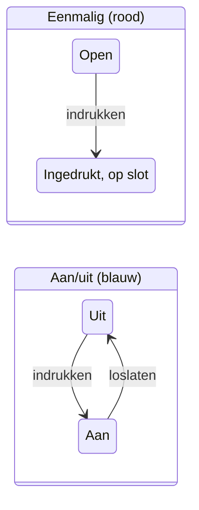

# Knoppen in plaats van vinkjes: alle acties van een sheaf in één tabel op de lijst

**Status:** ontwerp, nog niets gebouwd
**Datum:** 2026-10-30
**Gaat over:** de lijst van de hub (`/list`) en de vakjes bovenaan elke sheaf

Vandaag vink je een actie aan op de pagina van een sheaf zelf, en op de lijst staat per rij maar één vakje. Deze pagina zet eerst op een rij welke acties er zijn en wat een vinkje vandaag doet, en stelt dan drie manieren voor om er knoppen van te maken die in één tabel op de lijst staan, met een eenmalige knop die ingedrukt blijft en een aan/uit-knop. Onderaan staat welke ik aanraad.

## Wat er vandaag op de lijst en op de pagina staat

- **Op de pagina van een sheaf** staan de acties als gewone vakjes, `- [ ] Approve`, meestal bovenaan onder `## Actions`. Aanvinken schrijft `- [x] Approve` in het markdownbestand.
- **Op de lijst** is elke sheaf één rij. De acties staan erop als blauwe labels ("chips"), maar je kunt er niet op klikken. Er is één vakje per rij, en dat vinkt de **eerste** actie aan die geen Move to is.
- **Move to** kan nooit vanaf de lijst. Dat was een bewuste keuze (commit d85f2ec): Move to is een keuze uit meerdere klanten, en één vakje kan niet zeggen welke.
- **Na een vinkje** verdwijnt de rij uit "Waiting on you". Wat er daarna gebeurt, doet niet de hub maar een routine van de installatie: die leest de vinkjes in het bestand en zet het issue op GitHub op de juiste status.
- **Een vinkje weghalen** kan vandaag op de pagina, maar de routine doet er niets mee ("An untick moves nothing"). Alleen bij Share betekent weghalen echt iets.

## Elke actie van vandaag: eenmalig of omkeerbaar

| Actie | Soort | Wat een vinkje vandaag doet | Wat "loslaten" zou betekenen |
|---|---|---|---|
| Approve | eenmalig | Het voorstel is goedgekeurd; de routine zet het issue op "In progress at TT", de mailmodule schrijft het concept | Niets meer terug te draaien: het concept is er al. Knop blijft ingedrukt |
| Run it | eenmalig | De run mag starten; issue naar "In progress at TT" | De run loopt al. Knop blijft ingedrukt |
| Don't run | eenmalig | Samen met Run it één vraag; als alle antwoorden Don't run zijn, wordt het issue gesloten als "not planned" | Zou het issue heropenen. Kan later, vandaag doet weghalen niets |
| Undo skip | eenmalig | Het issue gaat weer open, status "In progress at TT" | Zou het opnieuw overslaan: dat is een nieuwe vraag, geen loslaten |
| Done | eenmalig | Status Done, issue gesloten als afgerond | Zou het issue heropenen. Vandaag doet weghalen niets |
| Share | **omkeerbaar** | Alleen de eigenaar: de sheaf wordt zichtbaar voor het hele project en het bestand verhuist uit de privémap | Al gebouwd: de eigenaar haalt het vinkje weg en de sheaf is weer alleen van hem of haar |
| Stop James | eenmalig | James stopt met dit project; wat nog op hem wachtte wordt opgeruimd | James start niet vanzelf opnieuw. Knop blijft ingedrukt |
| Move to `<klant>` | eenmalig, één uit meerdere | De mailmodule verhuist de mailthread naar die klant | De thread is al verhuisd. De andere keuzes verdwijnen |

Twee dingen vallen op. Zeven van de acht acties zijn eenmalig. En de enige aan/uit-actie, Share, werkt vandaag al als een schakelaar: de knop voor "omkeerbaar" heeft dus nu één gebruiker, en Done of Don't run kunnen er later bij als je wilt dat loslaten het issue heropent.

## Hoe de knop zich gedraagt: eenmalig of aan/uit

Dit geldt voor alle drie de ontwerpen hieronder.



- **Eenmalige knop**: rood rand, rood gevuld zodra ingedrukt, met wie en wanneer ("Approve ✓ jij, 30 okt"). Daarna is hij grijs en niet meer klikbaar. De hub weigert ook een poging om het vinkje in het bestand weg te halen via de pagina, zoals hij dat vandaag al doet voor Share door een niet-eigenaar.
- **Aan/uit-knop**: blauw, ingedrukt of niet, je kunt hem opnieuw klikken.
- **Een rode knop vraagt geen bevestiging**, maar laat 5 seconden "Ongedaan maken" zien voordat de hub schrijft. Zo kost een misklik niets, en blijft één klik genoeg.

## Ontwerp A: één kolom "Acties" met knoppen, per rij

*In één zin: de lijst blijft zoals hij is, maar de blauwe labels worden echte knoppen, één per actie.*

```
┌─────────────────────────────┬──────────────────────────────────────────┬────────┬───────┐
│ Sheaf                       │ Acties                                   │ Eigen. │ Issue │
├─────────────────────────────┼──────────────────────────────────────────┼────────┼───────┤
│ Antwoord op offerte-vraag   │ (Approve)  (Done)                         │ jij    │ #41   │
│ Crawl van de nieuwe site    │ (Run it)  (Don't run)                     │ jij    │ #38   │
│ Onzekere mailthread         │ (Move to klant-a)  (Move to klant-b)      │ jij    │ #44   │
│ Notitie bij projectstart    │ [Share]                                   │ jij    │ #12   │
│ Plan voor deze week         │ (Approve ✓ jij 30/10)  (Stop James)       │ @nell  │ #40   │
└─────────────────────────────┴──────────────────────────────────────────┴────────┴───────┘
  ( ) = eenmalig, rood       [ ] = aan/uit, blauw       ✓ = ingedrukt, op slot
```

- Elke actie van de sheaf staat in de rij, niet alleen de eerste. Het ene vakje per rij verdwijnt.
- **Move to** kan nu wel vanaf de lijst: elke klant is een eigen knop. Na één klik verdwijnen de andere.
- Bovenaan de pagina van de sheaf staan dezelfde knoppen, zodat het overal één bediening is.
- **Markdown op schijf: niets verandert.** Indrukken schrijft `- [x] Approve`, precies zoals een vinkje vandaag. Welke woorden eenmalig zijn, staat in de code van sheaf (een vaste tabel van de acht woorden). Agents en de routine lezen en schrijven hetzelfde als nu.
- **Kosten: 2 tot 3 dagen** (schatting). Knoppen en 5 seconden "Ongedaan maken" op lijst en pagina, het slot op eenmalige knoppen in de hub, Move to op de lijst, de SPEC en tests.

## Ontwerp B: een kolom per soort actie

*In één zin: de lijst wordt een raster waarin elke actie zijn eigen kolom heeft, zodat je van boven naar beneden kunt afvinken.*

```
┌──────────────────────┬─────────┬────────────────┬──────┬───────┬────────────┬─────────────────────┐
│ Sheaf                │ Approve │ Run it / Don't │ Done │ Share │ Stop James │ Move to             │
├──────────────────────┼─────────┼────────────────┼──────┼───────┼────────────┼─────────────────────┤
│ Offerte-vraag        │  ( )    │                │ ( )  │       │            │                     │
│ Crawl nieuwe site    │         │ (Run) (Don't)  │      │       │            │                     │
│ Onzekere mailthread  │         │                │      │       │            │ (klant-a) (klant-b) │
│ Notitie projectstart │         │                │      │  [ ]  │            │                     │
│ Plan deze week       │  ✓ jij  │                │      │       │  ( )       │                     │
└──────────────────────┴─────────┴────────────────┴──────┴───────┴────────────┴─────────────────────┘
```

- Sterk als je per soort wil werken: "alles goedkeuren wat klaarstaat" is één kolom naar beneden.
- Zwak: de meeste vakken zijn leeg, want een sheaf heeft meestal één of twee acties. Op een telefoon past het raster niet; daar zou het terugvallen op ontwerp A.
- Een kolom verschijnt alleen als minstens één rij die actie heeft.
- **Markdown op schijf: niets verandert**, net als bij A.
- **Kosten: 3 tot 4 dagen** (schatting). Alles van A, plus het raster, de lege kolommen weglaten en de val terug naar A op een smal scherm.

## Ontwerp C: het bestand zegt zelf of een actie eenmalig is

*In één zin: zoals A op het scherm, maar de soort knop en wie hem indrukte staan in de markdown, zodat agents het ook lezen.*

Vandaag: `- [x] Approve`. Met ontwerp C schrijft de hub bij indrukken:

```markdown
- [x] Approve — jij, 2026-10-30 14:02
- [ ] Share ⇄
```

- `⇄` achter een actie maakt er een aan/uit-knop van; zonder teken is hij eenmalig. Zo kan een agent zelf beslissen dat bijvoorbeeld Done omkeerbaar is voor één sheaf.
- Achter een ingedrukte eenmalige actie staat wie en wanneer. Een agent ziet het zonder de git-geschiedenis te lezen.
- **Markdown op schijf: verandert.** Elke agent die acties schrijft (James, de mailmodule) en de routine die vinkjes leest, moeten mee aangepast worden. Een oud bestand zonder teken blijft werken als "eenmalig".
- **Kosten: 4 tot 6 dagen** (schatting). Alles van A, plus het nieuwe formaat in de hub, de routine van de installatie en de instructies van James.

## De drie ontwerpen naast elkaar

| | A: kolom Acties | B: kolom per actie | C: soort in het bestand |
|---|---|---|---|
| Alle acties in één tabel op de lijst | ja | ja | ja |
| Move to vanaf de lijst | ja | ja | ja |
| Werkt op een telefoon | ja | nee, valt terug op A | ja |
| Markdown op schijf | ongewijzigd | ongewijzigd | nieuw formaat |
| Agents en routine aanpassen | nee | nee | ja |
| Wie bepaalt eenmalig of aan/uit | sheaf, vast per woord | sheaf, vast per woord | het bestand, per actie |
| Kosten (schatting) | 2–3 dagen | 3–4 dagen | 4–6 dagen |

## Mijn aanbeveling: ontwerp A

Ik raad **A** aan. Het doet wat gevraagd is (alle knoppen in één tabel op de lijst, een rode eenmalige knop die ingedrukt blijft, een aan/uit-knop) zonder dat er één byte verandert in hoe agents de markdown lezen en schrijven. Dat is het belangrijkste: James, de mailmodule en de routine werken door zoals vandaag.

B voegt alleen iets toe als je vaak dezelfde actie over veel sheaves doet, en kost dan een raster dat op een telefoon niet werkt. C is pas nodig als dezelfde actie in de ene sheaf eenmalig en in de andere omkeerbaar moet zijn. Vandaag is er maar één omkeerbare actie, Share, en die is het altijd: dan is een vaste tabel in sheaf genoeg, en kan C later nog als de behoefte er komt.

Twee vragen die bij A nog beantwoord moeten worden:

1. Mag Move to nu wel vanaf de lijst? Dat draait de keuze van d85f2ec terug; met een knop per klant is de reden van toen (één vakje kan niet kiezen) weg.
2. Moeten Done en Don't run omkeerbaar worden (loslaten heropent het issue)? Dan moet ook de routine van de installatie het weghalen van een vinkje gaan lezen. Zonder die wens blijven ze rood.

Kies **A**, **B** of **C**, of zet een opmerking op de passage die je anders wil.
